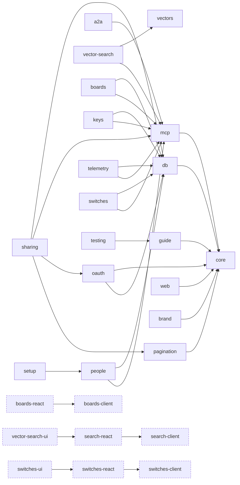

# The parts

<!-- Generated by `pnpm parts` (scripts/parts.mjs) from registry.json: edit those, never this file. test/parts.test.mjs fails when it is stale. -->

Every part is a folder an app copies into `src/kit/` with `npx @escalay/kit add <part>`; the parts it needs come with
it. An app imports `./kit/index.js`, which re-exports every part that is not an entry of its own, and each entry part
from its own file. Browser layers go into the frontend (`--web-dir`). Each part’s README says how to use it.

## Which part for which goal

The parts in the order they go in: each after the parts it needs. `kit add` brings the needed ones by itself.

| Goal | Parts, in order | How |
|---|---|---|
| Start a new API | `core` → `db` → `oauth` → `pagination` → `guide` → `mcp` → `brand` → `switches` → `testing` | `npm create escalay@latest <name>`: the starter, with an example feature and its tests; `--preset app` adds `switches-client` and `switches-react` to `web/kit/` |
| Put an existing API on the standard | `core` → `db` → `pagination` → `guide` → `mcp` → `testing` | `npx @escalay/kit add core db pagination guide mcp testing` |
| Lists that page | `core` → `pagination` | `npx @escalay/kit add pagination` |
| Agents and MCP clients sign in without a pasted key | `core` → `db` → `oauth` | `npx @escalay/kit add oauth`: the owner approves each one on the kit’s page |
| The owner signs in with a passkey and claims a fresh deployment | `core` → `db` → `mcp` → `people` → `setup` | `npx @escalay/kit add people setup` |
| A team: members through Cloudflare Access, with roles | `core` → `db` → `mcp` → `people` | `npx @escalay/kit add people` |
| API keys made and revoked through the API, and `GET /api/me` | `core` → `db` → `mcp` → `keys` | `npx @escalay/kit add keys` |
| Search by words, picture and likeness | `core` → `mcp` → `vectors` → `vector-search` → `search-client` → `search-react` → `vector-search-ui` | `npx @escalay/kit add vectors vector-search search-client search-react vector-search-ui`: the browser layers go into the frontend (`--web-dir`) |
| Boards: the owner’s collections of the app’s items | `core` → `db` → `mcp` → `boards` → `boards-client` → `boards-react` | `npx @escalay/kit add boards boards-client boards-react` |
| Feature switches, and license keys for paid features | `core` → `db` → `mcp` → `switches` → `switches-client` → `switches-react` → `switches-ui` | `npx @escalay/kit add switches switches-client switches-react switches-ui` |
| A daily anonymous usage report | `core` → `db` → `mcp` → `telemetry` | `npx @escalay/kit add telemetry` |
| One brand on every surface | `core` → `brand` | `npx @escalay/kit add brand`: then `npx @escalay/kit brand` renders it |
| Other agents delegate through A2A | `core` → `mcp` → `a2a` | `npx @escalay/kit add a2a` |
| A public front page and the browser app under `/app`, on Node | `core` → `web` | `npx @escalay/kit add web` |
| Sharing: invites to a space, the owner’s approval at it | `core` → `db` → `oauth` → `pagination` → `mcp` → `sharing` | `npx @escalay/kit add sharing`: then `await sharing.sweep()` in the scheduled handler (its README, Wire it) |

## Server parts

| Part | What it is | Needs | Import from | STANDARD | Browser layers | Docs |
|---|---|---|---|---|---|---|
| `core` | createAgentApi: OpenAPI 3.1 + Scalar docs, HAL links, problem+json, API keys + Access, ETags and Cache-Control, Idempotency-Key and rate limits, discovery (api-catalog, Link headers, robots.txt, Markdown for agents), a key-value store type, sortable ids (`newId`), long-poll waits (`waitFor`) and later work through a queue (`Jobs`: `queueJobs`, `memoryJobs`); an OAuth server plugs in from the `oauth` part | `hono`, `@hono/zod-openapi`, `zod`, `jose`, `@scalar/hono-api-reference` | `./kit/index.js` | §1–9, §12, §14 | — | [README](../src/core/README.md) |
| `db` | The app's database through Drizzle: `openDb` (node:sqlite, Turso/libSQL, or any async Drizzle SQLite database), `migrate` (each feature's steps, recorded in `kit_migrations`), `testDb`; `dbGuardStore` (idempotency and rate limits shared by every instance) | `core`, `drizzle-orm` | `./kit/index.js` | §1 | — | [README](../src/db/README.md) |
| `oauth` | The app as its own OAuth server: metadata, `/oauth/*`, agent registration (auth.md), ES256 tokens; `createOAuth` (with `approve`, `onGrant`, `onRevoke`, `ticketOf`, `answeredOf`, `complete`: the app's own sign-in page), `dbOAuthStore`, `memoryOAuthStore`, `generateOAuthKey` | `core`, `db` | `./kit/index.js` | §7, §11 | — | [README](../src/oauth/README.md) |
| `pagination` | Cursor pages and sorting: limitQuery, cursorQuery, sortQuery, pageOf, pageSchema | `core` | `./kit/index.js` | §4 | — | [README](../src/pagination/README.md) |
| `guide` | The agent guide from Markdown templates (llms.txt, agents/, skills/), its generated parts (endpoints, tools, playbooks, how to get unstuck) and the skills discovery index | `core` | `./kit/index.js` | §10 | — | [README](../src/guide/README.md) |
| `mcp` | An MCP server (2026-07-28) over the app's own routes: tools, resources, prompts, skills, and its Server Card; each tool publishes its command-line name | `core`, `@modelcontextprotocol/server` | `./kit/mcp/index.js` | §11, §19 | — | [README](../src/mcp/README.md) |
| `a2a` | A2A 1.0 over the MCP tools: the Agent Card at /.well-known/agent-card.json and a JSON-RPC endpoint (SendMessage, GetTask, ListTasks, CancelTask) whose skills are tools | `mcp` | `./kit/a2a/index.js` | §11 | — | [README](../src/a2a/README.md) |
| `vectors` | Gemini Embedding 2 through OpenRouter: look (image) and meaning (text) vectors, append-only ledgers that never pay twice, budgets and spend caps, nearest and standouts search (sharp, for pictures only) | `sharp` (optional) | `./kit/index.js` | §15 | — | [README](../src/vectors/README.md) |
| `vector-search` | Search by words, by picture and by likeness over the vectors: three documented routes (rate-limited where they cost) and the MCP tools that call them | `vectors`, `mcp` | `./kit/vector-search/index.js` | §15 | `search-client`, `search-react`, `vector-search-ui` | [README](../src/vector-search/README.md) |
| `web` | The front door: a public landing page at /, the browser app under /app behind the sign-in, old addresses redirected, and the paths auth must leave open | `core`, `@hono/node-server` | `./kit/index.js` | §16 | — | [README](../src/web/README.md) |
| `brand` | One brand on every surface: defineBrand (the app's brand/brand.ts) and createBrand for createAgentApi({ brand }): the favicon, PNG and SVG icons, manifest and OG card rendered at build time by `kit brand`, and MCP serverInfo, the Server Card, OpenAPI x-logo, the A2A card, the guide and head tags read it | `core` | `./kit/index.js` | §22 | — | [README](../src/brand/README.md) |
| `boards` | The owner's collections of the app's items: boards with notes in SQLite, their routes (idempotent saves, where an item is saved, optional suggestions) and MCP tools | `db`, `mcp` | `./kit/index.js` | §17 | `boards-client`, `boards-react` | [README](../src/boards/README.md) |
| `keys` | API keys made and revoked through the app's own API beside `API_KEYS` (hashes only, first characters, maker, last use), `GET /api/me`, and the MCP tools; only deployment keys and signed-in people manage keys | `db`, `mcp` | `./kit/index.js` | §7 | — | [README](../src/keys/README.md) |
| `people` | The owner and members of a deployment: passkey sign-in with an HttpOnly session cookie (hash stored), Access members matched to the team by email or domain, roles (owner, member), the team routes and MCP tools | `db`, `mcp`, `@simplewebauthn/server` | `./kit/index.js` | §7 | — | [README](../src/people/README.md) |
| `setup` | Claiming a fresh deployment with the SETUP_CODE secret (fails closed, rate-limited), recovery by rotating it, and a self-checking setup checklist of the app's own steps | `people` | `./kit/index.js` | §7 | — | [README](../src/setup/README.md) |
| `telemetry` | A daily anonymous usage report to the product's collector (`{ schema, instance, version, report }`, coarse ranges and booleans only), off with `DO_NOT_TRACK=1`, `TELEMETRY=off` or the owner's switch; `GET`/`PATCH /api/telemetry` and its MCP tool | `db`, `mcp` | `./kit/index.js` | §18 | — | [README](../src/telemetry/README.md) |
| `switches` | One catalog of the app's additive features (`defineFeatures`, stable kebab-case keys), each on or off for everyone, one person or one API key; providers in order (`databaseProvider`, `memoryProvider`, `fromSdk` for any flag service), `FEATURES_OFF` locks, `needs`, `requires` and offline license keys (`licenseOf`, ES256, `kit license`) for paid features; `gated` routes answer 403 `feature_disabled`, `isOn` for background work; `GET`/`PATCH /api/features` and its MCP tools | `db`, `mcp` | `./kit/index.js` | §21 | `switches-client`, `switches-react`, `switches-ui` | [README](../src/switches/README.md) |
| `sharing` | Invites to a space and the owner's approval at it, on the oauth part's hooks: single-use invites joined with a typed code, members mirrored from grants and held to their space (`sharing.oauth`), the sign-in pages, the owner's routes and MCP tools for invites and members, and `sweep` and `forget`; no page for an invite's link or asking to join yet | `db`, `mcp`, `oauth`, `pagination` | `./kit/sharing/index.js` | §7, §23 | — | [README](../src/sharing/README.md) |
| `testing` | Checks for an app's tests: lintOpenApi, guideRoutes, guideGaps, toolRoutes, toolsRun, cliGaps and cliSnapshot (the command line), softAuthenticator (passkeys in CI) and approveSignIn (an OAuth approval as a browser makes it) | `guide` | `./kit/testing/index.js` | §13 | — | [README](../src/testing/README.md) |

## Browser layers

Headless clients, React hooks and optional shadcn blocks over a server part’s routes, for the app’s frontend.

| Part | What it is | Needs | Import from | STANDARD | Layer of | Docs |
|---|---|---|---|---|---|---|
| `search-client` | Browser, no framework: a typed client for vector-search's routes, a controller for one search's state (debounced, cancelling), paste and drop of pictures | nothing | `./kit/browser/search-client.js` | §16 | `vector-search` | [README](../src/browser/README.md) |
| `search-react` | Browser, React: useVectorSearch, usePictureInput, useSimilar over search-client; headless, each app draws its own UI | `search-client`, `react` (peer) | `./kit/browser/search-react.js` | §16 | `vector-search` | [README](../src/browser/README.md) |
| `vector-search-ui` | Browser, React + shadcn: an optional search block (field with a picture chip, look/meaning switch, results grid) over search-react | `search-react`, `react` (peer), shadcn `button`, shadcn `input` | `./kit/browser/vector-search-block.js` | §16 | `vector-search` | [README](../src/browser/README.md) |
| `switches-client` | Browser, no framework: the features for the person signed in from `GET /api/features` (createFeaturesClient: getState, subscribe, isOn, refresh on focus, switch with dryRun, onDisabled and watchFetch for every 403 feature_disabled), isFeatureDisabled, whyOff | nothing | `./kit/browser/switches-client.js` | §21 | `switches` | [README](../src/browser/README.md) |
| `switches-react` | Browser, React: FeaturesProvider, useFeature, `<Feature>` (children while on, `off` while not), useFeatures, useSwitchFeature (preview and apply), useFeatureDisabled, featureHooks typed by the app's keys; headless | `switches-client`, `react` (peer) | `./kit/browser/switches-react.js` | §21 | `switches` | [README](../src/browser/README.md) |
| `switches-ui` | Browser, React + shadcn: FeatureSwitches (every feature with its switch, a confirm naming what else stops; read-only for members) and FeatureDisabledNotice ("This feature is disabled.", why, the app's own action) over switches-react | `switches-react`, `react` (peer), shadcn `button`, shadcn `switch` | `./kit/browser/switches-block.js` | §21 | `switches` | [README](../src/browser/README.md) |
| `boards-client` | Browser, no framework: a typed client for the board routes | nothing | `./kit/browser/boards-client.js` | §17 | `boards` | [README](../src/browser/README.md) |
| `boards-react` | Browser, React: useBoards, useItemBoards over boards-client (headless) | `boards-client`, `react` (peer) | `./kit/browser/boards-react.js` | §17 | `boards` | [README](../src/browser/README.md) |

## Root items

Repository setup, not parts: their files go to the repository’s root, only the shadcn CLI installs them, and `kit add`
refuses them.

- `npm-release`: Releases of an npm package with no manual step: release-please keeps a release pull request, merging it publishes every public package from GitHub Actions with npm trusted publishing and provenance, waits until npm serves them and publishes the GitHub release; with a read-only release check and the standard that explains it. For any pnpm repo; its files go to the repo root. `npx shadcn add escalay/api-kit/npm-release`

## How they depend on each other

An arrow points at a part the other needs.

Dashed: browser layers.

## Every README has one shape

Each part’s README opens with `# <folder>` and one paragraph saying what it is, then these sections, in this order
(`test/readmes.test.mjs` checks them). What changed between versions lives in [upgrading.md](upgrading.md), never in
a README.

1. **Use it when**: what it is for
2. **Don't use it when**: what it is not for, and what to use instead
3. **Add it**: the `kit add` command and what the part needs
4. **Wire it**: the block to copy into the app
5. **Options**: a table: option, type, default, what it does
6. **Exports**: what the part exports, and its files
7. **Flows**: a Mermaid sequence or state diagram for every flow of more than two steps
8. **Rules**: what holds, and the STANDARD sections
9. **Failure modes**: a table: what the caller sees, and why
10. **Limits**: scaling ceilings and runtimes: Node only, Workers, one writer
11. **Tests**: the helpers that test it, and the kit’s own tests
12. **Upgrading**: a link to its section of docs/upgrading.md, never history inline
