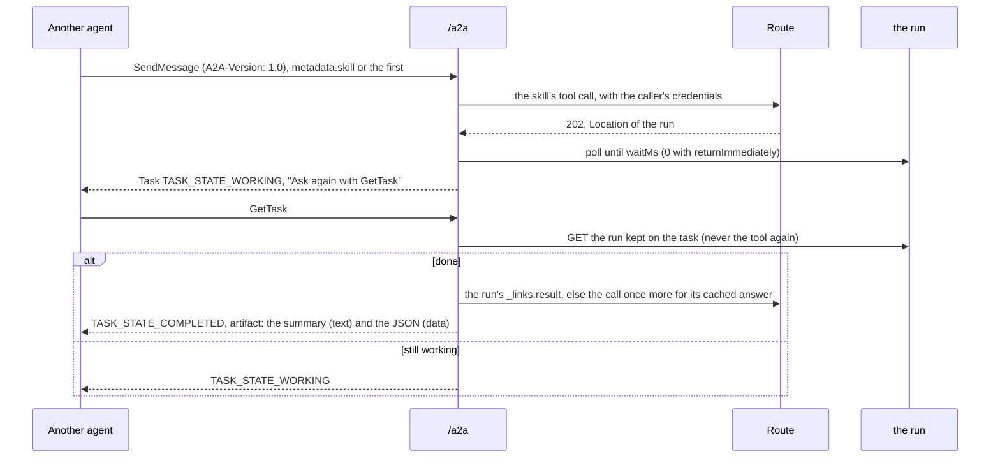
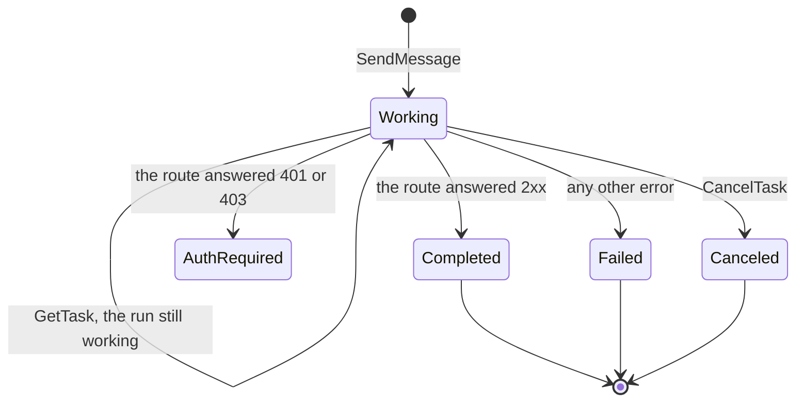

# a2a

A2A 1.0 over the MCP tools: an Agent Card at `/.well-known/agent-card.json` and a JSON-RPC endpoint at `/a2a` whose skills are tools. Another agent sends a message naming a skill; the tool runs its route in-process with the caller's credentials, and a slow route leaves the task working until `GetTask` finds its run done.

## Use it when

- Other agents should delegate a task to this app over A2A, beside MCP.
- One to three tools are worth delegating whole: a search, a research task.

## Don't use it when

- The tools are only for an agent's own use: MCP is enough.
- A client needs streaming, push notifications or the extended card: none is supported, and the card says so.

## Add it

```bash
npx @escalay/kit add a2a
```

Needs `mcp` (and through it `core`). Imported from `./kit/a2a/index.js`.

## Wire it

```ts
import { mountA2A } from './kit/a2a/index.js'

mountA2A(app, {
  info: { name: 'Recipes', description: 'Finds recipes for a description.', version },
  skills: [{ tool: tools.find((t) => t.name === 'search_recipes')!, text: 'q', tags: ['recipes'], examples: ['a quick soup'] }],
  callApi: inProcess(app),
  store: oauthStore,        // any KeyValueStore; tasks are kept a day
  oauth: !!oauth,           // advertise the OAuth server beside keys
})
```

Mount it after `createAgentApi`, whose `authenticate` guards `/a2a` (a relay: a `read` token may POST there).

## Options

| Option | Type | Default | What it does |
|---|---|---|---|
| `path` | string | `/a2a` | where the JSON-RPC endpoint is served (the card names it) |
| `info` | `{ name, description, version, organization? }` | required | the card's identity; `organization` defaults to `name` |
| `skills` | `{ tool, text, tags, examples? }[]` | required | one skill per tool; `text` is the tool argument a message's text fills; the first answers a message that names none |
| `callApi` | `CallApi` | required | how tools reach the routes: `inProcess(app)` |
| `store` | `KeyValueStore` | `memoryStore()` | where tasks are kept (a day): the OAuth store fits, under the kind `a2a-task` |
| `oauth` | boolean | false | advertise the app's OAuth server in the card beside API keys |
| `waitMs` | number | 60 000 | how long `SendMessage` waits for a slow route before answering with a working task |
| `brand` | `AgentBrand` | the app's | the card's `iconUrl`: the brand's 512 PNG (else its SVG) |

## Exports

| Export | What |
|---|---|
| `mountA2A(app, config)` | the Agent Card at `/.well-known/agent-card.json` and the JSON-RPC endpoint: `SendMessage`, `GetTask`, `ListTasks`, `CancelTask` |
| `agentCard(origin, config)` | the card for an origin (spec §4.4.1) |
| `A2A_VERSION` | `1.0` |
| `A2ASkill`, `A2AConfig`, `A2ATaskStore` | the types |

## Flows

`SendMessage` on a slow route, then `GetTask`:



A task's states:



## Rules

- Pick the 1–3 tools another agent would delegate to; the first skill answers a message that names none.
- The JSON-RPC answer is never kept by Idempotency-Key; the caller's key goes on to the route a skill runs, so a
  retried `SendMessage` runs it once.
- A message's text fills the skill's `text` argument; a `data` part may give all the arguments.
- Requests send `A2A-Version: 1.0` (a header, or the `A2A-Version` query parameter); none means 0.3, refused with
  `VERSION_NOT_SUPPORTED` (-32009).
- A task belongs to the caller that sent it, and only it may get, list or cancel it. An OAuth agent is its client and
  grant (`agent:<client_id>/<grant>`, as the guards key it), never the name it registered, so two clients that call
  themselves the same are two owners. An API key is its key name.
- A slow route (202 and a run) leaves the task working and keeps the run's `Location` on the task: `GetTask` polls
  that run and never calls the tool again while it works. When the run is done, the answer is the run's
  `_links.result` when it has one (it must answer in the tool route's shape, which the skill summarizes), else the
  tool called once more for its cached answer, as the standard's 202 rule says. A route that keeps no cache (an
  order, a payment) links its result, or that repeat call starts the work again: a 202 is never taken for an answer,
  so the task then stays working on the new run.
- A task that ended stays ended: a `GetTask` in flight when `CancelTask` lands finds the task canceled when it saves,
  and answers it canceled.
- Spec source of truth: `a2aproject/A2A` `specification/a2a.proto` (JSON is camelCase, enums SCREAMING_CASE).
- Standard: `docs/STANDARD.md` §11

## Failure modes

The endpoint answers JSON-RPC errors with HTTP 200, as A2A does over JSON-RPC.

| The caller sees | Why |
|---|---|
| `VERSION_NOT_SUPPORTED` (-32009) | no `A2A-Version: 1.0` header or query parameter |
| `TASK_NOT_FOUND` (-32001) | another caller's task, or one older than a day |
| `TASK_NOT_CANCELABLE` (-32002) | `CancelTask` on a task that already ended |
| `UNSUPPORTED_OPERATION` (-32004) | streaming, `SubscribeToTask`, the extended card, or a message to a finished task |
| `PUSH_NOTIFICATION_NOT_SUPPORTED` (-32003) | any push notification method: poll with `GetTask` |
| -32602 invalid parameters | an unknown skill, a message without `messageId`, role `ROLE_USER` or a part, or arguments the tool's input refuses |
| -32600, -32700 | not one JSON-RPC 2.0 request, or not JSON |
| a task in `TASK_STATE_AUTH_REQUIRED` | the tool's route answered 401 or 403 for this caller |
| a task in `TASK_STATE_FAILED` with the problem's text | the route answered any other error |

## Limits

- Tasks live a day; a caller's list keeps its 500 newest; `ListTasks` pages at most 100.
- The cancel check reads the store before writing (`KeyValueStore` has no conditional write), so on a database store
  two instances can still cross within one read and write.
- On Workers pass a database store (`dbOAuthStore(db)` fits): each isolate's memory is its own, and `mountA2A` warns
  when it has none.
- `SendMessage` holds its request open up to `waitMs` (60 s) while a run works.

## Tests

- The skills' tools run in `toolsRun` (testing part) like every tool.
- `test/a2a.test.ts`: the card and every method, ownership by client and grant, a tool with side effects polled and
  canceled.

## Upgrading

What changed between kit versions, and what to do: [docs/upgrading.md#a2a](https://github.com/escalay/api-kit/blob/main/docs/upgrading.md#a2a).
