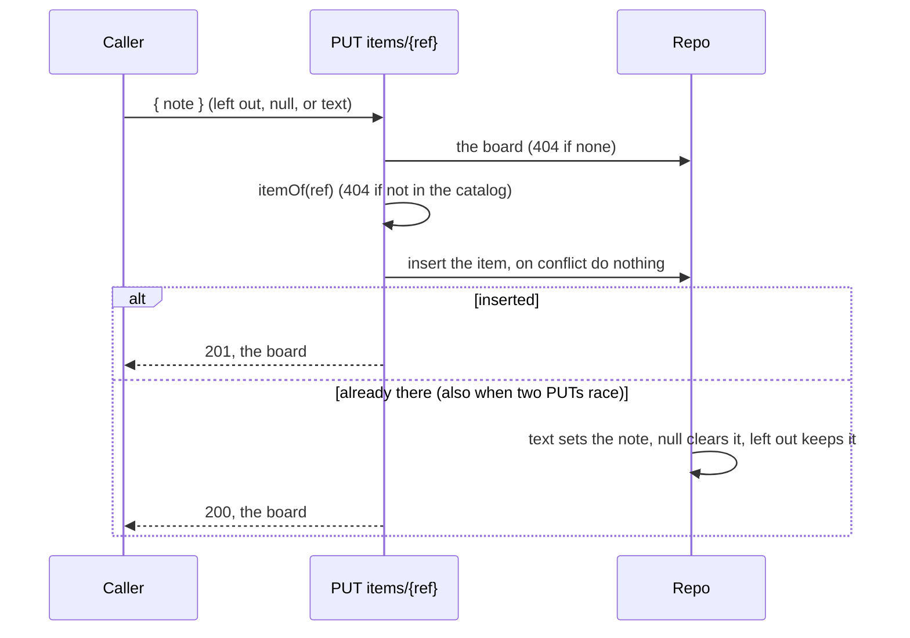

# boards

The owner's own collections of the app's items for a project, with a note per item: the part of a read-only catalog you can write, as routes and MCP tools, and the reference shape of a kit feature (`kit feature` makes the same folders).

## Use it when

- The app has a catalog (recipes, logos, episodes) and its owner, their keys and agents keep named collections of it.
- A feature of your own needs a model to copy: schema, repo, routes, handlers, tools, index.

## Don't use it when

- Each person needs their own boards: **boards are single-owner**, one set per deployment, and every caller with
  `read` sees every board. Keep your own feature, in this shape, with an owner column.
- The boards also list other things (curated collections beside the owner's): keep your own feature, in this shape.

## Add it

```bash
npx @escalay/kit add boards
```

Needs `db` and `mcp` (and through them `core`). Imported from `./kit/index.js`, like `people` and `setup`. The browser side is
`boards-client` and `boards-react` (browser README).

## Wire it

```ts
import { boardTools, registerBoards } from './kit/index.js'

await registerBoards(app, { db, item: RecipeCardSchema, refExample: 'recipe:soup', itemOf: (ref, origin) => cardOfRef(ref, origin), suggestions })
const tools = boardTools({ noun: 'recipes', label: (recipe) => recipe.title, refExample: 'recipe:soup', suggestions: true })
```

### In an app made by `kit init`

A feature of its own, over the cards of another feature (here `recipes`, its `cardOf` exported from its `handlers.ts`):

```ts
// src/features/boards/index.ts, listed in src/features/index.ts
import { BOARDS_MIGRATIONS, boardTools, registerBoards } from '../../kit/index.js'
import type { Feature } from '../index.js'
import { cardOf } from '../recipes/handlers.js'
import { recipesRepo } from '../recipes/repo.js'
import { RecipeSchema } from '../recipes/routes.js'

export const feature: Feature = {
  name: 'boards', // the name its steps migrate under
  tag: { name: 'Boards', description: 'Your boards of recipes, each with a note.' },
  migrations: BOARDS_MIGRATIONS,
  register: (app, { db }) =>
    registerBoards(app, { db, item: RecipeSchema, refExample: 'recipe:soup', itemOf: async (ref, origin) => {
      const row = await recipesRepo(db).get(ref.slice('recipe:'.length))
      return row ? cardOf(origin, row) : null
    } }),
  tools: boardTools({ noun: 'recipes', label: (recipe) => recipe.name, refExample: 'recipe:soup' }),
  samples: async (request) => {
    const made = async (path: string, body: object) => ((await (await request(path, { method: 'POST', body: JSON.stringify(body) })).json()) as { id: string }).id
    const [id, ref] = [await made('/api/boards', { name: 'A sample' }), `recipe:${await made('/api/recipes', { name: 'Soup' })}`]
    return { list_boards: {}, create_board: { name: 'Made by a tool' }, get_board: { id }, save_to_board: { id, ref }, remove_from_board: { id, ref } }
  },
}
```

Routes, and what each answers:

```
GET|POST /api/boards                   { count, _embedded: { boards } } (?item=<ref>: the boards holding it) · { name } → 201, the board
GET|PATCH|DELETE /api/boards/{id}      the board, with _embedded.items (each { ref, note, item: the card or null }) · 204
PUT|DELETE /api/boards/{id}/items/{ref}  { note? } or no body → the board: 201 added, 200 already on it · 204
GET /api/boards/{id}/suggestions       { count, _embedded: { items } }
```

Writes need `write`. A PUT that says `content-type: application/json` sends a body, `{}` at least: an empty one is a 400.

## Options

`registerBoards(app, config)`:

| Option | Type | Default | What it does |
|---|---|---|---|
| `db` | `Db` | required | the app's database; the boards tables are migrated into it |
| `item` | zod schema | required | the OpenAPI schema of an item's card |
| `itemOf` | `(ref, origin) => card \| null`, or a promise of it | required | a ref → the app's card, or null when it left the catalog (a save of it is a 404); awaited, so it may look the ref up in the database |
| `refExample` | string | required | the app's own ref (`recipe:soup`), shown in the routes' parameters |
| `refPattern` | RegExp | `BOARD_REF` (`<type>:<id>`) | what a ref looks like; another is a 400 |
| `suggestions` | `(refs, limit, origin) => cards` | none | cards like those on a board, best first, without what is on it; set, the suggestions route exists |
| `path` | string | `/api/boards` | where the routes live |
| `tag` | string | `Boards` | the routes' OpenAPI tag |

`boardTools(options)`:

| Option | Type | Default | What it does |
|---|---|---|---|
| `noun` | string | required | what the items are called (`recipes`) |
| `label` | `(card) => string` | required | an item's card → its line |
| `refExample` | string | none | the app's own ref, as given to `registerBoards`: the tools' `ref` argument says `<type>:<id>, e.g. recipe:soup`, so an agent sends a whole ref and not a bare id; left out, they name the shape alone |
| `suggestions` | boolean | false | add `board_suggestions` |
| `path` | string | `/api/boards` | the routes the tools call |

## Exports

The feature shape (copy it for your own features):

| File | What |
|---|---|
| `schema.ts` | the Drizzle tables (`boards`, `boardItems`) and `BOARDS_MIGRATIONS` (step 1 = its tables) |
| `repo.ts` | `boardsRepo(db)`: the only queries, nothing about HTTP |
| `routes.ts` | `boardRoutes(config)`: the `createRoute` contracts and their schemas |
| `handlers.ts` | `boardHandlers(config, repo)`: request → repo → HAL; a missing board or item is a `ProblemError` |
| `tools.ts` | `boardTools`: `list_boards`, `create_board`, `get_board`, `save_to_board`, `remove_from_board`, `board_suggestions`; on the command line `board list`, `board create`, `board view`, `board save`, `board remove`, `board suggestions` |
| `refs.ts` | `boardRef(type, id)`, `parseBoardRef(ref)`, `BOARD_REF`: also copied with `boards-client` |
| `index.ts` | `registerBoards`: migrate, then wire routes to handlers |

## Flows

`PUT /api/boards/{id}/items/{ref}` with a note:



## Rules

- A ref is `<type>:<id>`; the id may hold colons (`segment:episode:intro:2`). Build and read refs with
  `boardRef` / `parseBoardRef`, never by hand.
- **Boards are single-owner**: one set per deployment, and every caller with `read` (a key, an agent, a member) sees
  every board; every caller with `write` changes them.
- `PUT …/items/{ref}` adds the item or changes its note, idempotent also when two arrive together (the insert
  decides: one is 201, the other 200). Its note: left out (or blank) keeps the one it has, `null` clears it, text sets
  it. `save_to_board` and the browser client's `save(id, ref, note)` take the same three.
- Standard: `docs/STANDARD.md` §17

## Failure modes

| The caller sees | Why |
|---|---|
| 404 "No board …" | the board id doesn't exist: `GET /api/boards` lists them |
| 404 "No item … in the catalog" | `itemOf` gave null for the ref: add items by the ref their search results and links give |
| 400 on `ref` | the ref doesn't match `refPattern` (`<type>:<id>`): a bare id, say |
| 403 `insufficient_scope` | a write with a `read` token |

## Limits

- One set of boards per deployment (single-owner).
- A board's items are references: deleting a board leaves the catalog as it was, and an item that left the catalog shows
  with `item: null`.
- Node and Workers, on any database `openDb` opens.

## Tests

- `toolsRun` (testing part) runs the board tools: make a board first, put deleting tools last.
- `test/boards.test.ts` (routes, racing PUTs, notes), `test/boards-ui.test.tsx` (the browser client and hooks), and
  `test/db.test.ts` (a state file from before Drizzle adopted).

## Upgrading

What changed between kit versions, and what to do: [docs/upgrading.md#boards](https://github.com/escalay/api-kit/blob/main/docs/upgrading.md#boards).
