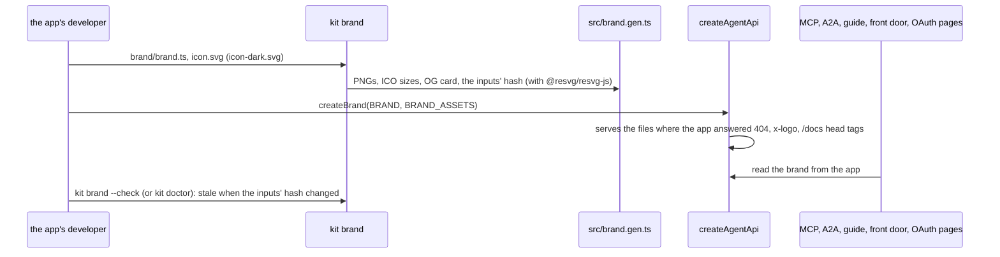

# brand

One brand, every surface: the app owns `brand/brand.ts` (`defineBrand`) and `brand/icon.svg` (and, if it wants, `brand/icon-dark.svg`, a mark made for dark backgrounds), and `kit brand` renders the PNGs at build time into `src/brand.gen.ts`, which is committed, so nothing rasterises at runtime and Workers serve the same bytes as Node.

## Use it when

- The app should show its own name, icon and colour in MCP clients, the Server Card, OpenAPI's `x-logo`, the A2A card,
  the guide, `/docs`, the front door and the OAuth pages.
- Browsers and connector lists need a favicon, PNG icons, a web manifest and an OG card.

## Don't use it when

- The app wants no brand: without one, every surface is byte for byte what it was.

## Add it

```bash
npx @escalay/kit add brand
pnpm add -D @resvg/resvg-js && npx @escalay/kit brand
```

Needs `core`. Rendering needs `@resvg/resvg-js` in the app, only when `kit brand` runs.

`npx @escalay/kit add brand` scaffolds both files (a monogram of the name's first letter on the accent); swap in your
own SVG, then `npx @escalay/kit brand` renders it again. The app is the nearest folder at or above `--dir` with a
`package.json` (or `--app`); with none, `add brand` makes nothing and says so. In an app whose lint and format
settings don't list it yet, `add brand` also adds `src/brand.gen.ts` to the ignore lists in `.oxfmtrc.json` and
`.oxlintrc.json` and the allowlist in `.gitleaks.toml`, or prints the line to add where it can't read one. A formatter
that rewrites the module anyway (single quotes) does no harm: `kit doctor` reads either quote style. `kit init` makes
every new app with them and an SVG-only `src/brand.gen.ts` until the first `kit brand`.

## Wire it

```ts
// brand/brand.ts
import { defineBrand } from '../src/kit/brand/index.js'

export default defineBrand({ name: 'cookbook', title: 'Cookbook', description: 'Recipes and menus for agents.', accent: '#2563eb' })
```

```ts
// src/app.ts
import BRAND from '../brand/brand.js'
import { BRAND_ASSETS } from './brand.gen.js'

const app = createAgentApi({ …, brand: createBrand(BRAND, BRAND_ASSETS) })
// mountMcp, mountA2A, serveGuide and serveFrontDoor take it from the app
```

`src/app.ts` imports `../brand/brand.js`, so `brand/` ships with the app: an app with its own Dockerfile adds
`COPY brand brand` beside `COPY src src` (new apps' Dockerfile has it). Workers bundle it from `main` and need nothing.

## Options

`defineBrand(brand)`:

| Option | Type | Default | What it does |
|---|---|---|---|
| `name` | string | required | the programmatic name, as MCP's `serverInfo.name` (`cookbook`) |
| `title` | string | required | what people read (`Cookbook`) |
| `description` | string, 1–100 characters | required | one sentence (the Server Card's limit) |
| `accent` | `#rrggbb` | required | the theme colour, the OG card's bar, and the OAuth pages' buttons |
| `background` | `#rrggbb` | white | behind the icon where one must be opaque (OG card, apple-touch icon, OpenAPI logo) |
| `websiteUrl` | https URL | none | MCP's `websiteUrl` where `info` leaves it out |
| `organization` | `{ name, url? }` | none | who makes it |
| `termsUrl`, `privacyUrl` | https URL | none | `termsUrl` is OpenAPI's `termsOfService` |

`createBrand(brand, assets)`: the brand and `BRAND_ASSETS`, what `kit brand` wrote.

## Exports

| Export | What |
|---|---|
| `defineBrand(brand)` | the brand, checked: names not empty, a description of 1–100 characters (the Server Card's limit), `#rrggbb` colours, absolute https URLs |
| `createBrand(brand, assets)` | what `createAgentApi({ brand })` takes (`AgentBrand` in core): the files it serves and what the other parts read |
| `brandIcons(origin, assets, { inline })` | the ordered MCP icons |
| `headTags(brand, assets, origin)` | the head tags, for pages the app renders itself |
| `webManifest(brand, assets)`, `icoOf(pngs)` | the manifest, and an ICO of PNGs built by hand |
| `Brand`, `BrandAssets` | the brand, and what `kit brand` writes |

### What it serves and who reads it

| Surface | From the brand |
|---|---|
| `/favicon.ico` (16, 32, 48 PNGs in one ICO), `/icon.svg`, `/icon-192.png`, `/icon-512.png`, `/apple-touch-icon.png` (180, opaque), `/og.png` (1200×630), `/site.webmanifest`, and `/icon-dark*` with a dark icon | the files; open without a key unless the app is private (behind Access, bypass SSO for these paths as STANDARD §7 lists them), a week of caching, an ETag of each file's bytes, `cross-origin-resource-policy: cross-origin` so other sites can show them in an `` (`same-site` in a private app); the SVGs sandboxed by `content-security-policy: default-src 'none'; style-src 'unsafe-inline'; sandbox` |
| MCP `serverInfo` (`server/discover`, 2025's `initialize`) and the Server Card | `title`, `description`, `websiteUrl` (where `info` leaves them out), `icons` |
| OpenAPI `info` | `x-logo` (the 512 PNG, else the SVG, on `background`) and `termsOfService` from `termsUrl` |
| A2A Agent Card | `iconUrl` |
| The guide | `{{brand.name}}`, `{{brand.title}}`, `{{brand.description}}` (`guideGaps(files, vars, { brand })` checks them) |
| `/docs` and the front door's pages | the head tags (`headTags`): icons, manifest, `theme-color`, Open Graph, Twitter card; a page with its own `rel="icon"` keeps it |
| The OAuth part's own pages (consent, device, claim, their errors) | the head tags, `/icon.svg` beside the title, and the `accent` on the buttons; a client is named by text only, never by a `logo_uri` it registered |

What each client shows, and why the icons come in this order:

| Client | Shows |
|---|---|
| Claude (MCP Apps) | only an inline `data:` PNG or JPEG, 64–128 px, under 10 KB, in a serverInfo under about 16,000 characters: the first icon, 96 px |
| VS Code | no SVG; honours `theme`; `https` icons only from the server's own host: the 192 and 512 PNGs |
| Clients that take SVG | the SVG, last |
| claude.ai and Claude Desktop connector lists | Google's favicon service for the **root domain** of the connector's address, whatever the server says |

The last row is the one the kit can't fix from here: a server at `mcp.example.com` shows `example.com`'s favicon.
Serve the same icon there too; `kit doctor` notes it for a host on a subdomain.

## Flows



## Rules

- PNG first, SVG last: the inline 96 PNG, then this host's 192 and 512 PNGs, then the SVG; a dark icon adds `https`
  entries with `theme: 'dark'` (one inline icon only).
- On MCP 2026-07-28 the inline icon rides only on `server/discover` (and 2025's `initialize`); the serverInfo stamped
  on every other answer leaves it out, since it weighs kilobytes.
- A path the app serves itself (a route, or a file in the front door's folder) stays the app's: a brand file answers
  only where the app answered 404. To give its own answer at one of these paths, the app serves it (any status but
  404). An app's own 404 there is replaced by the brand's file, and no option turns one path off: with a brand,
  `/icon.svg` and `/site.webmanifest` are always served, the others once `kit brand` rendered them (the dark ones with
  `brand/icon-dark.svg`). An app that must refuse one of them answers it with another status, such as 410.
- Headers set before the brand answers (the request id, an app's own) stay on its files.
- No brand, no change: every surface is byte for byte what it was.
- `kit brand` hashes `brand.ts`, the SVGs and its own output spec (never the rendered bytes, which differ between
  machines); `kit doctor` and `kit brand --check` call `src/brand.gen.ts` stale when the hash no longer matches
  (`doctor` looks at `brand/` only in an app with the brand part or a `src/brand.gen.ts`). The HTTP ETag is of the
  bytes served, so a new render reaches browsers.
- Standard: `docs/STANDARD.md` §22

## Failure modes

| The caller sees | Why |
|---|---|
| the app fails to start: "brand: … must not be empty", "description is N characters", "must be #rrggbb", "must be an absolute https URL" | `defineBrand` checks the brand where it is written |
| `kit brand` stops: "rendering the brand needs @resvg/resvg-js in the app" | the renderer is the app's own dev dependency: `pnpm add -D @resvg/resvg-js` |
| `kit brand --check` exits 1, `kit doctor` calls it stale | `brand/` changed since the last render: run `kit brand` |
| a `kit doctor` note: an inline icon over 10 KB | Claude shows only an inline icon under 10 KB |
| SVG icons only, no PNGs | `kit brand` never ran: `src/brand.gen.ts` is the SVG-only one `init` wrote |
| a connector list showing another favicon | it shows the root domain's favicon: serve the same icon there |

## Limits

- The OG card's text uses the machine's sans-serif font (none is bundled), so render where that font looks right.
- Rendering runs on a developer's machine or in CI, never at runtime; Node and Workers serve the same committed bytes.

## Tests

- `guideGaps(files, vars, { brand })` (testing part) checks the guide's `{{brand.*}}`.
- `test/brand.test.ts` (every surface over `test/brand-fixture.ts`; without a brand, every surface equals
  `test/fixtures/no-brand.json`), `test/brand-cli.test.ts` (`kit brand`, `--check`, `add brand`, the doctor lines).

## Upgrading

What changed between kit versions, and what to do: [docs/upgrading.md#brand](https://github.com/escalay/api-kit/blob/main/docs/upgrading.md#brand).
