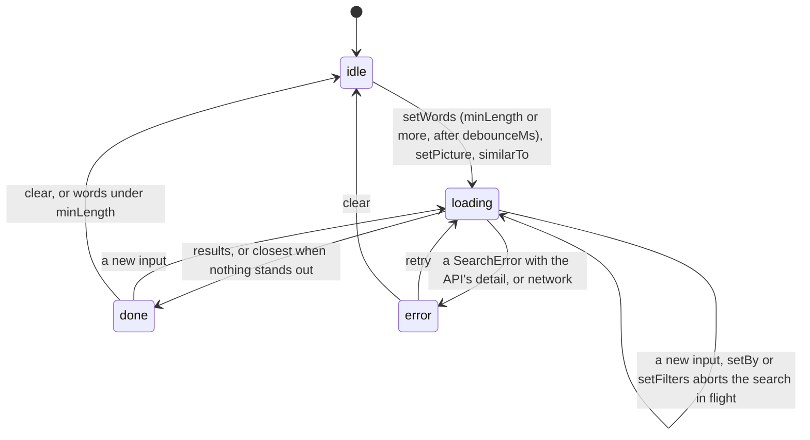
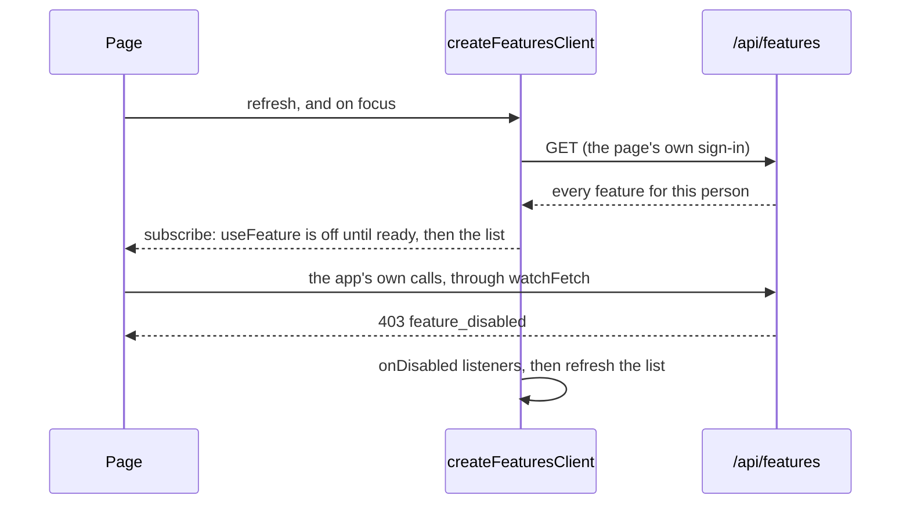

# browser

The browser side, for the app's frontend (not the API): typed clients for the search, board, feature-switch and owner's sharing routes, headless React hooks over them, and optional shadcn blocks; logic only, each app draws its own UI.

## Use it when

- A browser app (React, or none) calls a server part's routes: `vector-search`, `boards`, `switches` or `sharing`
  (the owner's side: invites and members).
- The app wants the state handled (debounce, cancel, refresh on focus, a 403 `feature_disabled` heard once) and its own
  markup.

## Don't use it when

- On the server: these go into the frontend, and are not the front door (`web`), which serves the frontend's files.
- The app wants another look than the blocks give: use the clients and hooks alone, the blocks are a suggestion.

## Add it

| Part | Files | What |
|---|---|---|
| `search-client` | `search-client.ts` | `createSearchClient`, `createSearchController` (debounce, cancel, picture paste and drop), `pictureFrom` (the first picture in a paste or drop) and `listenForPictures` (both, on any target) |
| `search-react` | `search-react.ts` | `useVectorSearch`, `usePictureInput`, `useSimilar` |
| `vector-search-ui` | `vector-search-block.tsx` | an optional search block (shadcn `button` + `input`) |
| `boards-client` | `boards-client.ts` + `../boards/refs.ts` | `createBoardsClient`: list, create, save, unsave, suggestions; `BoardsError` carries the problem; `boardRef`, `parseBoardRef`, `BOARD_REF` |
| `boards-react` | `boards-react.ts` | `useBoards`, `useItemBoards` |
| `switches-client` | `switches-client.ts` | `createFeaturesClient`: the features for the person signed in (`isOn`, refresh on focus, `switch` with `dryRun`, `onDisabled` and `watchFetch` for every 403 `feature_disabled`); `FeaturesError` carries the problem; `isFeatureDisabled`, `whyOff` |
| `switches-react` | `switches-react.tsx` | `FeaturesProvider`, `useFeature`, `<Feature>`, `useFeatures`, `useSwitchFeature`, `useFeatureDisabled`, `featureHooks<Key>()` |
| `switches-ui` | `switches-block.tsx` | `FeatureSwitches` (the owner's panel) and `FeatureDisabledNotice` (shadcn `button` + `switch`) |
| `sharing-client` | `sharing-client.ts` | `createSharingClient`: a space's sharing, invites (make, list a page at a time, read, revoke), members (list a page at a time, read, invite again, remove); `SharingError` carries the problem, `ShownOnceError` is a retried invite's 409 `shown_once` |
| `sharing-react` | `sharing-react.ts` | `useSharing`: one space as its owner sees it, more by cursor, each change then a reload |

```bash
npx @escalay/kit add search-client search-react vector-search-ui --dir apps/web/src/kit
npx @escalay/kit add boards-client boards-react --dir apps/web/src/kit
npx @escalay/kit add switches-client switches-react switches-ui --dir apps/web/src/kit
npx @escalay/kit add sharing-client sharing-react --dir apps/web/src/kit
# into the frontend, tracked by the API's kit.json
npx @escalay/kit add boards-react --dir apps/api/src/kit --web-dir ../../web/src/kit
# or one part with the shadcn CLI, into src/kit
npx shadcn add escalay/api-kit/boards-react
```

Each part brings the one under it (`search-react` brings `search-client`). The React layers need `react` (a peer);
the blocks need the app's shadcn components. No server part is needed in the frontend.

## Wire it

```ts
const boards = createBoardsClient<RecipeCard>()
const saved = (await boards.list()).find((b) => b.name === 'Saved') ?? (await boards.create('Saved'))
await boards.save(saved.id, boardRef('recipe', slug), 'the sun')
```

Feature switches in a React app, typed by the API's catalog (`src/features/catalog.ts`):

```tsx
export type FeatureKey = keyof typeof CATALOG
export const features = createFeaturesClient<FeatureKey>()
export const { useFeature, Feature, useSwitchFeature } = featureHooks<FeatureKey>()
const api = features.watchFetch(fetch)                       // the app's calls: a 403 feature_disabled refreshes the list

<FeaturesProvider client={features}>
  <Feature name="digest" off={<FeatureDisabledNotice name="digest" action={<UpgradeButton />} />}><Digest /></Feature>
  <FeatureSwitches canSwitch={me.role === 'owner'} />         // Settings
</FeaturesProvider>
useFeatureDisabled((problem) => toast.error(problem.detail)) // one alert for every switched-off call
```

The owner's sharing of one space (the routes `registerSharing` serves; no asking to join, nor an invite's link):

```tsx
const sharing = useMemo(() => createSharingClient({ path: '/api/shelves' }), [])
const { status, invites, members, moreInvites, loadMoreInvites, createInvite, revokeInvite, inviteAgain, removeMember } = useSharing(sharing, 'soups')
const invite = await createInvite({ label: 'Sam', scope: 'read', lifetime: '30d' }, { idempotencyKey: crypto.randomUUID() })
setShown(invite.message)                                     // the address and code: shown once, never kept by the hook
```

Search with the block:

```tsx
const search = createSearchClient<RecipeCard>({ path: '/api/search', similarPath: '/api/recipes/{slug}/similar' })
<VectorSearch client={search} getKey={(recipe) => recipe.slug} renderResult={(result) => <RecipeCard recipe={result.item} />} />
```

## Options

| Option | Type | Default | What it does |
|---|---|---|---|
| `createSearchClient({ path })` | string | required | vector-search's `path` |
| `createSearchClient({ similarPath })` | string | none | its `similarPath`, for `similar` |
| `createSearchClient({ headers, fetchImpl })` | object, `fetch` | none, `fetch` | extra headers, and the fetch (tests) |
| `createSearchController(client, { debounceMs })` | number | 250 | the wait after typing before a search |
| `createSearchController(client, { minLength })` | number | 2 | fewer characters search nothing |
| `createSearchController(client, { limit, by, filters })` | | the route's, `both`, none | each search's size, a fixed space, the first filters |
| `usePictureInput({ paste })` | `'window'` \| `'scope'` \| false | `'window'` | where a pasted picture is heard |
| `useSimilar(client, id, { by, limit, filters })` | | `look` | likeness for one id |
| `createBoardsClient({ path, headers, fetchImpl })` | string | `/api/boards` | where the board routes live |
| `createSharingClient({ path, headers, fetchImpl })` | string | `/api/spaces` | the sharing part's `path` |
| `createInvite(…, { idempotencyKey })`, `inviteAgain(…, { idempotencyKey })` | string | none | sent as Idempotency-Key: a retry is a `ShownOnceError`, never a second invite |
| `useSharing(client, space, { limit })` | number | the route's (50) | each page's size; without `space` it stays `idle` |
| `createFeaturesClient({ path })` | string | `/api/features` | where the switch routes live |
| `createFeaturesClient({ fetch })` | `fetch` | the window's | the fetch that carries the page's own sign-in |
| `createFeaturesClient({ refreshOnFocus })` | boolean | true | refresh when the page comes back into view |
| `FeatureSwitches` `canSwitch` | boolean | false | switches the owner can use; read-only for members |
| `FeatureSwitches` `groups`, `keys`, `iconOf`, `describe` | | every feature, one card | features in titled cards (nesting what needs another), or one plain card of `keys`; each feature's icon tile; its own line |
| `FeatureDisabledNotice` `name`, `action` | string, node | required, none | the feature, and the app's own action (an upgrade button) |
| `VectorSearch` `client`, `renderResult`, `getKey` | | required | the search client, the app's card for a result, a result's key |
| `VectorSearch` `placeholder`, `limit` | string, number | `'Describe it, or paste a picture'`, the route's | the field's text, the results' size |

## Exports

The parts above, by file. `FeatureSwitches` shows everyone's switch per feature, confirming what else stops; paid
features carry their plan as a badge and a card opens with where to get them; a status line shows only when the
switch can't say it, such as who switched it off; a quiet line shows when a person or key has its own switch.
`FeatureDisabledNotice` says "This feature is disabled.", why, and the app's own action. `useSharing` answers
`status` (`idle`, `loading`, `ready`, `error`), `error`, `sharing`, `invites`, `members`, `moreInvites` and
`moreMembers`, `loadMoreInvites` and `loadMoreMembers`, `reload`, and the four changes; `createInvite` and
`inviteAgain` answer the new invite with its code.

## Flows

A search controller's `status`:



The features list in the browser:



## Rules

- The clients use the page's own sign-in (same-origin cookies); a failure is a typed error with the API's `detail`.
- Typechecked with bundler resolution (`tsconfig.web.json`).
- `useFeature` says `on: false` until the list arrived (`ready`), so a switchable screen never flashes in and out.
- Build and read board refs with `boardRef` / `parseBoardRef` (copied with `boards-client`).
- An invite's code is in the answer that made it and nowhere else: the hook keeps it in no state, a list never
  carries it, and a retry with the same Idempotency-Key is a `ShownOnceError` saying which invite was made.
- A list follows only the cursor of its `next` link, on the client's own path and headers, never a host an answer
  names. `useSharing` drops an answer for a space it has left.
- Standard: `docs/STANDARD.md` §16, §17, §21, §23

## Failure modes

| The caller sees | Why |
|---|---|
| a search state with `status: 'error'` and the API's `detail` | the route answered a problem (no key 503, spend cap 429, a bad picture 400) |
| `BoardsError` with the problem | a board route answered an error (a missing board, a bad ref) |
| `SharingError` 404 `not_found` | no such space, or the caller may not share it (the same answer for both) |
| `SharingError` 409 `conflict` | revoking a used invite (remove its member), or a space with 100 open invites |
| `ShownOnceError` (409 `shown_once`) | a retry with an Idempotency-Key that already made an invite: revoke it and make another |
| `useSharing` with `status: 'error'` | the space's first load failed; a change's failure is thrown to its caller |
| a features state with `status: 'error'` | the first `GET /api/features` failed (the page is not signed in, the API is down); a later failed refresh keeps the list and sets `error` |
| a feature off while it loads | `useFeature` is `on: false` until the list is `ready` |
| an import of `@/components/ui/…` that doesn't resolve | the block needs the app's shadcn components: `npx shadcn add button input switch` |

## Limits

- Same-origin only: the clients send the page's cookies, not a key; another origin needs the API's `corsOrigins` and
  its own credentials (`headers`).
- The blocks use only `button`, `input` and `switch`, so Radix and Base UI styles both work.

## Tests

- `test/search-client.test.ts` (the client and controller), `test/search-ui.test.tsx` (the hooks and block in
  happy-dom), `test/boards-ui.test.tsx`, `test/switches-ui.test.tsx`, `test/sharing-client.test.ts` and `test/sharing-ui.test.tsx`
  (against the real routes). The blocks' shadcn
  imports resolve to `test/shadcn/` stand-ins.

## Upgrading

What changed between kit versions, and what to do: [docs/upgrading.md#browser](https://github.com/escalay/api-kit/blob/main/docs/upgrading.md#browser).
