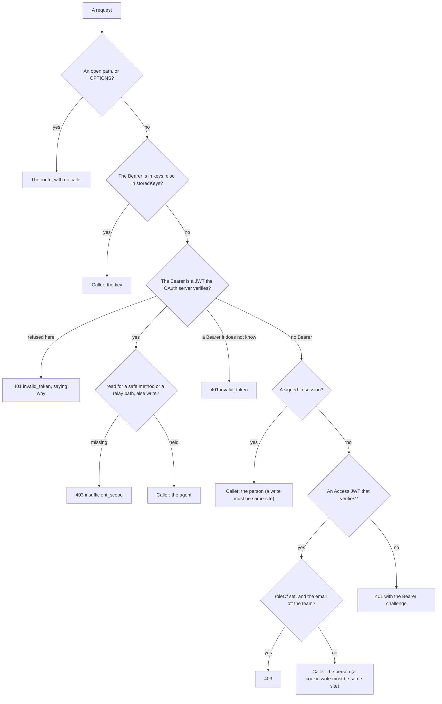
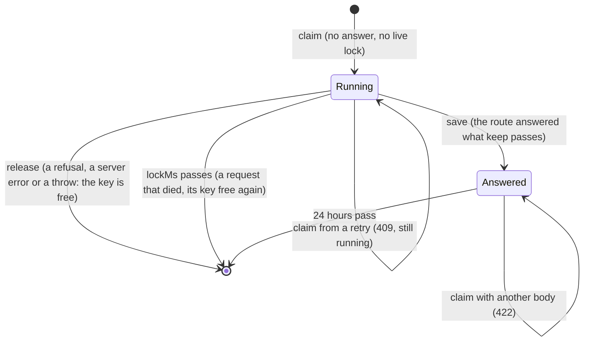

# core

The API itself: `createAgentApi` builds an OpenAPIHono app that already follows the standard (problem+json errors, HAL, auth, caching, discovery), so an app only adds its routes. Every other server part builds on it.

## Use it when

- Always, for an API on the kit: every other server part needs it.
- Routes need problem+json errors, HAL links, API keys or Access, ETags, Idempotency-Key, rate limits or discovery.

## Don't use it when

- Only a browser layer is wanted (`search-client`, `boards-client`, `switches-client`): those need no server part in the
  frontend.

## Add it

```bash
npx @escalay/kit add core
```

Needs `hono`, `@hono/zod-openapi`, `zod`, `jose`, `@scalar/hono-api-reference`.

## Wire it

```ts
import { createAgentApi, parseApiKeys, problemResponses, HAL_JSON, linksOf, originOf, ProblemError } from './kit/index.js'

const app = createAgentApi({
  title: 'Notes', version: '1.0.0', description: 'What it is and where to start (Markdown).',
  tags: [{ name: 'Notes', description: 'The notes.' }],       // the workflow tag first: the generated guide follows tag order
  auth: { realm: 'notes', keys: parseApiKeys(env.API_KEYS), access },
  oauth,                                                        // optional: createOAuth(…) from the oauth part
  private: true,                                                // optional: nothing readable without credentials, noindex
  home: 'app',                                                  // optional: `/` sends people to the browser app at `/app/` (default: to `/docs`)
  address: { header: 'cf-connecting-ip' },                      // optional: where the caller's address comes from (below)
  guards: { store: await dbGuardStore(db) },                    // optional: idempotency answers shared by every instance (required on Workers)
  brand: createBrand(BRAND, BRAND_ASSETS),                      // optional: the brand part; favicon, icons, x-logo, and what MCP, A2A, the guide and OAuth's pages read
})
app.use('/api/v1/products/:id/gaps', rateLimit({ policy: 'paid', limit: 120, windowSeconds: 3600, store: guards }))
```

## Options

`createAgentApi(config)`:

| Option | Type | Default | What it does |
|---|---|---|---|
| `title`, `version`, `description` | string | required | the OpenAPI `info` and the docs page; `description` is Markdown: what this is, where to start |
| `tags` | `{ name, description }[]` | required | the OpenAPI tags, in the order the generated guide follows (`Meta` is added) |
| `tagGroups` | `{ name, tags }[]` | none | Scalar's sidebar groups (`x-tagGroups`) |
| `auth` | `AuthOptions` | required | who may call (below) |
| `health` | `() => Record<string, unknown>` | none | extra fields for `/api/health` (not in private mode) |
| `corsOrigins` | string[] | none | origins allowed to call from a browser; the API's own pages need none |
| `discovery` | `DiscoveryConfig` | private, no, no, no | robots.txt's Content Signals and crawling, `sitemap`, `poppy` (`discovery.ts`) |
| `home` | `'docs'` \| `'app'` \| `false` | `'docs'` | where `/` sends people: `/docs`, the browser app at `/app/`, or nowhere (the app serves `/`) |
| `oauth` | `OAuthServer` | none | the app as its own OAuth server (`createOAuth`): mounted here, its tokens accepted beside keys |
| `brand` | `AgentBrand` | none | the brand part's `createBrand(…)`: its files served, `x-logo`, the docs' head tags, and what the other parts read |
| `guards` | `{ store?, keep?, skip? }` | memory, a success, none | Idempotency-Key: where answers are kept, which statuses are kept, more paths never kept (below) |
| `address` | `AddressTrust` | `'headers'` | where a caller's address is read, for every guard and part that counts by it (below) |
| `private` | boolean | false | nothing readable without credentials, `noindex` on every response (below) |

`auth` (`AuthOptions`, `authenticate` in `auth.ts`):

| Option | Type | Default | What it does |
|---|---|---|---|
| `realm` | string | required | the Bearer challenge's realm |
| `keys` | `Map<hash, name>` | required | the deployment's keys: `parseApiKeys(env.API_KEYS)` (only hashes kept) |
| `storedKeys` | `(hash) => Promise<name \| undefined>` | none | keys the app makes and revokes itself (the keys part's `storedKeysOf(db)`), asked after `keys` |
| `access` | `{ team, audience, verify?, roleOf? }` | none | Cloudflare Access: the team and audience to check its JWT; `roleOf` (people part) refuses an email off the team |
| `open` | string[] | none | more paths that need no credentials, added to the kit's own (patterns, below) |
| `relay` | string[] | `[mcpPath, '/a2a']` | paths that POST but only relay to routes in-process: a token needs `read` there; replaces the default, so list those too |
| `session` | `(c) => Promise<{ email, role? } \| null>` | none | a signed-in browser (people part's `sessionOf(db)`), asked when no Bearer is sent, before Access |
| `tokens`, `resourceMetadata` | | from `oauth` | set by `createAgentApi` from the OAuth server: its `verify` and `resourceMetadataFor` |

`rateLimit(options)` and the guard stores:

| Option | Type | Default | What it does |
|---|---|---|---|
| `policy` | string | required | the bucket's name, in `RateLimit-Policy` |
| `limit`, `windowSeconds` | number | required | at most `limit` calls per `windowSeconds` per caller |
| `store` | `GuardStore` | `memoryGuardStore()` | where windows are counted: `dbGuardStore(db)` shares them between instances |
| `address` | `AddressTrust` | the app's | where this limit reads an anonymous caller's address |
| `key` | `(c) => string \| null` | the caller | who is counted: per pack, per grant, per anything; null lets the call through uncounted |
| `memoryGuardStore({ maxEntries })` | number | 2000 | rate windows kept, and idempotency keys kept (never a running lock) |
| `guards.keep` | `(status) => boolean` | below 400 | which answers are kept to replay; `(status) => status < 500` keeps refusals too |
| `guards.skip` | string[] | none | more paths never kept, beside `/oauth/*` and `/agent/identity*` |

### The caller's address

A caller with no credentials is counted by its address: by `rateLimit`, by `Idempotency-Key` answers, and by the
setup claim. Name the one place it comes from with `address`; every guard and part reads it from the request
(`addressOf(c)`), and a `rateLimit({ address })` of its own wins.

| In front of the app | `address` |
|---|---|
| Cloudflare (Workers, or a tunnel or proxied DNS with the origin reachable only through it) | `{ header: 'cf-connecting-ip' }` |
| A reverse proxy, with the app reachable only through it, that appends the connection's address to `X-Forwarded-For` on every request | `{ header: 'x-forwarded-for' }`; two such proxies in a row, `hops: 2` |
| Nothing, on Node (`@hono/node-server`) | `'socket'` |

- `{ header, hops = 1 }` takes the value `hops` from the right, the one your nearest proxy wrote; whatever a caller
  put before it is never read. No header, or fewer values than `hops`, is `local`.
- A named header is only as true as the path to the app: anyone who can reach the app without going through that proxy
  (an open port, another hostname, a second route in) sends the header themselves and picks their own address. Close
  every other way in, or use `'socket'`.
- Check that your proxy sets or appends the header on every request: one configured to pass it through untouched
  leaves it as the caller sent it, and `hops` then counts the caller's own values.
- `'socket'` is the connection; where there is none (Workers, `app.request`, a call made in-process) it is `local`,
  never a header.
- A port after the address (`203.0.113.4:5678`, `[2001:db8::1]:443`) is dropped. A global IPv6 address (2000::/3)
  counts by its /64; one that carries an IPv4 address (mapped `::ffff:…`, dotted or hex, and NAT64 `64:ff9b::/96`)
  counts as that IPv4 address; any other (loopback, link-local, unique local) counts whole.
- The default, `'headers'`, reads `cf-connecting-ip`, else the whole `X-Forwarded-For`, as sent. A caller who can reach
  the app directly can send either, so set `address` on Node. `kit doctor` notes an app on `@hono/node-server` that
  names none.
- `rateLimit({ key })` replaces the caller in the bucket (`(c) => \`pack:${…}\``: per pack, per grant, per anything);
  `null` lets the call through uncounted.

### Path patterns

`open`, `relay` and `guards.skip` take path patterns (`matches`): an exact path, a trailing star for a prefix
(`/skills/*`), a leading star for a suffix, and a star inside for one whole segment (`/s/*/mcp` matches `/s/alpha/mcp`,
not `/s/alpha/mcp/x`; `/a/**` matches `/a/x` and `/a/x/y`). An app with one MCP per space passes
`relay: ['/mcp', '/a2a', '/s/*/mcp']`.

### Private mode

`private: true`: only `robots.txt`, `/api/health` (status only), the error pages and what an OAuth client needs to ask
for access stay open; the guide, docs, spec, discovery files and agent cards need a key, a token or the Access cookie.
Every response says `noindex`, a `public` cache becomes `private`, and no page points at the guide. Agents still
connect: MCP clients through OAuth (the 401 names the resource metadata), others with a key.

## Exports

| File | What |
|---|---|
| `api.ts` | `createAgentApi`: request ids, secure headers, CORS, auth, strict query parameters (unknown ones answer 400), `Idempotency-Key` replay, `/openapi.json`, `/docs`, `/problems/{code}`, `/api/health`, the discovery it can serve alone |
| `auth.ts` | who is calling (below) |
| `guards.ts` | idempotency and rate limits (below) |
| `problem.ts` | RFC 9457: `ProblemError` (throw it), `PROBLEMS`, `problemResponses(400, 404…)` for a route's documented errors, `problemResponse` |
| `hal.ts` | `linksOf(origin, { self, next… })`, `originOf(c)` (the public origin behind proxies), `pathWith(path, query)`, `LinksSchema`, `HAL_JSON` |
| `cache.ts` | `snapshotEtag` (on Workers pass `boot: env.CF_VERSION_METADATA.id`), `CACHE` presets, `cacheControl` |
| `discovery.ts` | api-catalog, Link headers, robots.txt with Content Signals, Markdown for agents, skills index, Server Card, `serveAiCatalog`, `publicOriginOf(app, c)` (the origin a publicly cached document names: the OAuth server's `publicOrigin` when set, else the request's) |
| `hooks.ts` | `tellApp(hook, call)`: tells one of the app's hooks (`onKeyChange`, `onSwitch`, `onTeamChange`, …) after the change it reports is made; a hook that throws is logged with `console.error`, never answered, so the request still succeeds |
| `kv.ts` | `KeyValueStore` (values with expiry) and `memoryStore`, what OAuth and A2A keep |
| `ids.ts` | `newId(prefix)`: `<prefix>_<time><random>` ids that sort by when they were made; `randomLetters` |
| `wait.ts` | `waitFor(look, timeoutSeconds)`: long polling for a route that waits for something to happen (keep it under ~25 s) |
| `cli.ts` | the command line's names: `cliOf(tool)` and `resourceCli` (a tool's `<noun> <verb>`, positional arguments, examples), `fallbackCliName` (the route rule), `pathKeysOf` (the input keys a call puts in its path: the positional ones), `routeOf`, `hintsOf` (read-only only for a `GET`), `CLI_BUILT_INS` and `CLI_AUTH_VERBS`, and the `_meta` keys `CLI_META`, `PROBLEM_META`, `PENDING_META` |
| `jobs.ts` | `Jobs<Job>`: work done later at a delay. `queueJobs(env.JOBS)` on Workers (a Cloudflare Queue, delay capped at 12 h), `memoryJobs()` in tests. One message per attempt: a job that must run again sends itself again |

### Auth (`auth.ts`)

- API keys, only their hashes kept: `hashApiKey`, `mintApiKey`, `parseApiKeys`; `storedKeys` for keys the app makes and
  revokes itself, looked up by hash after the start list.
- Cloudflare Access: `accessVerifier`, `accessOwner(access)` (the signed-in email, for OAuth's `owner`).
- `authenticate`: with OAuth on, the 401 names `resource_metadata` and `scope="read write"`; a token the OAuth server
  refuses for another resource is a 401 `invalid_token` saying why; an agent's caller has the `resource` its token is
  for.
- `SCOPES`, `OAUTH_OPEN_PATHS` and the `OAuthServer` shape the oauth part fills (`mcpPath` sets the default relay).
- `matches(path, pattern)`: the path patterns above. `Caller`, `Role`, `AuthOptions`, `AccessOptions`.

### Guards (`guards.ts`)

- `idempotency` (wired by `createAgentApi`): `Idempotency-Key` on POST and PATCH. A retry with the same key and body
  gets the stored answer (`Idempotent-Replayed: true`); the same key with another body is a 422; one still in flight a
  409. Kept 24 hours, and only what `keep` passes: by default a success (below 400), so a refusal or a server error
  frees the key and a retry after the cause is fixed runs again. It never keeps `/oauth/*` or `/agent/identity*`, whose
  answers hold tokens; an app's own open routes that answer a secret (a redirect holding a code) belong in
  `guards: { skip: ['/join/*'] }`, added to those.
- `rateLimit({ policy, limit, windowSeconds, store?, address?, key? })` for anything that spends money: the draft
  `RateLimit-Policy` / `RateLimit` headers, and a 429 with `Retry-After` past the limit.
- Both keep state in a `GuardStore`: `memoryGuardStore({ maxEntries })` (the default, one Node process) or
  `dbGuardStore(db)` from `db` (every instance shares it: required on Workers), passed as
  `createAgentApi({ guards: { store } })` and to each `rateLimit`.
- Both count per caller: an OAuth agent by its client and grant, never the name it registered; a key by its name; a
  person by their email; a caller without credentials by `addressOf(c)` (`AddressTrust`, above).
- `memoryGuardStore` drops what lapsed at most once a minute and keeps at most `maxEntries` rate windows, letting go of
  the one counted longest ago, and `maxEntries` idempotency keys, letting go of the oldest answers but never a lock a
  request still holds, so the keys can pass the cap while that many requests run.

## Flows

Who is calling, in the order `authenticate` asks:



The idempotency contract a `GuardStore` keeps for one caller, method, path and key:



## Rules

- Every route is `createRoute` + `app.openapi`: camelCase `operationId`, a summary, a description whose first sentence
  says what it is for, described parameters with real examples, a named HAL response, `...problemResponses(…)`.
- Errors are thrown as `ProblemError('not_found', { detail })`; the detail says what to do next.
- A query parameter the route doesn't declare is a 400 naming the ones it takes.
- A route that spends money answers 202 with a run when slow and carries a `rateLimit`.
- A write signed in with a session or the Access cookie must come from this site.
- Standard: `docs/STANDARD.md` §1–9, §12, §14

## Failure modes

| The caller sees | Why |
|---|---|
| 401 with `WWW-Authenticate: Bearer realm=…` | no key, token, session or Access cookie on a path that isn't open |
| 401 `invalid_token` | a key or token that is not valid: expired, revoked, mistyped, or another service's |
| 401 `invalid_token` with a sentence | a valid OAuth token the server refuses here: it is for another resource (the oauth part's `accepts`) |
| 403 `insufficient_scope` | a `read` token on a write that is not a relay path |
| 403 "must come from this site" | a write with the session or Access cookie from another site |
| 403 "not on this deployment's team" | an Access email `roleOf` refuses (the people part) |
| 400 naming the unknown query parameters | a parameter the operation doesn't declare |
| 400 "Idempotency-Key is at most 255 characters" | a longer key |
| 409 "still running" | the same Idempotency-Key while its first request is answering |
| 422 "used with a different body" | the same Idempotency-Key with another body |
| 429 with `RateLimit` and `Retry-After` | past a `rateLimit`; answers already computed are cached, so repeating one is not needed |

## Limits

- `memoryGuardStore` is one process: on Workers every isolate has its own, so pass `dbGuardStore(db)` there. It keeps
  at most `maxEntries` (2000) windows and answers.
- Idempotency answers are kept 24 hours; a lock lapses after 60 seconds (a request that died frees its key then).
- `Jobs` on Workers: a Cloudflare Queue, delay capped at 12 hours. `waitFor`: keep a wait under ~25 seconds.
- Node and Workers: the core imports on both (the `workers` test project imports the whole kit at global scope).

## Tests

- `lintOpenApi` (testing part) on `/openapi.json`; `test/kit.test.ts` runs a sample API through every rule, discovery
  and the guide.
- `test/guards.test.ts` and `test/guard-store-contract.ts`: the contract above on memory, node:sqlite and D1
  (`test/workers/guards.test.ts`).
- `test/core-parts.test.ts`: ids, waits, jobs.

## Upgrading

What changed between kit versions, and what to do: [docs/upgrading.md#core](https://github.com/escalay/api-kit/blob/main/docs/upgrading.md#core).
