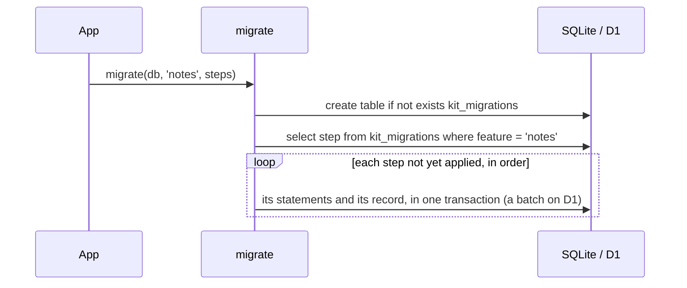

# db

The app's database through Drizzle: one `openDb` per app, and every feature's `repo.ts` queries through it. The same queries run on a local SQLite file today and on Turso or D1 later; only how the database is opened changes.

## Use it when

- The app keeps state of its own: features, OAuth rows, boards, keys, the team, switches.
- The guards (idempotency answers, rate limits) must be shared by every instance: `dbGuardStore(db)`, required on
  Workers.

## Don't use it when

- The data is a read-only catalog (a built store, JSON in memory): it stays behind its own store module, not `db`.
- The rows are OAuth state on Workers KV: KV is eventually consistent (the oauth README); keep them in SQLite or D1.

## Add it

```bash
npx @escalay/kit add db
```

Needs `core` and `drizzle-orm` (0.45). On Node ≥ 22.16, `node:sqlite` (with `setReturnArrays`); on Cloudflare Workers, a
D1 binding. No native module. The module imports on both: `node:sqlite` loads only when a path asks for it.

## Wire it

```ts
import { dbGuardStore, migrate, openDb, testDb } from './kit/index.js'

const db = await openDb(`file:${join(env.STATE_DIR, 'state.sqlite')}`)   // a path, ':memory:', or an open DatabaseSync
await migrate(db, 'notes', NOTES_MIGRATIONS)                             // each feature brings its own steps
const rows = await db.select().from(notes).where(eq(notes.id, id))       // in repo.ts only
const app = createAgentApi({ …, guards: { store: await dbGuardStore(db) } })

const db = await openDb(drizzle(createClient({ url, authToken })))       // Turso: any async Drizzle SQLite database
const db = await openDb(drizzle(env.DB))                                 // Cloudflare D1 (drizzle-orm/d1), in worker.ts
const db = await testDb()                                               // tests: empty, in memory
```

## Options

| Option | Type | Default | What it does |
|---|---|---|---|
| `openDb(source)` | path, `file:` URL, `':memory:'`, `DatabaseSync`, or a Drizzle database | required | a path or `DatabaseSync` opens node:sqlite through Drizzle's `sqlite-proxy` driver; a Drizzle database is used as it is |
| `migrate(db, feature, steps)` | `Db`, string, string[] | required | the feature's name in `kit_migrations`, and its SQL steps in order |

## Exports

| Export | What |
|---|---|
| `openDb(source)` | a path or `file:` URL or `:memory:` or `DatabaseSync` → Drizzle over node:sqlite (the `sqlite-proxy` driver, rows as arrays so same-named columns in a join stay apart); a Drizzle database → used as it is; any other URL → an error naming what to do |
| `migrate(db, feature, steps)` | applies the steps not yet applied, in order, each in a transaction, recorded in `kit_migrations (feature, step)`; on D1 (which refuses `begin`) each step and its record go as one atomic batch |
| `dbGuardStore(db)` | the guards' state (`core/guards.ts`) in table `kit_guards`, each check one atomic statement: rate windows and Idempotency-Key answers shared by every instance; expired rows go as it runs, at most once a minute per store. On Workers pass it to `createAgentApi({ guards: { store } })` and every `rateLimit` |
| `testDb()` | Node: an empty in-memory database; workerd: the test Worker's `DB` binding (storage is kept apart per test file, not per test) |
| `Db` | the type every repo takes |

| File | What |
|---|---|
| `index.ts` | `openDb`, `migrate`, `testDb`, `Db`; `nodeSqlite(sqlite)`, the Drizzle database `openDb` makes from a `DatabaseSync` |
| `guards.ts` | `dbGuardStore`, its `kit_guards` table (`kitGuards`) and `GUARD_MIGRATIONS` |

## Flows



## Rules

- **Only a feature's `repo.ts` queries the database.** Handlers call the repo, never `db`. That keeps a move off SQLite to
  the repos, and SQLite-only SQL (FTS5, `json_each`) inside a repo function.
- **A migration step never changes once it has run anywhere.** A change is a new step at the end. Step 1 of a table
  that already exists is its exact `create table if not exists …`, so live data is adopted.
- One step may hold several statements separated by `;` (not triggers: give a trigger its own step).
- **Rows have one shape on every database only through the query builder.** Raw `db.all(sql…)` returns arrays on
  node:sqlite and objects on D1: a repo uses `db.select()`, or names its columns and reads both shapes.
- Read-only catalogs (a built store, JSON in memory) don't go through `db`; they stay behind their own store module.
- Decision record: `docs/decisions/0001-features-drizzle-scaffold.md`.
- Standard: `docs/STANDARD.md` §1

## Failure modes

| The caller sees | Why |
|---|---|
| `openDb` throws "… is not a file; open it with its Drizzle driver and pass the database in" | a URL such as `libsql://` was passed: open it with its own Drizzle driver and pass the database |
| `testDb` throws "the Workers test project has no D1 binding named DB" | inside workerd with no `DB` binding in the test project's wrangler config |
| `migrate` throws, and the step is not recorded | a statement in the step failed; its transaction (or D1 batch) rolled back, so the next run tries it again |
| a repo reads `undefined` from a raw query on D1 | it read a raw `db.all(sql…)` row as an array (node:sqlite's shape); D1 answers objects |

## Limits

- One SQLite file per Node process is the local shape; several instances share state only on a shared database (Turso,
  D1).
- `dbGuardStore` prunes expired rows at most once a minute per store. `GUARD_MIGRATIONS` step 2 deleted the stored
  idempotency answers once (they could hold a secret through 1.30.0); locks and rate windows were kept.
- Node and Workers: `node:sqlite` on Node ≥ 22.16, D1 on Workers.

## Tests

- `testDb()` in the app's tests: an empty in-memory database on Node, the `DB` binding inside workerd.
- `test/db.test.ts` (an older state file adopted, every source opened), `test/workers/smoke.test.ts` (D1 migrations and
  `testDb`), `test/guard-store-contract.ts` (the guard stores, memory and database; `kit_guards` from 1.30.0 upgraded,
  on node:sqlite and in `test/workers/guard-upgrade.test.ts` on D1).

## Upgrading

What changed between kit versions, and what to do: [docs/upgrading.md#db](https://github.com/escalay/api-kit/blob/main/docs/upgrading.md#db).
