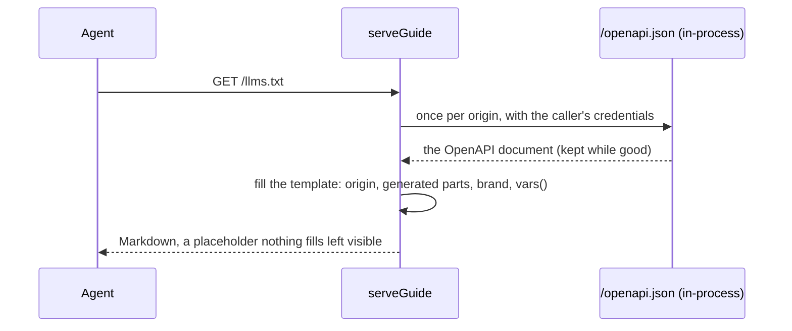

# guide

The agent guide: `/llms.txt`, `/llms-full.txt`, `/agents/*.md` and `/skills/*` from Markdown templates, filled per request. Everything the code knows (endpoints, tools, commands, playbooks, how to get unstuck) is generated from the OpenAPI document and the MCP tools, so the guide can't drift from the API.

## Use it when

- An API should be usable by an agent that has only its address: an `llms.txt` index, concept pages, skills.
- The guide must list endpoints, tools or commands: placeholders keep those lists current.

## Don't use it when

- A list of endpoints or tools would be written by hand: use a placeholder; never hand-write one.

## Add it

```bash
npx @escalay/kit add guide
```

Needs `core`. On Workers, `npx @escalay/kit guide` writes the folder as a module (`src/guide.gen.ts`).

## Wire it

```ts
import { guideFiles, serveGuide } from './kit/index.js'

serveGuide(app, { dir: GUIDE_DIR, vars: () => ({ counts: { notes: store.notes.length } }), full: ['llms.txt', 'agents/*', 'skills/*'] })
serveGuide(app, { files: GUIDE_FILES, vars, full })                       // Workers can't read a folder: `kit guide` writes src/guide.gen.ts
serveGuide(app, { dir: GUIDE_DIR, vars, full, commands: COMMANDS })        // COMMANDS: sdk/cli/commands.json, so {{cli.commands}} lists the jobs too
```

```md
# Notes
> {{counts.notes}} notes. Start with GET /api/search?q=…

## Endpoints
{{api.endpoints}}

## Search, with what to read first
{{api.tag.search}}

## MCP tools ({{mcp.count}})
{{mcp.tools}}

## On the command line
{{cli.commands}}
```

## Options

`serveGuide(app, options)`:

| Option | Type | Default | What it does |
|---|---|---|---|
| `dir` | string | one of `dir` or `files` | the guide folder, read on Node |
| `files` | `Map` or `Record<path, text>` | one of `dir` or `files` | the guide's files, for Workers (`GUIDE_FILES` from `src/guide.gen.ts`) |
| `vars` | `() => Record<string, unknown>` | required | the app's own values, read per request: `{{counts.notes}}` is `vars().counts.notes` (numbers get thousands separators) |
| `full` | string[] | required | the parts of `/llms-full.txt` in order; `folder/*` expands to that folder's files, `SKILL.md` first |
| `commands` | `{ commands }` | none | the CLI snapshot (`sdk/cli/commands.json`), so `{{cli.commands}}` lists the jobs too; without it, the mounted tools and resources |

The generated placeholders:

| Placeholder | What it fills |
|---|---|
| `{{origin}}` | the app's `publicOrigin` (the OAuth server's) when set, else the request's origin |
| `{{api.endpoints}}` | every operation, by tag in the order of `createAgentApi`'s `tags` |
| `{{api.tag.<slug>}}` | one tag's section alone, for a template that puts prose between them; the slug is the tag's name in lower case, every other run of characters a hyphen (`Search` → `search`, `Saved items` → `saved-items`) |
| `{{api.operations}}` | how many operations there are |
| `{{api.unblock}}` | how to get unstuck: the steps an agent takes after an error |
| `{{mcp.tools}}`, `{{mcp.count}}`, `{{mcp.resources}}` | the MCP tools with their routes, how many, the resource templates (`None.` without any) |
| `{{cli.commands}}` | every command of the app's CLI with what it does, from the mounted tools and resources, or the snapshot's `commands` |
| `{{skills.<name>.playbooks}}` | a skill folder's playbooks |
| `{{brand.name}}`, `{{brand.title}}`, `{{brand.description}}` | the app's brand, when it has one (`createAgentApi({ brand })`) |

## Exports

| File | What |
|---|---|
| `guide.ts` | `serveGuide` (from `dir`, or `files` on Workers), `guideFiles(dir)`, `guideModuleSource(files)` (the text `kit guide` writes; an app's test compares its `guide.gen.ts` to it), `fillTemplate`, `fullOrder`, `MARKDOWN` |
| `reference.ts` | the generated parts above (`generatedVars`, `endpointsMarkdown`, `endpointsByTag`, `toolsMarkdown`, `cliMarkdown`, `resourcesMarkdown`, `playbooksMarkdown`, `unblockMarkdown`), `brandVars`, `GENERATED_ROOTS`; the pieces they are made of: `operationLine` (one operation's line), `returnsOf` (its success body's top fields), `toolRoute` (the operation a tool calls), `playbookSummary` (a playbook's title and first paragraph), `firstSentence` |

## Flows



## Rules

- Write only what the code can't know: concepts, trust and measured accuracy, real-id examples, playbook steps and
  judgement. Never hand-write a list of endpoints or tools.
- Layout: `guide/llms.txt`, `guide/agents/{concepts,endpoints,trust,mcp}.md`, `guide/skills/<name>/SKILL.md` +
  `references/*.md` (served as MCP prompts too).
- `{{origin}}` is the app's `publicOrigin` (the OAuth server's, `publicOriginOf`) when it has one, on every page and
  skill, so a forged `X-Forwarded-Host` names nothing; without it, the request's origin. Set `publicOrigin` on an app
  open to anyone.
- The OpenAPI document is fetched once per origin, and the skills discovery files (`/.well-known/agent-skills/*`) are
  rendered once per origin and built again only when `vars()` gives other values (compared as JSON: values JSON can't
  spell out whole, a Map, a class instance or a BigInt, are rendered again on every request); a failed fetch or render
  is never kept.
- Each skill folder is published for discovery: `/.well-known/agent-skills/index.json`, and a deterministic archive
  per skill with references, or its `SKILL.md` alone.
- Standard: `docs/STANDARD.md` §10

## Failure modes

| The caller sees | Why |
|---|---|
| `{{name}}` left in the page | nothing fills it: a typo (`{{api.endpoint}}`) or a value `vars()` doesn't give; `guideGaps` catches it in tests |
| 404 problem "No agents/x.md. The index is /llms.txt." | a page the guide folder doesn't have |
| 404 at `/llms.txt` | the folder has no `llms.txt` |
| 500 `internal` on a guide page | the in-process `/openapi.json` answered an error for the caller's credentials; the failed fetch is not kept, so the next request tries again |

## Limits

- The spec and the skills renders keep the 8 origins used last, so callers naming new hosts can't grow memory.
- Workers can't read a folder: run `kit guide` after every change to `guide/` (an app's test compares `guide.gen.ts`).
- `vars()` runs on every request: keep it to values already in memory.

## Tests

- `guideRoutes(files, doc)` and `guideGaps(files, vars, { doc, tools })` (testing part) return `[]`.
- `expect(readFileSync('src/guide.gen.ts', 'utf8')).toBe(guideModuleSource(guideFiles(GUIDE_DIR)))` on Workers.
- `test/kit.test.ts` serves a sample guide with every placeholder.

## Upgrading

What changed between kit versions, and what to do: [docs/upgrading.md#guide](https://github.com/escalay/api-kit/blob/main/docs/upgrading.md#guide).
