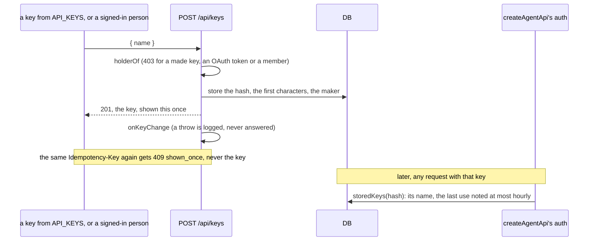

# keys

API keys the app makes and revokes through its own API, beside the ones it is started with (`API_KEYS`), and a "who am I" route: kept in the app's database as SHA-256 hashes, with each key's first characters, maker and last use.

## Use it when

- The owner hands out keys per app, machine or person, and revokes one without a redeploy.
- Callers need `GET /api/me`: who they are, what they may do (`scopes`), and whether they may manage keys.
- Holders need different reach: a key is made with `scopes` (`read`, `write`, `admin`; `read write` when left out).

## Don't use it when

- Keys must differ in which records they reach (one customer's, not another's): scopes say what kind of thing a key may do, not which data; scope data in the app.
- Agents should sign in by themselves: that is the oauth part, whose tokens expire.

## Add it

```bash
npx @escalay/kit add keys
```

Needs `db` and `mcp` (and through them `core`).

## Wire it

```ts
import { KEYS_TAG, keyTools, parseApiKeys, registerKeys, storedKeysOf } from './kit/index.js'

const fixedKeys = [...parseApiKeys(env.API_KEYS).values()]
const app = createAgentApi({ …, tags: [...tags, KEYS_TAG], auth: { realm, keys: parseApiKeys(env.API_KEYS), storedKeys: storedKeysOf(db) } })
await registerKeys(app, { db, fixedKeys, keyPrefix: 'pb', onKeyChange: (change, c) => log('key', change) })
// MCP: tools: [...featureTools, ...keyTools()]; toolsRun samples: who_am_i, list_keys, get_key, create_key, delete_key
```

## Options

`registerKeys(app, options)`:

| Option | Type | Default | What it does |
|---|---|---|---|
| `db` | `Db` | required | the app's database; the `api_keys` table is migrated into it |
| `fixedKeys` | string[] | required | the names of the keys in `API_KEYS`: they (and signed-in people) may manage keys, and their names are taken |
| `keyPrefix` | string | `ak` | what a new key starts with (`pb` gives `pb_…`) |
| `path`, `mePath` | string | `/api/keys`, `/api/me` | where the routes live |
| `tag` | string | `Keys` | the routes' OpenAPI tag |
| `onKeyChange` | `(change, c) => void` | none | hears each key made or deleted (`{ id, name, action, by }`, never the value) |

## Exports

| File | What |
|---|---|
| `schema.ts` | the `api_keys` table (`apiKeys`) and `KEYS_MIGRATIONS` |
| `repo.ts` | `keysRepo`: list, get, make, revoke, and `nameOf(hash)`, which notes a use at most once an hour |
| `routes.ts` | `keyRoutes`: `GET/POST {path}`, `GET/DELETE {path}/{id}`, `GET {mePath}`; `keySchemaOf` |
| `handlers.ts` | `keyHandlers`, and `holderOf`: who may make or revoke keys |
| `tools.ts` | `keyTools`: `who_am_i`, `list_keys`, `get_key`, `create_key`, `delete_key`; on the command line `auth status`, `key list`, `key view`, `key create`, `key delete` |
| `index.ts` | `registerKeys`, `storedKeysOf` (for `auth.storedKeys`), `KEYS_TAG` |

## Flows



## Rules

- Give each app, machine or person its own key so one can be revoked alone.
- Only a key from `API_KEYS` or a signed-in person may make or revoke keys, and a team `member` may not (an owner may,
  and so may a person with no role, in an app without a team). A key made through the API cannot make another, and
  neither can an OAuth token, so a token's expiry still bounds what an approved agent can do.
- A key is shown once, in the answer that makes it. Names are unique, and a deployment key's name is taken.
- Idempotency-Key never keeps the key (`showOnce`, core): a retry with the same key and body is a 409 `shown_once`
  naming the key made and where it is, and a new Idempotency-Key makes another. Lost the first answer? Revoke that key
  and make another. Made over MCP or A2A, the key is in that one reply only: an A2A task keeps no artifact.
- `onKeyChange` hears each key made or deleted: log it with the app's events. It is told once the key is stored or gone,
  and a hook that throws is logged, never answered: a made key is still shown (once) with its 201.
- A deleted key stops working on its next request.
- Standard: `docs/STANDARD.md` §7

## Failure modes

| The caller sees | Why |
|---|---|
| 403 "Only a key set in the deployment (API_KEYS) or a signed-in person can make or revoke keys" | the caller is a key made through the API, an OAuth token, or a team member |
| 409 "A key named … already exists" | the name is taken, by a made key or a deployment key |
| 409 `shown_once` "This Idempotency-Key already made the key …" | a retry of a create that was done: the key was shown once, in its answer |
| 404 "No key …" | the id doesn't exist |
| 401 with a key that worked before | the key was deleted |

## Limits

- One lookup by hash per request with a made key; its last use is written at most once an hour.
- Node and Workers, on any database `openDb` opens.

## Tests

- `toolsRun` (testing part) with samples for `who_am_i`, `list_keys`, `get_key`, `create_key`, `delete_key`.
- `test/keys.test.ts`: who may make keys, names, shown once, revoked at once, a throwing hook; a retried create never
  answers or stores the key (memory and database guards, over `/mcp`, the kit's client and command line).

## Upgrading

What changed between kit versions, and what to do: [docs/upgrading.md#keys](https://github.com/escalay/api-kit/blob/main/docs/upgrading.md#keys).
