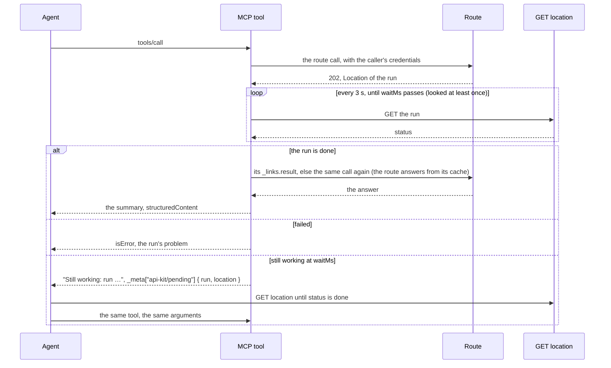

# mcp

An MCP server over the routes: each tool is a thin call to a route, run in-process with the caller's own credentials, so the API and MCP can't drift. It also serves resources, prompts, skills and the Server Card, and follows a slow route's run so a tool still answers.

## Use it when

- Agents should reach the API through MCP (spec 2026-07-28, with a fallback for 2025-era clients).
- The app ships skills: they are served as MCP skills and prompts too.
- Another part needs it: `a2a`, `vector-search`, `boards`, `keys`, `people`, `telemetry` and `switches` publish their
  tools through it.

## Don't use it when

- A tool would do work no route does: add the route first, then the tool that calls it.

## Add it

```bash
npx @escalay/kit add mcp
```

Needs `core` and `@modelcontextprotocol/server`. Imported from `./kit/mcp/index.js`.

## Wire it

```ts
import { inProcess, mcpServerFactory, mcpTool, mountMcp } from './kit/mcp/index.js'

const getNote = mcpTool({
  name: 'get_note', title: 'One note', description: 'A note with its author, year and tags. Use after a search.',
  input: z.object({ slug: z.string().describe('From a search result.') }),
  annotations: { readOnlyHint: true, openWorldHint: false },
  cli: { name: 'note view', examples: [{ run: 'note view fox', about: 'One note' }] },
  call: ({ slug }) => ({ path: `/api/notes/${encodeURIComponent(slug)}` }),
  summarize: (note) => `${note.title} (${note.year}) · ${note._links.self.href}`,
})
mountMcp(app, { factory: mcpServerFactory({ info, instructions, tools: [getNote], callApi: inProcess(app) }), allowedHostnames: [host, 'localhost'] })
```

A stdio entry on a laptop runs the same tools over HTTP with its own key: `callApi: overHttp(origin, key)`, served with
the SDK's stdio transport.

A list that pages: the cursor goes in as an argument and comes back in the summary, from `_links.next` (pagination
part), so an agent asks for the next page with it:

```ts
const listNotes = mcpTool({
  name: 'list_notes', title: 'Notes', description: 'The notes, newest first, a page at a time. Start here.',
  input: z.object({ cursor: z.string().optional().describe('From the last page’s summary, for the next page.') }),
  annotations: { readOnlyHint: true, openWorldHint: false },
  cli: { name: 'note list', examples: [{ run: 'note list', about: 'The newest notes' }] },
  call: (args) => ({ path: '/api/notes', query: args }),
  summarize: (page) => {
    const cursor = page._links.next && new URL(page._links.next.href).searchParams.get('cursor')
    return [...page._embedded.notes.map((note) => `${note.title} · id ${note.id}`), ...(cursor ? [`More: list_notes with cursor ${cursor}`] : [])].join('\n')
  },
})
```

By hand, a request on spec 2026-07-28 names its version twice, in `mcp-protocol-version` and in the body's `_meta`
(a request without it is a `-32602`), and its method (and a call's tool) in headers; without the header, the server
answers as a 2025-era one would (an event stream, when the request accepts one):

```bash
# By hand: the tools, then one call
curl https://api.example.com/mcp -H "authorization: Bearer $KEY" -H 'content-type: application/json' \
  -H 'accept: application/json, text/event-stream' -H 'mcp-protocol-version: 2026-07-28' -H 'mcp-method: tools/list' \
  -d '{"jsonrpc":"2.0","id":1,"method":"tools/list","params":{"_meta":{"io.modelcontextprotocol/protocolVersion":"2026-07-28","io.modelcontextprotocol/clientCapabilities":{}}}}'
curl https://api.example.com/mcp …the same headers, but -H 'mcp-method: tools/call' -H 'mcp-name: get_note' \
  -d '{"jsonrpc":"2.0","id":2,"method":"tools/call","params":{"name":"get_note","arguments":{"slug":"fox"},"_meta":{…the same…}}}'
```

One MCP per space, beside the owner's `/mcp`: the mount path's parameters reach each call as `at.params`, decoded.

```ts
const listRecipes = mcpTool({
  name: 'list_recipes', title: 'List recipes', description: 'The recipes on this shelf.', input: z.object({}),
  call: (_, at) => ({ path: `/api/shelves/${encodeURIComponent(at?.params.space ?? '')}/recipes` }),
  summarize: (shelf) => shelf.recipes.join(', '),
})
mountMcp(app, { path: '/s/:space/mcp', factory: mcpServerFactory({ info, instructions, tools: [listRecipes], callApi: inProcess(app) }), allowedHostnames: [host, 'localhost'] })
```

## Options

`mcpServerFactory(options)`:

| Option | Type | Default | What it does |
|---|---|---|---|
| `info` | `{ name, version, title?, description?, websiteUrl?, icons? }` | required | the server's identity; the app's brand fills `title`, `description`, `websiteUrl` and `icons` where it leaves them out |
| `instructions` | string | required | what the server is for; one line per skill's `SKILL.md` is added |
| `tools`, `resources`, `prompts` | arrays | resources and prompts none | what it serves |
| `skills` | `SkillCatalog` | none | the guide's skill folders (`guideSkills`) |
| `callApi` | `CallApi` | required | how tools reach the routes: `inProcess(app)`, or `overHttp(origin, key)` for a stdio entry |
| `waitMs` | number | 60 000 | how long a tool follows a slow route's run (202) before it answers "still working" |
| `toolsTtlMs` | number | an hour | how long clients may cache `tools/list`; shorter when the tools change without a deploy |
| `structured` | `'always'` \| `'withOutput'` | `'always'` | when a tool's JSON rides as `structuredContent`: always, or only for a tool with an `output` schema (the others answer text only, so the app's CLI prints `{ text }` for their `--json`) |
| `brand` | `AgentBrand` | the app's | the brand, for a factory not mounted on the app (stdio) |

`mountMcp(app, options)`:

| Option | Type | Default | What it does |
|---|---|---|---|
| `path` | string | `/mcp` | where MCP is served; the Server Card is at `<path>/server-card` and `/.well-known/mcp/server-card.json`. Elsewhere, pass the same path to `createOAuth({ mcpPath })`. With parameters (`/s/:space/mcp`) it serves one MCP per value, its card only at `<path>/server-card`, and it is left out of `mountedMcp` |
| `factory` | `AgentMcpFactory` | required | `mcpServerFactory(…)` |
| `allowedHostnames` | string[] | required | the hosts a browser's `Origin` may name |

`mcpTool(tool)`: `name` (snake_case), `title`, `description` (when to use it), `input` (zod), `output` (the route's 200
schema, when fixed), `annotations`, `call` (args, and `at` with the mount path's `params` → the route call), `summarize` (the text an agent reads first),
`links` (`resource_link`s), `route` (when `routeOf` can't read it from `call`), `cli` (its command, noun then verb).

## Exports

| Export | What |
|---|---|
| `mcpTool`, `mcpResource` | a tool (route call + summary) and an attachable resource |
| `CallAt` | the second argument of a tool's `call` and a resource's `read`: `{ params }`, the mount path's parameters (`{}` at `/mcp`) |
| `routeOf`, `ROUTE_META` | a tool's route (`GET /api/v1/recipes/{id}`), published in `tools/list` as `_meta["api-kit/route"]`; set `route` on a tool whose path is built in steps |
| `cli` on a tool or resource, `cliOf`, `CLI_META` | its command on the app's CLI, noun then verb (`cli: { name: 'note view', examples: [{ run: 'note view n_1', about: 'One note' }] }`), published with its positional arguments (the route's path parameters) as `_meta["api-kit/cli"]` |
| `PROBLEM_META`, `PENDING_META` | a failed call carries its problem (with `status`) in `_meta["api-kit/problem"]`; one still working names its run and the path to poll (`{ run, location }`) in `_meta["api-kit/pending"]`, and its text says to `GET` that path until the run is done, then call the tool again |
| `mountedMcp(app)` | the tools and resources `mountMcp` serves at the path without parameters, for `cliGaps` and `cliSnapshot` |
| `guideSkills({ files, fill })` | the guide's skill folders as the factory's `skills` and `prompts` (one prompt per playbook); `fill` renders a file first when a skill uses placeholders |
| `guideSkillProblems({ files, fill })` | what the server would warn of reading the same skills, one line each, `[]` when every skill loads: a frontmatter it can't read (a `: ` in an unquoted description) means the skill is skipped, so the app's test checks it |
| `mcpServerFactory` | the server: info, instructions, tools, resources, prompts, skills (options above) |
| `mountMcp` | `/mcp` (Streamable HTTP, MCP 2026-07-28 with a fallback for older clients) and the Server Card |
| `serverInfoOf(info, brand, origin, { inline })` | that identity: the inline PNG icon first (2025's `initialize`, `server/discover`, the card), left out of the serverInfo 2026-07-28 stamps on every other answer; a stdio factory takes `brand` itself |
| `inProcess(app)` / `overHttp(origin, key)` | how tools reach the routes: in the same process, or over HTTP for a stdio entry |
| `callWaiting`, `pollRun` | `callWaiting` makes the call and follows a 202 run until it finishes; past the wait it names the run (`pending`) and its path (`location`). `pollRun` polls a run already started (looking at least once) and never makes the call again while it works |

| File | What |
|---|---|
| `index.ts` | the server, tools, resources, mounting, the waits; `problemOf` and `problemText` (a failed answer as a problem, and as one line an agent can act on), `toolsHashOf` (a short hash of the tool and template lists, on every tool as `_meta["api-kit/tools-hash"]`, `TOOLS_HASH_META`, so a client that caches the list learns it changed), `FORWARDED` (the request headers `mountMcp` passes on to the routes a tool calls) |
| `skills.ts` | `guideSkills`, `guideSkillProblems`, and `attachSkills` (the factory calls it): the extension plus what a plain client needs |

## Flows

A tool on a slow route (202 and a run):



## Rules

- One tool per task-sized route, `snake_case` verbs, a description that says when to use it; arguments named like the
  route's parameters. The summary is what an agent reads first: a few lines per result with ids and links.
- Every tool names its command (`cli`) with an example: `cliGaps` (testing part). Read-only is the default only for a
  `GET`; a destructive tool says `destructiveHint: true`.
- A pending run is checked by its path, never by calling the tool's route again while it works: the agent (or `pollRun`)
  `GET`s `location` until its `status` is `done`, then calls the tool again, which answers at once from the route's
  cache or the run's `_links.result`. A 202 is never taken for an answer.
- A resource template's query variables (`{?format}`) may be left out of a URI.
- A tool's `authInfo.clientId` is an OAuth agent's client_id (never the name it registered), else the key's name or
  the person's email; `authInfo.extra` adds the agent's `grant` and `name` beside the forwarded `headers`
  (`FORWARDED`: the credentials and `Idempotency-Key`, given each call as `<key>:<JSON-RPC id>`, so a retried call
  runs its route once; `mountMcp` never keeps its own answer, on any path), and the mount path's `params`.
- A mount path's parameters come from the route alone, decoded: arguments, `_meta` and the query string never set
  them, and a dot segment (`/s/../mcp`, `/s/%2e%2e/mcp`) is resolved before routing, so it reaches `/mcp`. A tool
  encodes a parameter when it builds a path (`encodeURIComponent`). A parameter names a space, it never grants it:
  the route (and, with OAuth, `accepts`, which judges the tools' in-process calls too) decides whether the caller may
  reach that space. A2A and `toolsRun` call a tool with no `at`: a space's tools belong on its mount only.
- The route readers (`routeOf`, the guide, `cliGaps`) run a call with each parameter as `{name}`
  (`POST /api/shelves/{space}/recipes`), so a space tool keeps its route and hints. A mount with parameters is never
  what the guide, `mountedMcp`, the AI Catalog or `/.well-known/mcp/server-card.json` describe, whichever is mounted
  first; its own card names the endpoint asked for (`/s/soups/mcp`).
- Skills are findable from `resources/list` alone, without the extension's methods: each `SKILL.md` is listed as
  `<name> skill: start here` with its frontmatter description, and its `references/*.md` too while a skill has at
  most 20; the `skill://{+path}` template's description names the start URI; reading a folder (`skill://`, `skill://postbox`,
  `skill://postbox/references`) answers a Markdown list of its files as `skill://` URIs; a miss names the start URI;
  the server's `instructions` get one line naming each `SKILL.md`. `skills/list`, `skills/get` and
  `resources/directory/read` work as the extension defines them.
- Standard: `docs/STANDARD.md` §11, §19

## Failure modes

| The caller sees | Why |
|---|---|
| a tool result with `isError` and `_meta["api-kit/problem"]` | the route answered an error: its problem (with `status`) and its text say what to do |
| "Still working: run …" and `_meta["api-kit/pending"]` | the route's run was still working after `waitMs` |
| 403 from `/mcp` | a browser's `Origin` names a host not in `allowedHostnames` |
| 401 from `/mcp` | no credentials: `/mcp` is guarded like every route; with OAuth on, the 401 points at the resource metadata |
| 405 on `GET` or `DELETE /mcp` | the server is stateless: POST only, as the spec asks |

## Limits

- A tool call holds its request open up to `waitMs` (60 s) while a run works; polls are 3 seconds apart.
- `tools/list` is cached by clients for `toolsTtlMs` (an hour): a tool changed without a deploy needs a shorter one.
- A skill lists its `references/*.md` in `resources/list` only while it has at most 20.
- Node and Workers.

## Tests

- `toolRoutes(tools, doc)` and `toolsRun(tools, app, samples)` (testing part): every tool lands on a route and runs.
- `cliGaps(mountedMcp(app))` (testing part): every tool and resource has a command.
- `test/kit.test.ts` (an MCP round trip), `test/cli.test.ts`, `test/mcp-params.test.ts` (a mount path's parameters).

## Upgrading

What changed between kit versions, and what to do: [docs/upgrading.md#mcp](https://github.com/escalay/api-kit/blob/main/docs/upgrading.md#mcp).
