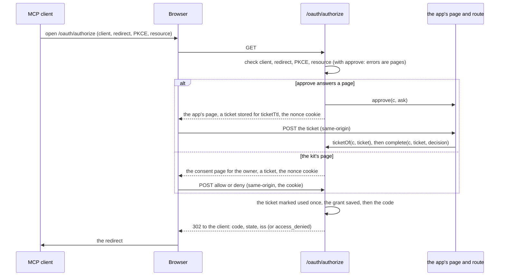
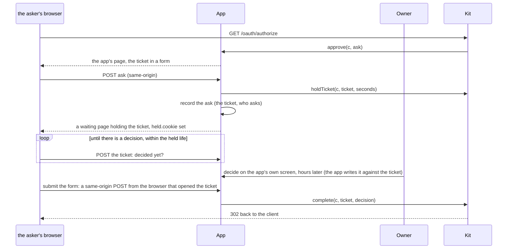
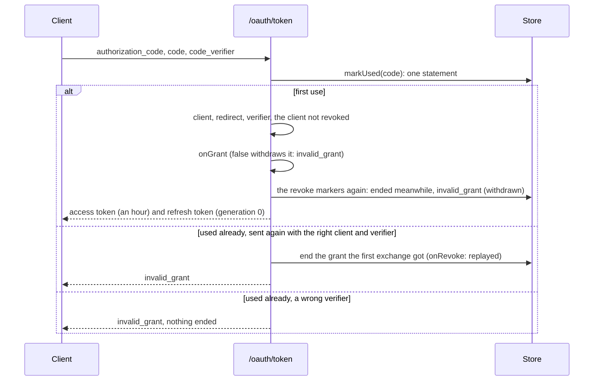
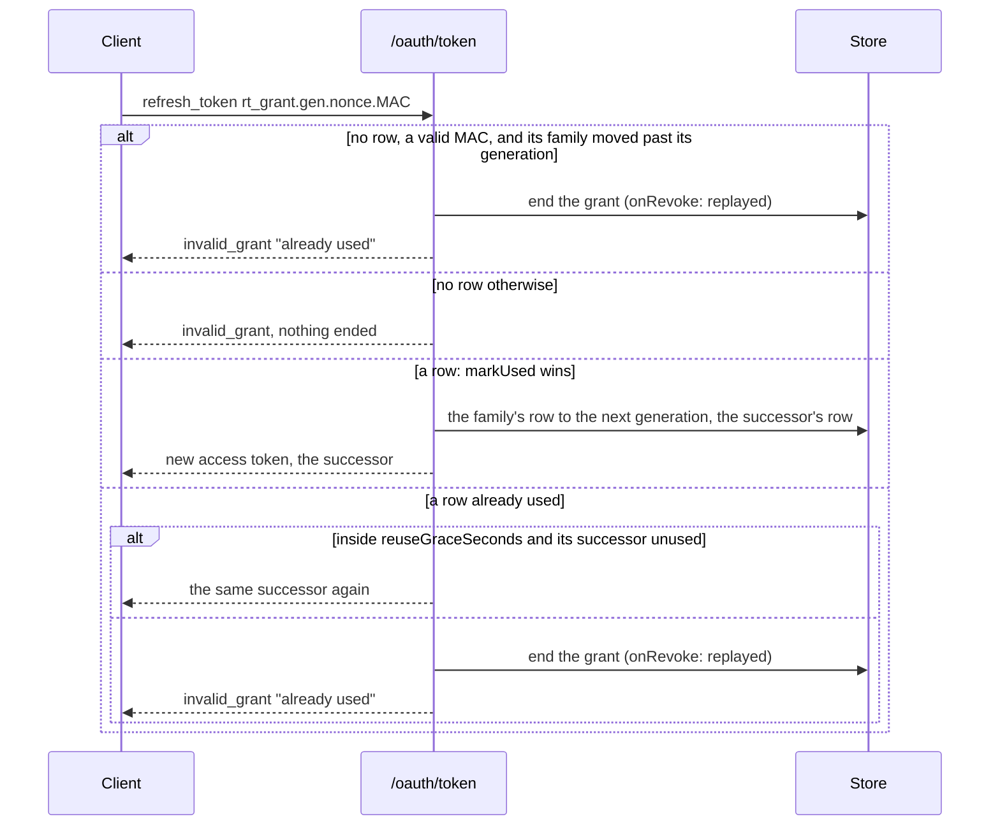
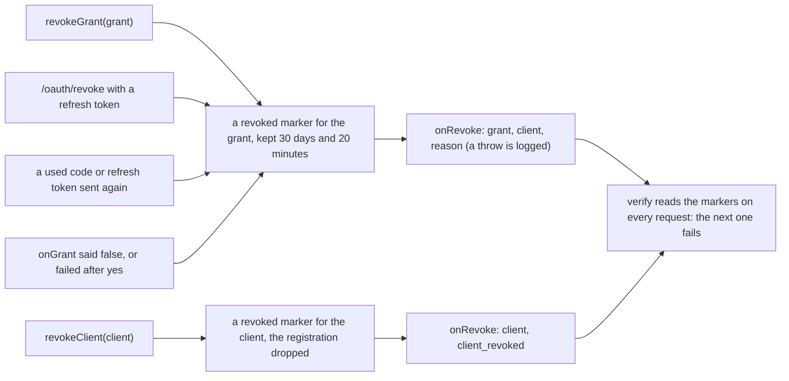
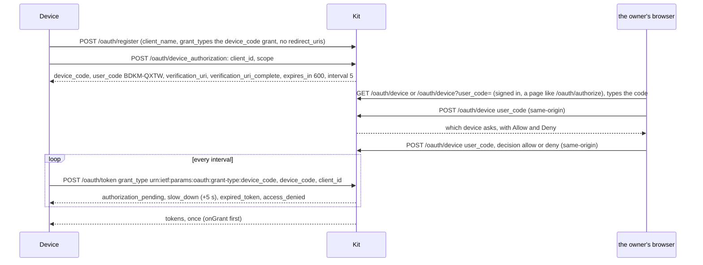
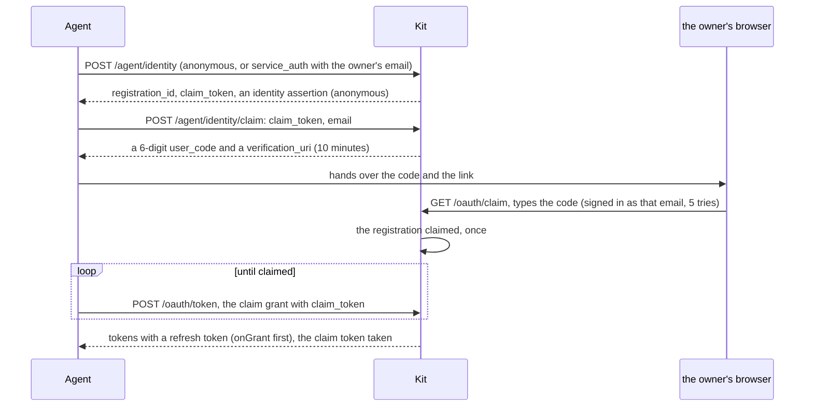

# oauth

The app as its own OAuth server, so MCP clients (Claude, ChatGPT) and agents connect without a pasted key: dynamic client registration, authorization code with PKCE, the device authorization grant (RFC 8628) for CLIs and devices without a browser, refresh rotation, revocation, agent registration through `/auth.md` with a 6-digit owner claim, ES256 tokens with `read` / `write` scopes bound to an audience, and the metadata documents.

## Use it when

- MCP clients and agents should connect by themselves, each approved by a person, each revocable on its own.
- A CLI or a device without a browser needs a sign-in (the device grant).
- The app decides who approves a sign-in: an invite, an ask to join, a page for strangers (`approve`).
- One app serves several spaces, each with its own MCP address and tokens that work only there (audiences).

## Don't use it when

- Only the owner's own machines call the API: keys are simpler (`API_KEYS`, the keys part).
- The rows would live in Workers KV: eventually consistent, so a new code reads as unknown and a revoke can be
  undone. Use SQLite or D1 (`dbOAuthStore`).

## Add it

```bash
npx @escalay/kit add oauth
```

Needs `core` and `db`. A signing key in the app's secrets: `generateOAuthKey()` makes one.

## Wire it

```ts
import { accessOwner, createAgentApi, createOAuth, dbOAuthStore, generateOAuthKey } from './kit/index.js'

const oauth = env.OAUTH_SIGNING_KEY
  ? createOAuth({
      name: 'Notes',
      signingKey: env.OAUTH_SIGNING_KEY,
      store: await dbOAuthStore(db),
      owner: access ? accessOwner(access) : async () => null,
      reuseGraceSeconds: 30,                               // two tabs or a retried refresh never sign anyone out
    })
  : undefined
const app = createAgentApi({ …, oauth })                   // mounts /oauth/*, the metadata, and accepts its tokens
```

`owner` is who may approve on the kit's pages. Behind Access, `accessOwner(access)`. An app with the `people` part asks
its session, or a deploy signed in by passkey alone can never approve a sign-in (`kit doctor` notes it when the file
that calls `createOAuth` never calls `personOf`; comments don't count). An app behind
Access as well asks `accessOwner(access)` when this answers null:

```ts
owner: async (c) => {
  const person = await personOf(c, db)
  return person?.role === 'owner' ? person.email : null
},
```

The starter (`npm create escalay@latest`) sets `reuseGraceSeconds: 30` and says this beside its `owner`.

### The app's own approval page

An app that approves by an invite typed on its own page (`test/oauth.test.ts` runs it as written):

```ts
// The invites the owner made, each for one person (an app keeps them in its database)
const INVITES = new Map([['garden-42', 'owner@example.test']])
const invitePage = (ask: SignInAsk, note = '') => `<!doctype html><meta name="referrer" content="same-origin"><title>Join Sample</title>
<p>${escape(ask.client.name)} asks to use Sample (${escape(ask.resource)}) and returns to ${ask.onThisComputer ? 'an app on this computer' : escape(ask.redirectHost)}. ${note}</p>
<form method="post" action="/join"><input type="hidden" name="ticket" value="${ask.ticket}"><input name="invite" aria-label="Invite code"><button>Join</button></form>`

const oauth = createOAuth({
  name: 'Sample', signingKey, store, owner,
  approve: async (c, ask) => c.html(invitePage(ask)),                                          // every sign-in starts at the app's page
  onGrant: async (grant) => grant.kind !== 'code' || INVITES.delete(grant.data?.invite ?? ''),  // spent with the first token
})
const app = createAgentApi({ title: 'Sample', version: '1.0.0', description: 'A sample.', tags: [], auth: { realm: 'sample', keys: parseApiKeys(''), open: ['/join'] }, oauth })
app.post('/join', async (c) => {
  const body = await c.req.parseBody()
  const ticket = String(body.ticket ?? '')
  const ask = await oauth.ticketOf(c, ticket)
  if (!ask) return c.html((await oauth.answeredOf(c, ticket)) === 'approved' ? '<p>Already approved: return to your app.</p>' : '<p>This sign-in expired: start again from your app.</p>', 400)
  const holder = INVITES.get(String(body.invite ?? ''))
  if (!holder) return c.html(invitePage(ask, 'That invite code is not one of ours.'), 400)
  return oauth.complete(c, ask.ticket, { approver: holder, scopes: ['read'], data: { invite: String(body.invite) } })
})
```

- `escape` is the app's own HTML escaping. The app's routes are its own to open (`auth.open`) and to limit.
- **An app's own approval page carries `<meta name="referrer" content="same-origin">`** (or a proxy in
  front of the app sets that policy), as the kit's pages do. `createAgentApi` serves every page with `Referrer-Policy: no-referrer` and replaces
  one a route sets; under it a browser posts the form with `Origin: null`, and where it sends no `Sec-Fetch-Site`
  either (plain http at an address other than this machine's) the POST is refused (403).

### One MCP per space

An app serving several MCP resources, one per space (`/s/alpha/mcp`), passes `resources` and `resourceOf`. The
default `accepts` then takes a token whose audience is exactly `resourceOf(c)` (RFC 8707's own rule), besides an
aud-less one and one for the root or `mcpPath`, so each space's token works at its own address and nowhere else. MCP
tools that call `/api` in-process with the same bearer lose the space's path, so a space's token is refused there
unless the app passes its own `accepts`, as here (`test/oauth.test.ts` runs this example as written):

```ts
const SPACE = /^\/s\/[a-z0-9-]+\/mcp/
const resourceOf = (c: Context) =>
  oauth.rootOf(c) + (SPACE.exec(c.req.path)?.[0] ?? (c.req.path === oauth.mcpPath || c.req.path.startsWith(oauth.mcpPath + '/') ? oauth.mcpPath : ''))
const oauth = createOAuth({
  …,
  // A pure check of the path: the kit has checked the origin, and the metadata path asks it too
  resources: (path) => /^\/s\/[a-z0-9-]+\/mcp$/.test(path),
  resourceOf,                                                  // where a 401 points (RFC 9728 §3.3)
  accepts: async (caller, c) => {
    // The path decides at an MCP address, a space's or mcpPath. Elsewhere, as in a tool's in-process /api call, the
    // path names none: only then does the app read the space the call carries (`spaceOf`)
    const root = oauth.rootOf(c)
    const here = resourceOf(c) === root ? (spaceOf(c) ?? root) : resourceOf(c)
    // An aud-less, root or mcpPath token works everywhere, as with the default
    return !caller.resource || caller.resource === root || caller.resource === root + oauth.mcpPath || caller.resource === here || `This token is for ${caller.resource}, not ${here}: connect again there.`
  },
})
```

The spaces' MCP endpoints are relays too, so a `read` token may POST there: `auth: { …, relay: ['/mcp', '/a2a',
'/s/*/mcp'] }`. `relay` takes the same patterns as `open` (`matches`): a star inside is one whole path segment, so
`/s/*/mcp` matches `/s/alpha/mcp` and not `/s/alpha/mcp/x`. It replaces the default (`mcpPath` and `/a2a`), so list
those too.

### Open to anyone

Registration, device authorization, `/agent/identity`, the token endpoint and, with `approve`, `/oauth/authorize` answer
anyone and write rows without auth. Once people other than the owner sign in, they are a public surface:

```ts
const oauth = createOAuth({
  …,
  publicOrigin: 'https://sample.example.test',                                  // the only origin it names or checks
  limits: { store: await dbGuardStore(db), address: { header: 'cf-connecting-ip' } },   // per address, never the owner
})
```

## Options

`createOAuth(config)`:

| Option | Type | Default | What it does |
|---|---|---|---|
| `name` | string | required | shown on the consent page and in the metadata (`resource_name`) |
| `signingKey` | string | required | the private ES256 key as a JWK JSON string (`generateOAuthKey()`); parsed when called, so a bad key throws at start |
| `store` | `OAuthStore` | required | `dbOAuthStore(db)` (SQLite or D1), `memoryOAuthStore()` in tests |
| `owner` | `(c) => Promise<email \| null>` | required | the signed-in person on the kit's approval pages, or null: only they may approve |
| `owners` | string[] | whoever `owner` lets in | emails allowed to claim an agent and to approve a device |
| `approve` | `(c, ask) => Promise<Response \| null>` | none: the kit's page | the app's own page for a sign-in; null shows the kit's page to the owner |
| `onGrant` | `(grant, c) => Promise<boolean>` | yes to every grant | hears the first token of every grant; false withdraws it |
| `onRevoke` | `(revoked) => void` | none | hears every grant the kit ends, and why |
| `ticketTtl` | seconds | 600 | a consent ticket's life and its nonce cookie's: whole, from 60 to a week; a held one (`holdTicket`) as long as held |
| `reuseGraceSeconds` | seconds | 0 | a used refresh token sent again inside it gets the same successor; 0: any replay revokes the grant |
| `publicOrigin` | origin | the request's own | the one origin of the issuer, every document, token and check |
| `limits` | `{ store, address? }` \| false | false | per-address limits on the open endpoints, never the owner |
| `maxUnusedClients` | whole number | 10 000 | registrations no sign-in has used, kept at most of each kind |
| `maxUnusedTickets` | whole number | 10 000 | codes waiting for a person, kept at most of each kind; never a held ticket |
| `mcpPath` | path | `/mcp` | where MCP is mounted (`mountMcp`'s `path`): its resource, metadata pointer and relay |
| `resources` | `(path) => boolean` | none: the origin and `mcpPath` only | whether this server issues tokens for a resource path; a pure check of the string |
| `resourceOf` | `(c) => URL` | the origin, plus `mcpPath` under it | the canonical resource a request is for: where its 401 points |
| `accepts` | `(caller, c) => Promise<true \| string>` | aud-less, root or `mcpPath` everywhere, and `resourceOf(c)` there | whether a valid token fits this request; a sentence refuses it |
| `listResources` | `(origin) => string[]` | `[origin, origin + mcpPath]` | what the metadata lists as `protected_resources` |
| `metadata` | object | none | extra fields for the authorization server metadata (`poppy_domains`) |
| `brand` | `AgentBrand` | the app's | the brand on the kit's pages |

What the app's hooks take and give (`approval.ts`):

| Shape | Fields |
|---|---|
| `SignInAsk` (to `approve`) | `ticket`, `client` (`id`, `name`, `redirectUris`), `redirectUri`, `redirectHost` (a host, or the scheme, `sample-app:`), `onThisComputer` (an http loopback redirect only), `scopes`, `resource` (the audience the grant gets), `named` (the client chose `resource`: `complete` binds no other), `expiresAt` (the ticket's, epoch seconds), `state`, and `arrival` (`site`: the first GET's `Sec-Fetch-Site`, `referrerOrigin`: its `Referer`'s origin, each null when not sent) |
| `SignInDecision` (to `complete`) | `{ approver, scopes?, data?, resource? }` or `'deny'` |
| `SignInGrant` (to `onGrant`) | `kind` (`code`, `device` or `claim`), `grant`, `client` (`id`, `name`), `approver`, `scopes`, `resource` (absent on a grant from before audiences), `data` |
| `SignInRevoked` (to `onRevoke`) | `grant` (none on `client_revoked`), `client` (none from `revokeGrant`), `reason`: `revoked`, `replayed`, `withdrawn`, `client_revoked` |

An OAuth caller (`c.get('caller')`) is `{ kind: 'agent', client, grant, name, scopes, owner, resource }`:

- `client` is the client_id (a registration id for a claimed agent). Rate limits, idempotency answers and MCP's
  `authInfo.clientId` key on it, with `grant`; `name` is what the client called itself, for display only, so two
  clients that register the same name are two callers.
- `grant` is one approval: every token from one sign-in (a code, a device approval, a claim), rotated or not, carries
  it. Tokens issued before grants have none and run to their hour, known by `client`.
- `owner` is the approver (the token's `sub`); `resource` the audience the token was issued for, absent on tokens from
  before audiences.

## Exports

| Export | What |
|---|---|
| `createOAuth(config)` | the server (below) |
| `oauth.mount(app)` | the metadata, `/oauth/*`, `/agent/identity*` and `/auth.md`; `createAgentApi({ oauth })` calls it |
| `oauth.verify(jwt, c)` | an access token → its caller, `{ refused }` when `accepts` turns it away here (truthy: check `'refused' in answer`), or null (expired, revoked, not ours); `createAgentApi` passes it as `auth.tokens` |
| `oauth.resourceMetadataFor(c)` | the protected-resource metadata URL for a request's resource (RFC 9728 §3.3): where a 401 points |
| `oauth.issuerOf(c)`, `oauth.publicOrigin` | the issuer's origin: `publicOrigin` (undefined when unset), else the request's |
| `oauth.rootOf(c)`, `oauth.resourceOf(c)`, `oauth.mcpPath` | the root resource (the issuer's origin, canonical), the resource a request is for, where MCP is mounted |
| `oauth.authorizationServer(origin)` | the authorization server metadata document (RFC 8414) |
| `oauth.protectedResource(origin, suffix)` | the protected-resource metadata document for `origin + suffix` (RFC 9728) |
| `oauth.authMd(origin)` | the `/auth.md` text: how an agent registers and is claimed |
| `oauth.ticketOf(c, ticket)`, `oauth.answeredOf(c, ticket)`, `oauth.complete(c, ticket, decision)` | the app's own sign-in page: the waiting ask, what this browser answered already, the answer |
| `oauth.holdTicket(c, ticket, seconds)` | holds one ticket for a decision made later (an ask to join): `{ expiresAt, cookie }`, or null when it expired, was answered, or this browser did not open it |
| `oauth.revokeGrant(grant)`, `oauth.revokeClient(clientId)` | end one sign-in; end every sign-in of a client and drop its registration (the owner's kill switch) |
| `generateOAuthKey()` | a new signing key, a private JWK JSON string |
| `dbOAuthStore(db)`, `memoryOAuthStore()`, `OAuthStore` | the stores: `get`, `put`, `delete`, plus `take`, `markUsed`, `trim`, `hold` and `extend` |
| `OAUTH_MIGRATIONS`, `oauthKeys` | the `oauth` table and its steps |
| `SignInAsk`, `SignInDecision`, `SignInGrant`, `SignInRevoked`, `TokenCaller`, `OAuthConfig` | the types |

| File | What |
|---|---|
| `index.ts` | `createOAuth` and everything it returns, `generateOAuthKey` |
| `approval.ts` | `SignInAsk`, `SignInDecision`, `SignInGrant`, `SignInRevoked`; the ticket cookie and the same-origin rule |
| `store.ts` | `OAuthStore` (its methods above), `dbOAuthStore(db)` (in the app's database, node:sqlite or D1; drops expired rows at start, then on a write at most once a minute), `memoryOAuthStore` |
| `schema.ts` | the `oauth` table, its `expires_at` index, and `OAUTH_MIGRATIONS` |

## Flows

### Authorize, with the consent ticket



### Deciding later (`holdTicket`)



### Code to token, and a replayed code



### Refresh, with the grace and a replay



### Revoking, and `onRevoke`



### Device authorization (RFC 8628)



### Agent claim (auth.md)



## Rules

### Threats, and what stops them

| Threat | What stops it |
|---|---|
| a code seen in a redirect (a log, a Referer, a shared history) used by someone else | PKCE binds the code; it is used once, even by a failed exchange; sent again with the right client and verifier it revokes the grant the first exchange got (OAuth 2.1 §4.1.3) |
| a stolen refresh token | rotation on every use; any earlier token of a live family, sent again or revoked at `/oauth/revoke`, ends the grant; the grace only ever gives the same successor |
| a refresh token made up from a grant id (every access token carries its grant) | its MAC under a secret derived from the signing key: a made-up one ends nothing |
| an approval posted from another site | the same-origin rule on every approval POST: `Sec-Fetch-Site: same-origin`, or with no such header an `Origin` equal to the issuer's; `same-site` and `Origin: null` are refused |
| a ticket opened in one browser approved in another | the nonce cookie (Rules) binds it to the browser that opened it |
| a double-clicked Allow, or two tabs | a ticket, a claim attempt and a typed device code are each taken once |
| a stored approval standing in for a click | none exists (Rules) |
| a redirect before anything is checked | with `approve`, `/oauth/authorize` never redirects before a person acts; redirect URIs are https, http only on this machine, or an app's own scheme |
| a forged `X-Forwarded-Host` in a cached document, a token's `iss` or its audience | `publicOrigin`: the one origin every document, token and check names; unset, only a bare host counts, so a path in it never makes a space's token a root one |
| a flood of registrations, tickets or device codes | every row written without auth is capped per kind, unused registrations lapse in a week, and `limits` counts per address |
| guessing a device code or a claim code | 8 letters from 20, 10 minutes, 5 wrong codes in 10 minutes per signed-in person; a claim code dies after 5 wrong tries |
| a space's token used at another space | the grant's audience (RFC 8707) and `accepts`; an invite binds its space with `complete`'s `resource` |
| a resource check telling anyone which spaces exist | `resources` is a pure function of the string, with no lookup |
| a client's logo used to impersonate someone | a client is named by text only: a `logo_uri` it registers is never fetched or shown |
| an anonymous agent skipping `onGrant` with its identity assertion | with `onGrant` set, jwt-bearer works only once its claim was collected and heard |
| a revoke undone or missed | revocation reads are never cached; markers outlive anything issued behind them; rows never in Workers KV |

### Who approves a sign-in

By default the owner approves every sign-in on the kit's own page at `/oauth/authorize`, behind the single sign-on
(`owner`). An app that decides for itself (an invite, an ask to join, a page for strangers) passes `approve`, and hears
every first token in `onGrant`:

- `approve(c, ask)` runs at `GET /oauth/authorize` once the kit has checked the client, its redirect, PKCE and the
  resource, before `owner`. A Response is the app's page; null shows the kit's page to the owner.
- The app's page posts the ticket to the app's own route, which reads it with `oauth.ticketOf(c, ticket)` (null when
  expired, answered, or opened in another browser; then `oauth.answeredOf(c, ticket)` says `approved`, `denied` or
  `answered` for a ticket this browser spent already, so the route can say "Already approved") and answers with
  `oauth.complete(c, ticket, decision)`. `approver` becomes the token's `sub` (`caller.owner`), `scopes` may only
  narrow what was asked (a wider or empty list is a 400 page), `data` goes on the code and reaches `onGrant`.
  `resource` binds the grant to a resource this server issues for (an invite's space), checked as a client's would be
  (`resources`, the issuer's origin, the canonical form) when the client named none; a client that named one keeps it,
  the same one again is fine, and any other, or one not issued for, is a 400 page (`invalid_target`) with the ticket
  still live. The audience the app chose is the server's choice: a `resource` the client sends later at the token
  endpoint is not held against it, and refresh keeps it. Without `resource`, the ticket's audience. It returns the 302
  to the client (`code`, `state`, `iss`, or `access_denied`) or a 400/403 page. A blank `approver` is a 400 page, and
  the ticket stays live.
- `onGrant(grant, c)` hears the first token of every grant. It runs after the kit's own checks (client, redirect and
  verifier for a code; the owner's answer for a device; the collected claim token for a claim), once per grant however
  many polls race. false withdraws it: `invalid_grant`, the code or device code spent, the grant ended (`onRevoke`
  hears `withdrawn`, even when the store fails). After its yes, whatever stops the tokens withdraws the
  grant once, `onRevoke` told, before the error: a throw in it or in the tokens' writes (500), or a grant ended while
  it ran (a replayed code, a revoke: "This sign-in was revoked"). It is not asked on refresh
  or jwt-bearer: judge later requests in `accepts`. An app that keeps its own rows per grant makes them here and
  refuses a token whose grant has none.
- `onRevoke(revoked)` hears every grant the kit ends, after it has ended it. A grant that lapses (its refresh token
  unused for 30 days) is not told: nothing ends it, its tokens just expire. `revoked`: `revokeGrant` (no `client`: the
  kit keeps no grant-to-client index) or a refresh token at `/oauth/revoke`. `replayed`: a used code or refresh token
  sent again, its row kept or not. `withdrawn`: `onGrant` said no, or its yes got no token. `client_revoked`: `revokeClient`, naming the client
  and no grant, since it ends every grant of the client. Revoking an access token alone ends no grant and is not told.
  It is told at least once (a code sent a third time is told again): keep the handler idempotent. A throw is logged (`onRevoke failed: …`), never answered: the revoke has happened and the request
  answers as it would have.

**Mirror grants with `onGrant` and `onRevoke`.** An app that lists who holds access (a space's members, their agents)
makes its row when `onGrant` says yes and drops it when `onRevoke` names its grant, or every grant of a client on
`client_revoked`. Its `accepts` refuses a token whose grant has no row, so a row the app dropped stops the token on its
next request, whatever the kit's markers say. A lapsed grant is never named, so the app ages its own rows: `accepts`
writes the row's last-seen time (every request with the grant's tokens passes there), and a row with none for 30 days
is dropped with `revokeGrant(grant)`, even one that refreshed in those 30 days but made no request.

- **Nothing is granted without a click.** There is no approve-at-once answer: a grant follows only `complete`, from a
  same-origin POST, by the browser that opened the ticket, once. A stored approval never stands in for one: the same
  client and approver signing in again see the page again.
- **The ticket is bound to the browser.** Every `GET /oauth/authorize` that stores a ticket sets an HttpOnly,
  SameSite=Lax nonce cookie, `__Host-oauth_ticket` on https (`oauth_ticket` on http; on https only the `__Host-` name
  is read), Path `/`, Max-Age `ticketTtl` (600 by default), or longer while a ticket this browser opened is held. A
  live one is reused and its Max-Age renewed, so a second sign-in in the same browser neither breaks the first nor
  shortens the second, nor a held one. The ticket keeps only the nonce's SHA-256.
- **Same-origin, not same-site.** `complete`, the kit's consent POST, `/oauth/claim` and `/oauth/device` take a POST
  only with `Sec-Fetch-Site: same-origin`, or, with no such header, an `Origin` equal to the issuer's. A missing
  header with no matching `Origin` is refused (403), and so is `same-site`: a sibling host is same-site. `Origin: null`
  never matches; the kit's pages set their referrer policy to `same-origin` so a browser sends the real one.
- **A ticket is answered once.** It is marked used and kept, its nonce hash and the answer only, until its life
  (`ticketTtl`, or the held life) ends. Posted again from the browser that answered it (a double click, a tab brought back), it is a
  page that says the sign-in went through ("Already approved") or was refused, with no code and no redirect; from
  another browser it is "This approval expired".
- **With `approve` set, `/oauth/authorize` never redirects before a person acts:** every error (an unknown client, a
  wrong redirect, `response_type`, PKCE, the resource) is a 400 page with no link. Without it, the owner first, then a
  `response_type` or PKCE error goes back to the client's redirect.
- The kit's page answers only for the owner it was shown to: a ticket the app's page holds can't be approved there.
- `/oauth/claim` and `/oauth/device` stay the owner's (`owner`, `owners`); `approve` is for `/oauth/authorize` only.
- In Access, `/oauth/authorize` may bypass the sign-in once the app passes `approve`: the app's page decides. Keep it
  gated otherwise. A ticket is stored only when a page holds it: the app's, or the kit's shown to the owner. A visit
  `approve` sends to the owner's sign-in stores nothing; one the app's page answers stores a row for `ticketTtl` (10
  minutes by default), as an open `/oauth/register` stores a client. An app whose sign-in is reachable outside Access
  passes `publicOrigin` and `limits` (below): `oauth.mount` runs inside `createAgentApi`, before any middleware the
  app adds, so the app can't limit these endpoints itself.
- Every page the kit shows (consent, device, claim, errors) carries the app's brand when it has one
  (`createAgentApi({ brand })`, or `brand` here): head tags, icon, title, accent; else the plain look.
- The consent page names what is asked for, `Sample: /s/alpha/mcp` (all of Sample for the root), and where it
  returns: a host, a custom scheme (any app may claim one), or "an app on this computer" for an http loopback redirect.
- Rules after cloudflare/workers-oauth-provider (the browser-bound, single-use consent ticket; never redirect before
  the redirect is checked) and oidc-provider (the grant is saved before the code exists), both MIT.

### Deciding later: holding a ticket

The route an ask to join posts to holds its ticket (Flows: Deciding later) and sets `held.cookie`; every other page
lives `ticketTtl`.

- Only the browser that opened it may hold it (the nonce cookie); an expired, answered or foreign ticket gives
  null. `seconds`: whole, 60 to a week, else it throws.
- It lives `seconds` from now; holding again moves it. One conditional write (the store's `hold`): a hold
  after `complete` gives null, never reopening it.
- `cookie` keeps the nonce cookie as long as the longest ticket held in that browser (a `held-nonce` row, only grown,
  through the store's `extend`), so no later sign-in there cuts it short.
- Newer tickets never evict it: it is outside `maxUnusedTickets`. The kit doesn't cap held tickets: the app bounds
  them (one ask per address) and passes `limits`.

The page polls an app route (`ticketOf` first) and submits its form once decided: `complete` still needs the opening
browser, a same-origin POST, once. A decision after the held life finds it expired. A hold does not renew its
client: an unused registration still lapses after a week (`complete` then says to add the connection again).

### Audiences (RFC 8707)

> **The default `accepts` takes a root token at every space.** A client that sends no `resource` gets the root, and a
> root token works everywhere on the origin, every space included. An app that signs people in by invite binds each
> grant to the invite's space: `oauth.complete(c, ticket, { approver, resource: <the space's resource> })`. Its token
> then works at that space only, even when the client asked for nothing. An app that wants a space to take only its
> own tokens also refuses the root there in its own `accepts` (One MCP per space, above).

Every grant is bound to one resource, signed as its tokens' `aud` and on the caller as `resource`:

- The resource the client sends at `/oauth/authorize` (or `/oauth/device_authorization`), when this server issues for
  it: the origin, `mcpPath` (default `/mcp`), and with `resources` set, what it approves.
- Else the **root**, the issuer's origin: a client that sends no `resource`, or (without `resources`) one the app does
  not describe.
- An agent registered at `/agent/identity` (auth.md) names no resource: its grant gets the root when it registers,
  and its claim, refresh and jwt-bearer tokens carry it. One registered before audiences stays without, even if
  claimed after.

The audience is fixed at the authorization request. A token request naming another resource is `invalid_target`,
checked before anything is written, so the code or refresh token still works with the right one. Refresh keeps the
audience. When the server chose the audience (the root), a `resource` the client sends later is not held against it.

A resource is compared in its canonical form: an absolute http(s) URL, scheme and host lower-cased, the default port
and one trailing slash dropped (`HTTP://Example.test:443/mcp/` is `https://example.test/mcp`). A user part, a query,
a fragment, a dot segment or an encoded dot (`%2e`) makes it no resource: `invalid_target` with `resources` set, the
root without. More than one `resource`, or one not sent as a string, is refused: a 400 page at authorize,
`invalid_target` at `/oauth/device_authorization` and the token endpoint, before anything is written. A code, device
approval, refresh token or agent registration from before audiences ignores `resource` altogether, two of them
included: it stays aud-less. Errors at authorize are pages, never redirects.

- With `resources` set, the kit checks the resource's origin is the issuer's, exactly (a longer host that starts with
  it is another origin), then asks `resources` for the path. Another origin or a refused path is `invalid_target`,
  and `/.well-known/oauth-protected-resource<path>` is 404 for a path it refuses. Without it, the metadata echoes any
  path.
- `resources` must be a pure function of the string, with no lookup: it answers the metadata path too, so a lookup
  would tell anyone which spaces exist. Whether one exists or is open is decided when the person approves.
- `accepts` runs on every request after the token's signature and revocation checks, in-process calls included: MCP
  tools call `/api` with the same bearer, and apps rewrite paths before the kit runs. Whatever carries the space to an
  in-process call (`spaceOf`) must be something a client cannot set, such as a header the app strips from every
  outside request, and the request's own path outranks it at every MCP address, a space's or `mcpPath`: otherwise a
  client sends the carrier with one space's token and reaches another, or `mcpPath`. A sentence refuses: 401
  `invalid_token`, the sentence as `detail` (and its printable ASCII as `error_description`), `resource_metadata` at
  `resourceOf(c)`. Compare audiences with `oauth.rootOf(c)`, the root as the kit signs it (canonical: a host in
  capitals or with its default port is the same root).
- Keep `mcpPath` in `resourceOf` and in `accepts`: without it, a token asked for `<origin>/mcp` (what MCP clients
  send) is refused at `/mcp`, `/api` and every space, and the 401 at `/mcp` points at the origin's metadata.
- `listResources(origin)` names what the authorization server metadata lists (`protected_resources`, default the
  origin and `mcpPath`). Never list per-space resources there.
- `mcpPath` keeps the pointer, the metadata, the listed resources and the relay (`read` may POST there) on MCP when it
  is mounted elsewhere: pass `mountMcp`'s `path`.

Three exceptions to "a token is accepted only by its audience" (MCP 2026-07-28 asks servers to reject tokens not meant
for them, or otherwise verify they are the intended recipient):

- **A token with no `aud` is accepted** by the default `accepts`: no token, code, device approval, refresh token or
  registration from before audiences has one, nor ever gains one. Connections made before keep working.
- **A root token is accepted at a space's resource:** the default `accepts` takes it everywhere on the origin, so a
  client that sends no `resource`, or a connection made before the app had spaces, keeps working there. The app, with
  one issuer and a row per grant, is then what verifies the token is meant for it.
- **A token whose `aud` is the origin plus `mcpPath` is accepted everywhere on the origin** by the default `accepts`:
  MCP tools call `/api` in-process with the same bearer, so the token for the single MCP must fit the whole origin,
  spaces included. An app that wants otherwise refuses it in its own `accepts`, as for the root.

### Open endpoints: one origin, lifetimes, caps and limits

- **`publicOrigin`** is the one origin of the issuer, every token's `iss` (and `verify`'s check of it), every metadata
  document, auth.md, the 401's `resource_metadata`, the device and claim links, `rootOf` (so the resource check and
  the root audience), the same-origin rule on every approval POST and the ticket cookie's name. `createAgentApi` also
  names it in every discovery document cached publicly (`public, max-age=3600`): `api-catalog`, `robots.txt`,
  `sitemap.xml`, `poppy.json` (organization, APIs and issuer), and with their parts the Server Card, the Agent Card,
  the skills index and archives, and the AI Catalog. A forged `X-Forwarded-Host` then reaches no shared cache, and the
  metadata and auth.md are cached publicly (`public, max-age=300`). Unset, each request's own origin is used,
  a bare forwarded host included, and the metadata and auth.md are `no-store`; the other discovery documents stay
  `public, max-age=3600`, so behind a proxy that passes a caller's `X-Forwarded-Host` through, they can be
  poisoned. Not covered either way: what is never cached publicly (HAL links, `/openapi.json`, the guide, problem
  `type` URLs) keeps the request's origin. It must be an origin with no path (`createOAuth` throws otherwise), and it
  must be the origin tokens were issued under: setting one that differs signs everyone out, since their tokens' `iss`
  no longer matches.
- **A registration no sign-in has used lives a week** (`/oauth/register`; long enough for an invite of a day, with
  room). Its first use (a code exchanged, a device token collected) gives it a year from then. One that lapses meets
  the page that says to remove the connection in the app and add it again (a client never hears `invalid_client` at
  `/oauth/authorize`), and `invalid_client` at `/oauth/device_authorization`. A client registered before the caps has
  no `used` flag and keeps its year. An agent's `/agent/identity` registration lives a day. An approval after the
  lapse is refused, but a code approved in the last minutes of the week can still be exchanged after it (a code lives
  10 minutes), and the lapsed client is not made again: that sign-in's tokens and refresh tokens work, while a new
  sign-in with that client_id meets the "add it again" page.
- **Every row anyone may write without auth is capped**, so the table stays bounded whatever the addresses: past its
  cap, a new row evicts the oldest unused row of its kind (`maxUnusedClients` and `maxUnusedTickets`, default 10 000
  each, whole numbers, 0 or more; `createOAuth` throws otherwise).

| Kind | Written by | Cap |
|---|---|---|
| `client` | `POST /oauth/register` | `maxUnusedClients` |
| `registration`, `claim-token` | `POST /agent/identity` | `maxUnusedClients`, each |
| `consent` | `GET /oauth/authorize`, when a page holds the ticket | `maxUnusedTickets` |
| `claim-attempt` | `POST /agent/identity` (`service_auth`), `POST /agent/identity/claim` | `maxUnusedTickets` |
| `device`, `device-user` | `POST /oauth/device_authorization` | `maxUnusedTickets`, each |

  Never evicted: a used client (a sign-in collected its first token), a claimed registration, a client a live
  consent ticket holds (a page is waiting on a person: an invite, an ask to join), the claim token of a live
  registration, an answered ticket, a ticket the app holds (`holdTicket`), and a row from before the caps (no `used`
  flag). A waiting ticket the app has not held is not protected: `maxUnusedTickets` newer tickets evict it, and its
  client with it on a later registration (Deciding later: holding a ticket). So the unused rows are at most
  `maxUnusedClients` clients plus one per open ticket, `maxUnusedClients` registrations and as many claim tokens, and
  `maxUnusedTickets` of each of the four waiting kinds, plus the tickets the app holds; the rest follow an approval (claimed registrations, tokens,
  refresh rows) or a signed-in person (device answers and tries). An approved device not yet collected (one poll,
  seconds) and a claim code not yet typed can be evicted by a flood: the device or agent starts again. The cap needs
  the store's `trim` (`dbOAuthStore` and `memoryOAuthStore` have it, with its `heldBy`); a store without it is not
  capped. The cap is soft under concurrency: each write trims before it inserts, so requests that arrive together can
  all pass the trim and leave the table over the cap by as many as were in flight, until the next write trims it
  back. Each capped write first counts its kind by key (the primary key, no JSON read), and only a kind over its cap is
  scanned; with `limits` off nothing slows a flood, so an app whose sign-in is reachable outside Access also passes
  `limits`.
- **`dbOAuthStore` prunes expired rows** on a write, at most once a minute, besides when it is made, through an index
  on `expires_at` (`OAUTH_MIGRATIONS` step 2).
- **`createOAuth` warns once at start** (`console.warn`) when `approve` is set without both `limits` and
  `publicOrigin` (`limits: false` counts as not set), and `kit doctor` notes the same from the app's code, comments
  left out.
- **`limits`** (default `false`: none) counts per address, read by `addressOf` from `address` (default the app's
  `createAgentApi({ address })`). A named source counts a global IPv6 address by its /64; with none named, the
  `'headers'` read takes the address as sent, each IPv6 address on its own. Past a limit: 429 with `Retry-After` (JSON
  `too_many_requests`, a page at authorize). A request whose `owner(c)` answers (the owner signed in) is never counted.

| Endpoint | Limit per address |
|---|---|
| `POST /oauth/register`, `POST /agent/identity` and `POST /agent/identity/claim`, together | 20 an hour |
| `POST /oauth/device_authorization` | 20 an hour |
| `GET /oauth/authorize` | 60 a minute |
| `POST /oauth/token`: misses only (`invalid_grant`), counted after the lookup | 30 a minute |

- Only a miss counts at the token endpoint, and only a miss is refused, so a right code or refresh token is never
  turned away by other people's junk, and a device polling (`authorization_pending`, `slow_down`) counts nothing.
- On Workers pass `dbGuardStore(db)`, so every isolate shares the counts, and `address: { header: 'cf-connecting-ip' }`
  (`AddressTrust`, core's README; behind another proxy, the header it writes): the default read takes
  `cf-connecting-ip` or `x-forwarded-for` as sent, which a caller can set to anything, without the /64 grouping, so
  one IPv6 host gets a bucket per address. Where the named source is missing every caller shares the single `local`
  bucket, which anyone can fill.

### Grants and revoking

- A claimed agent's claim, refresh and jwt-bearer tokens share one grant, so once that grant is revoked (a replayed
  refresh token, `revokeGrant`) its identity assertion is refused too: the agent registers again. A registration is
  approved once: a second claim code typed for it gets an "Already approved" page (409), never a second grant. A
  claim from before grants uses its registration id.
- `verify` reads the issued row and both revocation markers (the client's, and the grant's when the token has one) in
  one round trip: three row reads per request with a grant, two without.

```ts
await oauth.revokeGrant(caller.grant)   // ends that sign-in at once: its access tokens fail now, its refresh tokens too
await oauth.revokeClient(clientId)      // every sign-in of the client, and drops its registration: it registers again
```

`revokeClient` also ends what was approved but not yet collected: a code exchanged, or a device approval or a claim
token polled after it, gets `invalid_grant`, and the device page refuses a code whose client is gone. A claim token
collected after `revokeGrant` ended its grant gets `invalid_grant` too: a claimed agent can learn its grant through
jwt-bearer before it collects the claim, and a refresh token issued into that grant would outlive the marker and undo
the revoke. The claim grant reads both markers after it takes the claim token, so a revoke landing during the poll
counts. Both markers (`revokeGrant`'s and `revokeClient`'s) are kept 30 days and 20 minutes, longer than a refresh
token issued from a code or device approval collected at the last moment.

### Refresh tokens: rotation, replay and the rows it leaves

A refresh token is `rt_<grant>.<generation>.<nonce>.<MAC>`: the MAC is an HMAC of the other three under a secret
derived from the signing key. The first token's nonce is random; each successor's is an HMAC of the token before it,
so a retry gets the same successor and no token can be made from the key and a grant id alone (every access token
carries its grant). Each refresh marks the token used, moves the grant's one `refresh-family` row to the next
generation, and writes that generation's token row; the used token's row stays only for `reuseGraceSeconds` (0, the
default: it goes at once). So a sign-in keeps two rows however often it refreshes, its newest token's and its
family's.

- A used token sent again while its row is kept is reuse.
- One whose row is gone is still known: its MAC shows this server made it, and its family has moved past its
  generation, so it was used. Sending it ends the grant ("already used"), and so does revoking it at `/oauth/revoke`.
- A made-up token that names a grant has no valid MAC and ends nothing.
- A refresh token from before generations (`rt_` and random characters) is known by its row: it still rotates, and an
  earlier one is still caught as a replay. How, and what a rollback or a rollout with two versions does:
  [docs/upgrading.md#oauth](https://github.com/escalay/api-kit/blob/main/docs/upgrading.md#oauth).

Revocation reads stay uncached: `verify` reads the issued row and the markers on every request, so a revoke stops a
client on its next request. Rotating the signing key also changes the MAC, so earlier tokens of the old key are no
longer recognised as replays: they are only unknown.

**Refresh storms** happen when one client refreshes the same token twice at once: two tabs sharing a sign-in, a CLI and
its background job, or a refresh retried after a dropped answer. With the default 0, the second refresh is reuse and
ends the sign-in, so the person signs in again. `createOAuth({ …, reuseGraceSeconds: 30 })` (the starter sets it)
gives a used refresh token sent again inside the window (less than `reuseGraceSeconds` after the first answer) the
same successor: the next generation's token, which is the same each time it is made, so none is stored for it. It
never makes a second branch: once that successor is used, or the window has passed, it is reuse. The successor is
written by the first request, after it marks the used token. If that request dies in between, a retry in the window
gets a successor no row backs, and its next refresh is `invalid_grant` (with 0 the retry would have revoked the grant
instead). The retry never writes the row itself, since a write there could reset a successor already used.

### Device authorization: codes and Access

The requests are the Flows diagram (Device authorization). Nothing to wire: `mount` adds it, and the metadata names
`device_authorization_endpoint`.

- Device codes: 8 letters from `BCDFGHJKLMNPQRSTVWXZ` (no vowels), shown as `XXXX-XXXX`, case and dashes ignored;
  10 minutes; single use; only hashes kept. A signed-in person may type 5 wrong codes in 10 minutes, then 429. When
  `owners` is set, only they may approve. Polling sooner than `interval` answers `slow_down` and adds 5 seconds.
- In Access, `/oauth/device` stays behind the sign-in (like `/oauth/claim`, and `/oauth/authorize` unless the app
  passes `approve`); `/oauth/device_authorization` bypasses it. Name the path exactly: an Access path without `*`
  covers only itself, while `/oauth/device*` would also gate `/oauth/device_authorization` and break every device.

### Everything else

- The signing key lives in the app's secrets, never in the repo; rotating it signs everyone out. `createOAuth` parses
  it when called: a malformed key throws there, at start, not on the first OAuth request.
- Refresh tokens last 30 days and rotate on each use; MCP clients and claimed agents both get one. Only their hashes
  are kept, and only the newest token's row (above). A used token sent again revokes its grant (every refresh token of
  that sign-in, and its access tokens at once), as does revoking any one of them. Two refreshes of one token at once
  rotate once: the second is that replay, unless `reuseGraceSeconds` covers it.
- A code is used once, even by a failed exchange, and kept until its 10 minutes end. Sent again with the right client
  and verifier, it revokes the grant the first exchange got (OAuth 2.1 §4.1.3); with a wrong verifier it revokes
  nothing. The trade: someone who sees the code in the redirect (a log, a Referer, a shared history) and sends it
  first with any verifier spends it, so the real client's exchange fails and the person connects again. Nothing is
  issued or exposed. `redirect_uri` at the token endpoint is checked when sent and may be left out (PKCE binds the code).
- A device code and a claim token give tokens once, however many polls arrive together: the owner's device answer is
  marked collected, and the claim token is taken. The polls that lose hear `invalid_grant` (device) or `expired_token`
  (claim).
- An approval form posted twice at once (a double-clicked Approve) approves once: the consent page marks its ticket
  used (the other post gets "Already approved", or "Already answered" while the first is still saying so; 400, no
  code), the claim page takes the claim attempt ("This code expired", 410), and the device page takes the typed code
  (the code form again, 400), so Allow and Deny from two tabs write one answer.
- Revoking an access token (`/oauth/revoke`) ends only that token; `revokeGrant` ends the sign-in.
- The store makes single use hold under concurrent requests: `markUsed` (codes, refresh tokens), `take`, `hold`
  (a held ticket) and `extend` (a browser's held life) are one statement each in `dbOAuthStore`, honour expiry, and
  read a row with no `used` key (a sign-in from before) as unused. A store without them falls back to a read then a write, safe only one request at a
  time: tests.
- OAuth rows live in SQLite or D1, never Workers KV: KV is eventually consistent, so a new code reads as unknown and a
  revoke can be undone.
- Keep the OAuth paths open (`OAUTH_OPEN_PATHS`); `createAgentApi` does it when `oauth` is set, private mode included.
- An app whose sign-in is reachable outside Access passes `publicOrigin` and `limits`; one behind a proxy or
  reachable by more than one host, `publicOrigin`.
- Rules after cloudflare/workers-oauth-provider and better-auth (both MIT).
- Standard: `docs/STANDARD.md` §7, §11

## Failure modes

The consent page (`/oauth/authorize`):

| The caller sees | Why |
|---|---|
| 401 "Sign in first" | no `approve`, and `owner` answers null: the person is not signed in to the site |
| 400 "Can't approve this request" with the reason | an unknown or lapsed client ("Remove this connection in your app and add it again"), a wrong redirect, `response_type`, PKCE, more than one resource, a resource refused (`invalid_target`), a blank approver, or scopes wider than asked |
| a 302 to the client with `error=invalid_request` | without `approve`, once the owner is signed in, a `response_type` or PKCE error goes back to the client's redirect |
| 403 "Not allowed" | the POST is not same-origin, nobody is signed in, the ticket was opened in another browser, or it was shown to another owner |
| 400 "This approval expired" | the ticket's life (`ticketTtl`, or the held life) ended, it is unknown, or another browser answered it |
| 400 "Already approved" / "Already answered" | this browser answered the ticket already (a double click, a tab brought back) |
| 429 "Too many sign-ins from here" | past `limits` at authorize (60 a minute per address) |

The claim page (`/oauth/claim`):

| The caller sees | Why |
|---|---|
| 401 "Sign in first" | open the link in the browser signed in to the site |
| 410 "This code expired" | the claim attempt is older than 10 minutes, was used, or a double-clicked post took it first |
| 403 "This claim names someone else" | signed in as another email than the agent named |
| 400 "That code doesn't match" | a wrong 6-digit code; at the fifth, "Too many tries: ask the agent for a new code" |
| 410 "This registration expired" | the agent's registration lapsed (a day) |
| 409 "Already approved" | the registration was approved already: one approval per registration |

The device page (`/oauth/device`):

| The caller sees | Why |
|---|---|
| 401 "Sign in first" | open the page in the browser signed in to the site |
| 403 "Not allowed" | `owners` is set and the signed-in person is not one of them |
| 400, the code form: "That code doesn't match a device waiting here" | a wrong or expired code |
| 429 "Too many tries" | 5 wrong codes in 10 minutes |
| 400 "This device can't be connected" | its client was revoked or its registration lapsed |
| 400, the code form: "That code was just answered" | the same code answered from another tab |

The token endpoint and the API:

| The caller sees | Why |
|---|---|
| `invalid_grant` "This code is used, expired or unknown." | a code sent twice, too late, or made up |
| `invalid_grant` "already used, so every refresh token from this sign-in is revoked" | a refresh token replayed: the grant is ended |
| `invalid_grant` "This sign-in was withdrawn: start again." | `onGrant` said false |
| `invalid_grant` "This sign-in was revoked: start again." | the grant ended while `onGrant` ran: withdrawn |
| 500 at `/oauth/token`, `onRevoke` told `withdrawn` | a throw in `onGrant` or in the tokens' writes |
| `invalid_grant` "This client was revoked" / "This sign-in is revoked" | `revokeClient` or `revokeGrant` ended it |
| `invalid_target` | a second resource, or one other than the authorization request's |
| `authorization_pending`, `slow_down`, `expired_token`, `access_denied` | a device or a claim still waiting, polled too fast, expired, or refused |
| `invalid_client` 401 at `/oauth/device_authorization` | the client is not registered here, or its registration lapsed |
| 401 `invalid_token` with a sentence | a valid token `accepts` refused here: it is for another resource |
| 429 `too_many_requests` | past `limits` on registration, device authorization or token misses |

## Limits

- One `verify` costs three row reads per request with a grant (the issued row and both markers), uncached.
- Unused rows are bounded by the caps above (held tickets by the app); the cap is soft under concurrency, by as many
  writes as were in flight.
- A sign-in keeps two refresh rows (its newest token's and its family's) however often it refreshes.
- Access tokens last an hour, refresh tokens 30 days, codes and device codes 10 minutes, consent tickets `ticketTtl` (a held one up to a week),
  agent registrations a day, unused client registrations a week, used ones a year.
- Node and Workers; rows in SQLite or D1 (`test/workers/oauth.test.ts` runs the store contract on D1).

## Tests

- `approveSignIn(app, query, { headers })` (testing part) approves on the kit's page the way a browser does: it opens
  the page, keeps its ticket cookie, and posts same-origin; `{ form }` posts the app's own page instead.

```ts
import { approveSignIn } from './kit/testing/index.js'

const answer = await approveSignIn(app, { response_type: 'code', client_id, redirect_uri, code_challenge, code_challenge_method: 'S256' }, { headers: { 'x-test-owner': 'owner@example.test' } })
const code = new URL(answer.headers.get('location')!).searchParams.get('code')
```

- Hand-made claim and device POSTs carry `'sec-fetch-site': 'same-origin'`.
- `test/oauth-store-contract.ts` is what every store must pass, with the attacks on the token endpoint; it runs on
  memory, node:sqlite and D1. `test/oauth.test.ts` runs the flows, audiences, approvals, the open endpoints, and this
  README's invite and spaces examples as written.

## Upgrading

What changed between kit versions, and what to do: [docs/upgrading.md#oauth](https://github.com/escalay/api-kit/blob/main/docs/upgrading.md#oauth).
