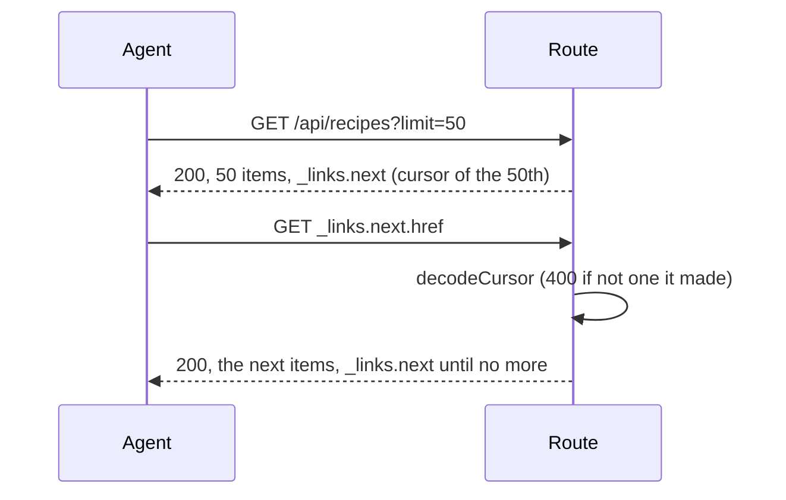

# pagination

Cursor pages and sorting for lists of any size, so every list pages the same way: HAL with its items under `_embedded.<name>`, `count` on the page, `total` only when it is cheap, and `_links.next` until there is no more.

## Use it when

- A route answers a list that can grow past one page, or that can change between two calls.
- A list sorts by fields an agent picks (`sortBy`, `order`).

## Don't use it when

- The list is small and held in memory: STANDARD §4 lets it page by `page`/`perPage` with `first`/`prev`/`next`/`last`
  links and the same item shape. The kit has no helper for that; build the links with core's `linksOf` and `pathWith`.

## Add it

```bash
npx @escalay/kit add pagination
```

Needs `core`, which comes with it.

## Wire it

```ts
import { cursorQuery, decodeCursor, limitQuery, pageOf, pageSchema, sortQuery } from './kit/index.js'

request: { query: z.object({ limit: limitQuery({ fallback: 50 }), cursor: cursorQuery, ...sortQuery(['newest', 'name'], 'newest') }) },
responses: { 200: { content: { [HAL_JSON]: { schema: pageSchema('RecipePage', 'recipes', RecipeSchema, 'Recipes, newest first.') } }, description: 'Recipes.' } },

const after = decodeCursor(query.cursor, z.object({ id: z.string() }))           // 400 on a cursor it didn't make
const rows = await repo.after(after?.id ?? '', limit + 1)                         // one extra row says there is more
return c.json(pageOf({ origin, path: c.req.path, query, name: 'recipes', items: rows.slice(0, limit).map(card),
  next: rows.length > limit ? { id: rows[limit - 1]!.id } : null }), 200)
```

### A cursor that pages right under any sort

Under a sort, the cursor holds the last row's sort value and its id (`{ sortValue, id }`): rows that tie on the value
are told apart by the id, so no row is skipped or shown twice. It also holds the sort it was made under, so a cursor
from another sort is a 400. `test/pagination.test.ts` runs this example.

```ts
// repo.ts: the rows after a cursor, under any sort
const SORTS = {
  newest: { column: recipes.createdAt, natural: 'desc', valueOf: (row: Recipe) => row.createdAt },
  name: { column: recipes.name, natural: 'asc', valueOf: (row: Recipe) => row.name },
} as const

export const recipesAfter = (db: Db, { sortBy, order, after, limit }: { sortBy: keyof typeof SORTS; order?: 'asc' | 'desc'; after?: { sortValue: string; id: string }; limit: number }) => {
  const { column, natural } = SORTS[sortBy]
  const [past, by] = (order ?? natural) === 'desc' ? [lt, desc] : [gt, asc]
  return db.select().from(recipes)
    .where(after ? or(past(column, after.sortValue), and(eq(column, after.sortValue), past(recipes.id, after.id))) : undefined)
    .orderBy(by(column), by(recipes.id))
    .limit(limit + 1)
}

// handlers.ts
const sort = `${query.sortBy}:${query.order ?? ''}`
const after = decodeCursor(query.cursor, z.object({ sort: z.literal(sort), sortValue: z.string(), id: z.string() }))
const rows = await recipesAfter(db, { sortBy: query.sortBy, order: query.order, after, limit: query.limit })
const last = rows[query.limit - 1]
return c.json(pageOf({ origin, path: c.req.path, query, name: 'recipes', items: rows.slice(0, query.limit).map(card),
  next: rows.length > query.limit && last ? { sort, sortValue: SORTS[query.sortBy].valueOf(last), id: last.id } : null }), 200)
```

## Options

| Option | Type | Default | What it does |
|---|---|---|---|
| `limitQuery({ fallback })` | number | 20 | a page's size when `limit` is left out |
| `limitQuery({ max })` | number | 200 | the largest `limit` accepted (more is a 400) |
| `sortQuery(fields, fallback)` | string[], string | required | the fields `sortBy` takes, and the one used when it is left out; `order` is `asc` or `desc`, each field's natural order when left out |
| `pageOf({ total })` | number | left out | the whole list's size: give it only when it is cheap to count |

## Exports

| Export | What |
|---|---|
| `limitQuery({ fallback, max })`, `cursorQuery`, `sortQuery(fields, fallback)` | the query parameters, described (`sortQuery` gives `sortBy` + `order`) |
| `pageOf({ origin, path, query, name, items, next, total })` | the page, with `_links.next` carrying the encoded cursor |
| `pageSchema(component, name, item, description)` | the page's OpenAPI schema |
| `encodeCursor` / `decodeCursor(cursor, schema)` | opaque cursors (base64url JSON), validated on the way in |

## Flows



## Rules

- Cursors, not page numbers, when the data can change between calls: rows inserted mid-read never shift a page.
- An agent follows `_links.next.href` until it is absent; it never builds a cursor itself.
- Fetch one row more than the page (`limit + 1`): it says there is a next page without counting.
- Standard: `docs/STANDARD.md` §4

## Failure modes

| The caller sees | Why |
|---|---|
| 400 `bad_request` on `cursor` ("The cursor is not one this API issued (or it belongs to another list)") | the cursor isn't base64url JSON, or fails the route's schema: made by hand, cut short, or from another list or sort |
| 400 on `limit` | below 1 or over `max` |
| 400 on `sortBy` or `order` | a field the route doesn't list, or an order other than `asc`/`desc` |

## Limits

- A cursor is base64url JSON the route chooses, at most 2048 characters (`cursorQuery`): keep it to a sort value and an
  id.
- `total` costs a count of the whole list: leave it out when that is not cheap.
- Runs wherever core runs: Node and Workers.

## Tests

- `lintOpenApi` (testing part) checks every documented parameter has a description.
- `test/pagination.test.ts` pages the keyset example above through every sort; `test/kit.test.ts` pages a sample API.

## Upgrading

What changed between kit versions, and what to do: [docs/upgrading.md#pagination](https://github.com/escalay/api-kit/blob/main/docs/upgrading.md#pagination).
