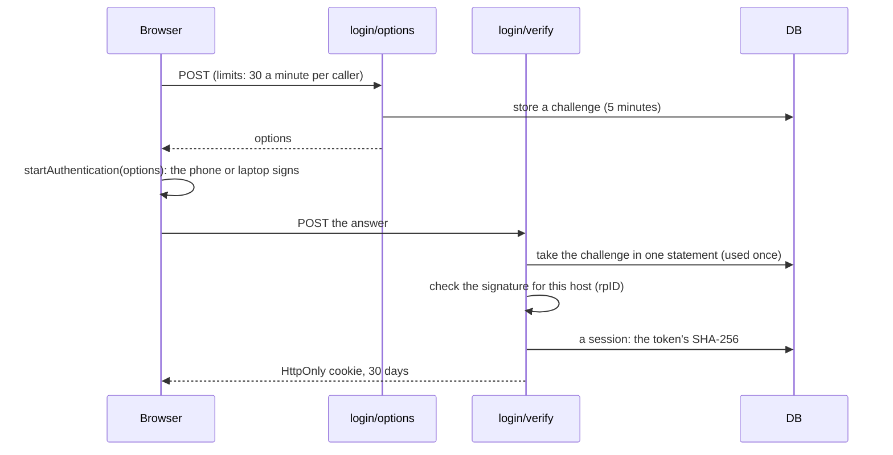
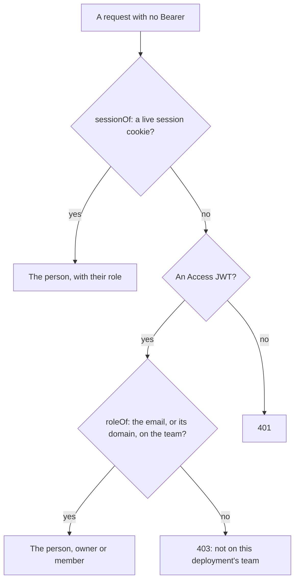

# people

The owner and the members of a deployment, how each signs in, and the team: the owner signs in with a **passkey** (made after claiming the deployment through the `setup` part), members come through **Cloudflare Access**, which proves their email, and this part decides whether that email is on the team and with which role; a signed-in browser holds a random token in an HttpOnly cookie, and only its SHA-256 is stored.

## Use it when

- A deployment someone runs for themselves needs an owner who signs in without Access (a passkey).
- Several people share a deployment: members by email or by domain, with roles (owner, member).
- The OAuth part's `owner` should be the person signed in by passkey (`personOf`).

## Don't use it when

- Only machines call the API: keys are enough (`keys`, `API_KEYS`).
- Every person sits behind Access and needs no role: `access` alone lets every Access email in.

## Add it

```bash
npx @escalay/kit add people setup
```

Needs `db`, `mcp` (for the tools), and `@simplewebauthn/server` 14 (runs on Node and workerd; the kit's workers test
proves it). The owner's first passkey comes through `setup`.

## Wire it

```ts
const fixedKeys = [...parseApiKeys(env.API_KEYS).values()]
const app = createAgentApi({ …, tags: [...tags, PEOPLE_TAG, SETUP_TAG], auth: {
  realm, keys, open: [...PEOPLE_OPEN_PATHS, ...SETUP_OPEN_PATHS], session: sessionOf(db),
  access: access && { ...access, roleOf: roleOf(db) },
} })
const guards = await dbGuardStore(db)
await registerPeople(app, { db, rpName: 'Postbox', fixedKeys, limits: { store: guards, address: { header: 'cf-connecting-ip' } }, onTeamChange: (change, c) => log('team', change), onPasskeyChange: (change, c) => log('passkey', change) })
await registerSetup(app, { db, code: env.SETUP_CODE, guards, fixedKeys, steps })
// MCP: tools: [...featureTools, ...teamTools()]
// The browser: @simplewebauthn/browser's startRegistration / startAuthentication with `options`, then post the answer
// OAuth: owner: async (c) => { const person = await personOf(c, db); return person?.role === 'owner' ? person.email : null }
```

Routes:

```
GET    /api/session                                   who this browser is signed in as (never needs a key)
DELETE /api/session                                   sign out
POST   /api/session/passkeys/register/options|verify  add a passkey: signed in, or with an enrolment from setup
POST   /api/session/passkeys/login/options|verify     sign in with a passkey, for 30 days
GET    /api/session/passkeys · DELETE …/{id}          your passkeys
GET    /api/team · POST · PATCH|DELETE …/people/{id} · DELETE …/domains/{domain}   the team (writes: admin only)
```

## Options

`registerPeople(app, options)`:

| Option | Type | Default | What it does |
|---|---|---|---|
| `db` | `Db` | required | the app's database; the people tables are migrated into it |
| `rpName` | string | required | the name a passkey prompt shows (`Postbox`) |
| `fixedKeys` | string[] | none | the names of the keys in `API_KEYS`: they may change the team like the owner |
| `sessionPath`, `teamPath` | string | `/api/session`, `/api/team` | where the routes live; keep `PEOPLE_OPEN_PATHS` in step if you change the first |
| `cookie` | string | `session` | the cookie's name, prefixed `__Host-` on https |
| `tag` | string | `People` | the routes' OpenAPI tag |
| `limits` | `{ store, address? }` \| false | false | 30 calls a minute to the two options routes together, per caller (below) |
| `onTeamChange` | `(change, c) => void` | none | hears each change to the team |
| `onPasskeyChange` | `(change, c) => void` | none | hears each passkey added or removed |

## Exports

| File | What |
|---|---|
| `schema.ts` | `people`, `team_domains` (`teamDomains`), `passkeys`, `sessions` (indexed by person), `webauthn_challenges`, and `PEOPLE_MIGRATIONS` |
| `repo.ts` | `peopleRepo`: the only queries (people, domains, passkeys, sessions, challenges, `sweep`) |
| `session.ts` | `startSession`, `endSession`, `personOf`, `sessionOf` (for `auth.session`), `roleOf` (for `access.roleOf`), `isAdmin`, `startEnrolment` (with its purpose: `claim` or `recovery`), `SESSION_DAYS` |
| `routes.ts` | `peopleRoutes`: the session, the passkey ceremonies, your passkeys, the team; `PersonSchema` |
| `handlers.ts` | `peopleHandlers`: request → repo → HAL; the WebAuthn checks |
| `names.ts` | `passkeyBaseName`, `distinctName`: a passkey's name from the device and browser |
| `tools.ts` | `teamTools`: `list_team`, `add_to_team`, `change_team_role`, `remove_from_team` |
| `index.ts` | `registerPeople`, `PEOPLE_TAG`, `PEOPLE_OPEN_PATHS` |

## Flows

Signing in with a passkey:



Who a person is, on every request:



## Rules

- Passkeys are bound to the host (`rpID` = the request's hostname). A new domain means new passkeys: recover through
  setup, or sign in through Access and add one.
- A cookie write must come from the same site (`Sec-Fetch-Site`, else `Origin`); other sites can't post through it.
- Each challenge is used once and expires in 5 minutes; an enrolment (from setup) in 15. A valid enrolment is used
  for its person even in a browser that is still signed in, so a recovery made there completes and is told as one.
- A challenge is taken in one statement, so two verifies of it sent together sign in once.
- Expired challenges and sessions are swept from the writes that add them, at most once a minute per database
  (`sweep` in the repo is that delete).
- `limits` (default `false`: none) allows 30 calls a minute to the two options routes together, per caller: a signed-in
  person by their email, anyone else by address (`addressOf`, from `address`, default the app's
  `createAgentApi({ address })`). Past it: 429 with `Retry-After`, and nothing stored. Each anonymous call stores a
  challenge for 5 minutes, so an app whose sign-in page is open to anyone passes `limits` (on Workers with
  `dbGuardStore(db)`, so every isolate shares the count).
- A new passkey is named after the device and browser it was made in (`Mac · Chrome`, from the user agent) unless the
  person posts a name of their own; a bare device word (`Mac`, `This device`) counts as none. Two of a person's passkeys
  never share a name: the later one is numbered (`Mac · Chrome (2)`).
- Team writes are admin only (`isAdmin`: the owner, or a key from `API_KEYS`). The last owner stays an owner, and an
  owner keeps at least one passkey.
- Registering the part changes Access for the app only when `access.roleOf` is passed: then emails off the team get 403.
- `onTeamChange` hears each change to the team (`{ who, from, to, by, notify }`: an email or `@domain`, the role before and
  after, null when off the team; `notify`, for a person just added, is false when the caller asked that they not be told);
  an unchanged role or a domain already listed is not a change. Log it with the app's events, and send any invite from it.
  It is told once the change is made, and a hook that throws is logged, never answered: the change stays made.
- `onPasskeyChange` hears each passkey added or removed (`{ action, who, id, name, by, via }`: `who` is the email it
  belongs to, `name` the device and browser it was made in unless its person named it, `via`, for one added, how its
  maker got in: `session`, or an enrolment from `claim` or `recovery`). It is told once the passkey and the session
  exist, and a hook that throws is logged, never answered: the passkey stays made. Passkeys removed with their person are a team
  change, not told here. Log it, and alert the person from it: a passkey they did not add is someone else's way in.
- Standard: `docs/STANDARD.md` §7

## Failure modes

| The caller sees | Why |
|---|---|
| 400 "This challenge expired or was used: ask for new options." | the challenge is older than 5 minutes, or a verify already took it |
| 400 "The passkey could not be checked" | the WebAuthn answer failed its checks (origin, signature, challenge) |
| 401 "This passkey is not known here" | a passkey made on another host, or never registered: recover on `/setup` |
| 401 "This enrolment has expired or was used" | the enrolment from setup is older than 15 minutes, or spent: claim or recover again |
| 401 "Sign in first, or start from /setup with an enrolment" | adding a passkey with no session and no enrolment |
| 403 "Passkeys belong to a person" | a key or token managing passkeys: sign in in a browser |
| 403 "Only the owner (or a key from API_KEYS) can change the team" | a member or another caller writing the team |
| 403 "not on this deployment's team" | an Access email `roleOf` doesn't find, by email or domain |
| 403 on a write with the cookie | the write came from another site |
| 409 "This is the last owner" / "This is your last passkey" | the team keeps an owner, and an owner a passkey |
| 409 "… is already on the team" | adding an email that is on it: change their role instead |
| 429 with `Retry-After` | past `limits` on the options routes |

## Limits

- Passkeys work only on the host they were made on.
- Sessions last 30 days (`SESSION_DAYS`); each is one row, swept once expired.
- Without `limits`, every anonymous options call stores a challenge row for 5 minutes.
- Node and Workers (`@simplewebauthn/server` runs on both).

## Tests

- `softAuthenticator()` (testing part) answers the ceremonies the way a phone would, so the whole flow runs in CI:
  claim → `register(options, origin)` → verify → `login(options, origin)` → verify.
- `toolsRun` (testing part) runs the team tools.
- `test/people.test.ts`: the claim, passkeys, sessions, races, sweeping, limits, the team, the hooks;
  `test/workers/races.test.ts` races the single statements on D1.

## Upgrading

What changed between kit versions, and what to do: [docs/upgrading.md#people](https://github.com/escalay/api-kit/blob/main/docs/upgrading.md#people).
