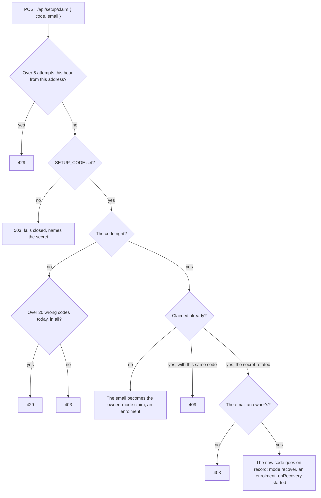

# setup

Claiming a fresh deployment, getting back into it, and the checklist of what the deploy could not do by itself: the setup code is a secret typed into the deploy form (`SETUP_CODE`), and the first person to send it becomes the owner and gets an enrolment to make their passkey (`people` part).

## Use it when

- People deploy the app for themselves (a Deploy to Cloudflare button, a container) and the first one in must become
  the owner.
- The owner may lose their passkey: rotating the secret lets them back in.
- The deploy leaves steps the app can check (a domain, a binding, a key): a checklist that checks them for real.

## Don't use it when

- The owner signs in only through Access: Access already proves who they are.

## Add it

```bash
npx @escalay/kit add setup
```

Needs `people` (and through it `db`), and a `GuardStore` for the attempt counts (`dbGuardStore(db)`).

## Wire it

```ts
await registerPeople(app, { db, rpName: 'Postbox', fixedKeys })
await registerSetup(app, { db, code: env.SETUP_CODE, guards: await dbGuardStore(db), fixedKeys, onRecovery: (recovery, c) => log('recovery', recovery), steps: [
  { id: 'domain', title: 'Choose the mail domain', why: 'Addresses are made on it.', minutes: 1,
    check: async () => ({ ok: domains.length > 0, detail: domains.join(', ') || 'None set.', fixUrl: '…' }) },
] })
```

### In an app made by `kit init`

`npx @escalay/kit add people setup --wire` writes all of this, `SETUP_CODE` in every file that lists the settings (in
an app made before its markers it prints the edits instead). By hand: a feature of its own, listed in `src/features/index.ts` after `people` (whose README has its feature and the lines in
`src/app.ts`); `Env` in `src/app.ts` gains `SETUP_CODE?: string`, a secret like the others:

```ts
// src/features/setup/index.ts, listed in src/features/index.ts after people
import { dbGuardStore, parseApiKeys, registerSetup, SETUP_MIGRATIONS, SETUP_TAG } from '../../kit/index.js'
import type { Feature } from '../index.js'

export const feature: Feature = {
  name: 'setup', // the name its steps migrate under
  tag: SETUP_TAG,
  migrations: SETUP_MIGRATIONS,
  register: async (app, { db, env }) => registerSetup(app, { db, code: env.SETUP_CODE, guards: await dbGuardStore(db), fixedKeys: [...parseApiKeys(env.API_KEYS).values()], steps: [] }),
  tools: [],
  samples: async () => ({}),
}
```

Then post the enrolment to `/api/session/passkeys/register/options` and `/verify` (see `people`). Routes:

```
GET  /api/setup            { claimed, codeSet, recovery } (never needs a key)
POST /api/setup/claim      { code, email } → { mode: claim|recover, enrolment }: the enrolment goes to people's register/options
GET  /api/setup/checklist  { done, total, _embedded: { steps } }: every step, checked now (admin only)
```

### A step for a feature that can be switched off

A step that sets up a switchable feature (sending, a model) answers `switchedOff: true` while that feature is off:
it is listed, says so, and is counted neither as done nor as left.

```ts
check: async () => ((await flags.isOn('sending')) ? checkSending() : { ok: false, detail: 'Switched off under Features.', switchedOff: true })
```

## Options

`registerSetup(app, options)`:

| Option | Type | Default | What it does |
|---|---|---|---|
| `db` | `Db` | required | the app's database; `setup_state` is migrated into it |
| `code` | string \| undefined | required | the setup code from the environment (`env.SETUP_CODE`); unset, every claim is refused |
| `steps` | `SetupStep[]` | required | the checklist: `{ id, title, why, minutes, optional?, check }` |
| `guards` | `GuardStore` | required | where claim attempts are counted (`dbGuardStore(db)`: every instance shares it) |
| `fixedKeys` | string[] | none | the names of the keys in `API_KEYS`: they may see the checklist like the owner |
| `path` | string | `/api/setup` | where the routes live |
| `tag` | string | `Setup` | the routes' OpenAPI tag |
| `onRecovery` | `(recovery, c) => void` | none | hears an owner getting back in: `started`, then `completed` |

## Exports

| File | What |
|---|---|
| `schema.ts` | `setup_state` (`setupState`: one row once claimed: when, by whom, the hash of the code used) and `SETUP_MIGRATIONS` |
| `routes.ts` | `setupRoutes`: status, claim, checklist |
| `index.ts` | `registerSetup`, `SetupStep`, `Recovery`, `SETUP_TAG`, `SETUP_OPEN_PATHS` |

## Flows

A claim:



## Rules

- **Fails closed:** with no code set, every claim is refused (503, naming the secret to set).
- Attempts are limited: every attempt counts at its address, 5 an hour (429, even for the right code); wrong codes
  count in all, 20 a day (past it a wrong code is 429, not 403). A wrong code is 403. The address is read from the
  source the app names with `createAgentApi({ address })` (`addressOf`, core README); without one, as sent.
- **The right code always gets through the day's count**: only wrong codes fill it, so nobody can spend it and lock
  the owner out of claiming. The threat that leaves: a guesser spread over many addresses is held back only by the
  per-address limit and the code's length, so the code is long and random (the deploy form's is). What can still
  refuse the right code is its own address's 5 an hour: where every caller shares one address (no named source, so the
  `local` bucket), anyone can fill it, so name the source (`address: { header: 'cf-connecting-ip' }` behind
  Cloudflare).
- A claimed deployment answers its own code with 409. A **different** code (the secret was rotated) opens recovery
  for an existing owner's email, once: it becomes the code on record.
- The enrolment is shown once: Idempotency-Key never keeps it (`showOnce`, core), so a retry with the same key is a
  409 `shown_once` saying to rotate the code to get back in.
- `onRecovery` hears an owner getting back in, in two stages (`{ stage, who, passkey }`): `started` when a rotated code
  is accepted for their email, `completed` when the enrolment it gave makes a passkey (named). Log both, and alert the
  owner on `started`: only someone holding the deployment's secrets can start one, and it may not be them. A hook
  that throws is logged, never answered: the rotated code is spent by then, so the owner still gets the enrolment.
  Why one hook named after the act: recovery is the word this part already uses (`recovery` in the status, `mode:
  recover`), and one hook with a `stage` keeps a started recovery and its end in one place, as `onKeyChange` does with
  its `action`. A recovery is not a change of state the app could ask for later, so it is not `onRecoveryChange`; and
  claiming is not covered, since the first owner is the one who reads the log.
- Each step's check runs on every look, with a 5 second limit; a throw or a timeout shows as not ok, never as a 500.
- Standard: `docs/STANDARD.md` §7

## Failure modes

| The caller sees | Why |
|---|---|
| 503 "No setup code is set" | `SETUP_CODE` is not set: nobody can claim until it is |
| 403 "That setup code is not right" | a wrong code |
| 429 "Too many setup attempts from here" | more than 5 attempts this hour from this address, right code or not |
| 429 "Too many wrong setup codes today" | more than 20 wrong codes today, from anywhere |
| 409 "This deployment is already claimed" | the code on record was sent again: to recover, rotate the secret and use the new code |
| 409 `shown_once` "This Idempotency-Key already opened setup" | a retry of a claim or recovery that was done: its enrolment was shown once |
| 403 "Recovery is for an owner" | a rotated code sent with an email that isn't an owner's |
| 403 on the checklist | the caller is not the owner or a key from `API_KEYS` |
| a step "The check took too long." or "The check failed: …" | its `check` ran over 5 seconds or threw |

## Limits

- The day's 20 wrong codes are counted in all, not per address: a flood of wrong codes holds back other wrong codes,
  never the right one.
- Where every caller shares one address bucket (`local`), anyone can fill the 5 an hour: name the address source.
- Node and Workers; the counts are shared only through a shared `GuardStore` (`dbGuardStore`).

## Tests

- `softAuthenticator()` (testing part) makes the owner's passkey from the claim's enrolment in CI.
- `test/people.test.ts`: the claim, the limits by address and the day's wrong codes, recovery and its hook, the
  checklist, a retried claim that never answers or stores the enrolment.

## Upgrading

What changed between kit versions, and what to do: [docs/upgrading.md#setup](https://github.com/escalay/api-kit/blob/main/docs/upgrading.md#setup).
