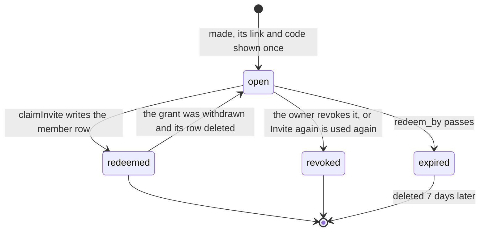
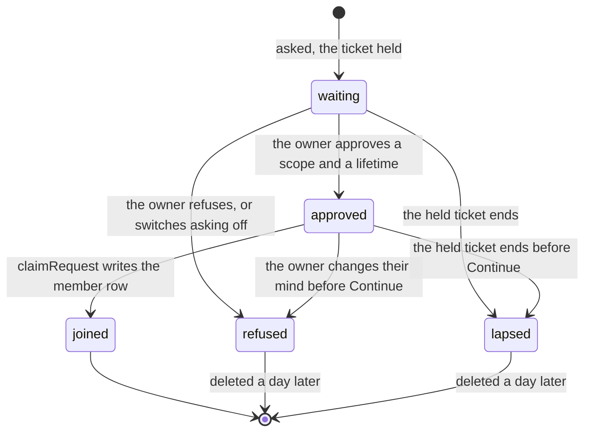
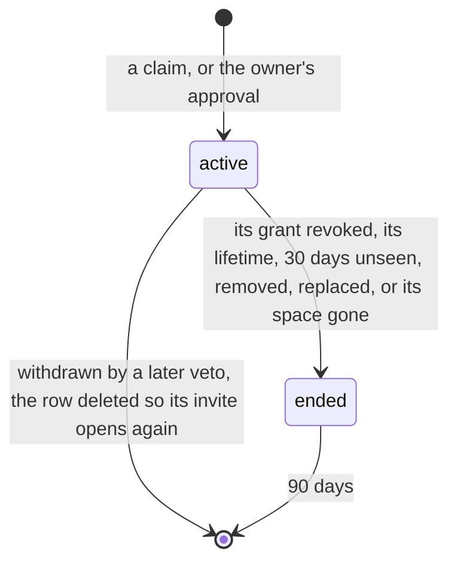

# sharing

Invites to a **space** (the part of an app that is shared: a shelf, a board, a project), asks to join, and the owner's approval, built on the oauth part's hooks. A **member** is one grant into one space: one app, signed in once, by invite, by ask or by the owner's approval. The part is being built in steps; so far it holds its tables, the only queries over them, the named states of its rows and its secrets, and nothing is wired into an app yet: until this README says it wires into `createOAuth`, an app that needs sharing builds it on oauth's `approve`, `complete` with `resource`, `holdTicket`, `onGrant` and `onRevoke`, keeping `docs/STANDARD.md` §23.

## Use it when

- People other than the owner, and their agents, should reach one part of the app (one space) and nothing else.
- The owner hands out single-use invites (a link and a typed code), or lets people ask to join and decides later.

## Don't use it when

- Only the owner and their own agents sign in: the oauth part alone does that (`src/kit/oauth/README.md`).
- A whole team reaches the whole app: the people part (members through Cloudflare Access, with roles).

## Add it

```bash
npx @escalay/kit add sharing
```

Needs `db`, `oauth`, `mcp` and `pagination` (and through them `core`). Imported from `./kit/sharing/index.js`. Runs on
Node and Workers.

## Wire it

```ts
import { migrate } from './kit/index.js'
import { sharingKeys, sharingRepo, SHARING_MIGRATIONS } from './kit/sharing/index.js'

await migrate(db, 'sharing', SHARING_MIGRATIONS)
const repo = sharingRepo(db)
// 32+ random bytes, its own entry in the app's secret store: never the OAuth signing key
const keys = sharingKeys(env.SHARING_SECRET)
```

## Options

`sharingKeys(secret)` and `sharingRepo(db)`:

| Option | Type | Default | What it does |
|---|---|---|---|
| `secret` | string | required | the app's sharing secret, 32 bytes or more; the four keys are derived from it (HKDF-SHA256: `sharing-link`, `sharing-code`, `sharing-cookie`, `sharing-address`). Rotating it voids open invites; members keep working |
| `db` | `Db` | required | the app's database (`openDb`), the same one as its OAuth state; `SHARING_MIGRATIONS` migrated into it |

## Exports

| File | What |
|---|---|
| `schema.ts` | the Drizzle tables `sharingSpaces`, `sharingInvites`, `sharingRequests`, `sharingMembers`, and `SHARING_MIGRATIONS` (step 1: the four tables and ten indexes); what each column means is in its JSDoc |
| `repo.ts` | `sharingRepo(db)`: every statement over the tables, nothing about HTTP (below) |
| `states.ts` | the named states: `inviteStateOf`, `requestStateOf`, `memberStateOf`, `memberListingOf`, `askingStateOf`; the times `redeemByOf`, `memberExpiresAtOf`, `REDEEM_WITHIN` (a day), `UNSEEN_FOR` (30 days), `UNANSWERED_PAUSE` (10) |
| `secrets.ts` | `sharingKeys`, `newLinkToken` (192 bits), `newInviteCode` (`BDKM-QXTW`, from `CODE_ALPHABET`), `normalisedCode`, `newShownCode` (6 digits), and what the tables keep instead: `linkHashOf`, `codeHashOf`, `addressKeyOf` (HMACs), `ticketHashOf` (SHA-256) |
| `index.ts` | re-exports the above |

`sharingRepo(db)`, by table:

| Table | Statements |
|---|---|
| `sharing_spaces` | `spaceAt`, `setAskToJoin` (clears a pause), `noteUnanswered`, `noteAnswered`, `forgetSpace` |
| `sharing_invites` | `addInvite` (null on a link or code hash already taken), `inviteAt`, `inviteByLink`, `inviteByCodeAt`, `inviteByCodeAnywhere` (only for a client that named no space), `listInvites`, `countOpenInvites`, `revokeInvite`, `revokeInvitesReplacing`, `revokeInvitesMadeByGrant`, `revokeInvitesMadeByClient`, `revokeInvitesOf` |
| `sharing_requests` | `addRequest` (null on a ticket that already asked), `requestAt`, `requestByTicket`, `listRequests`, `countWaitingAt`, `countWaitingFrom` (an address), `approveRequest`, `refuseRequest`, `refuseWaitingAt` |
| `sharing_members` | `claimInvite`, `claimRequest`, `addOwnerMember`, `memberByGrant`, `memberAt`, `listMembers`, `noteSeen`, `endMember`, `endMemberOfGrant`, `endMembersOfClient`, `endMembersOf`, `deleteMemberOfGrant` |
| aging | `endExpiredMembers`, `endLapsedMembers`, `deleteEndedMembers`, `deleteClosedInvites`, `deleteClosedRequests` |

## Flows

An invite (`inviteStateOf`). Redeemed is not a column: a member row holding its `invite_id` is.



An ask to join (`requestStateOf`). Joined is a member row holding its `request_id`.



A member (`memberStateOf`). Past its lifetime or unseen for 30 days it reads as ended before aging writes it.



## Rules

- **The claim is the insert.** `claimInvite` and `claimRequest` are one `insert … select … where` each: the member is
  written only while the invite is of the member's space, unrevoked, in time and unredeemed (the ask: approved, in
  time, unused). `invite_id`, `request_id` and `grant_id` are unique, so a racing second claim writes nothing and
  answers null, never throws. No statement uses a transaction: each holds on node:sqlite, libSQL and D1.
- **An id never crosses spaces.** Every statement taking an id a route names also takes the space
  (`and space_id = ?`): an id from one space is not found at another.
- **Ending is not deleting.** A removed, replaced or revoked member's row stays (ended, with its reason) until aging
  deletes it, so its invite never reopens; only a withdrawn grant's row is deleted (`deleteMemberOfGrant`).
- **States are named only through `states.ts`**, one rule per function; the repo's once-only statements check the
  same rules in SQL (an open invite, an unused ask, a listed member). A live row past its lifetime or unseen for 30
  days is ended (fail closed); the owner's list hides removed and replaced members and shows other ended ones as
  signed out.
- **No secret at rest.** The link token and the typed code are kept only as HMACs under their own derived keys, the
  asker's address only as an HMAC, the consent ticket only as a SHA-256; the link and code are shown once.
- The migration's SQL holds no comment and no quote: a step is split on `;` outside quotes.
- Standard: `docs/STANDARD.md` §7, §23

## Failure modes

| The caller sees | Why |
|---|---|
| `sharingKeys` throws "the secret holds N bytes" | the sharing secret is shorter than 32 bytes: make 32 random bytes of its own |
| `addInvite` answers null | its link or code hash is taken (a code collision): make a new token and code, and add again |
| `claimInvite` answers null | the invite is spent, revoked, past `redeem_by`, of another space, or the grant already has a member |
| `claimRequest` answers null | the ask is not approved, lapsed, of another space, or already joined |
| `approveRequest` or `refuseRequest` answers false | the ask is decided, joined, lapsed, or of another space |

## Limits

- Two instances on one database are safe: each decision is one statement.
- An invite's code: 8 letters from 20 (about 34.6 bits), redeemable for a day.
- Node and Workers, on any database `openDb` opens (node:sqlite, libSQL, D1).

## Tests

- `test/sharing.test.ts`: the migration's tables and indexes, every named state as a table, the secrets, both claims
  under a race, an id from one space at another for every by-id statement, and no table holding a secret.
- `test/workers/sharing.test.ts`: the migration and both claims on D1, the keys inside workerd.

## Upgrading

What changed between kit versions, and what to do: [docs/upgrading.md#sharing](https://github.com/escalay/api-kit/blob/main/docs/upgrading.md#sharing).
