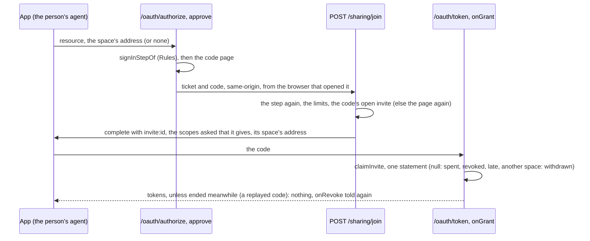
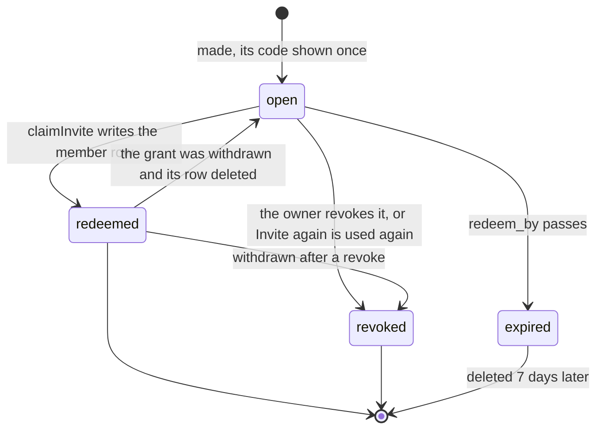
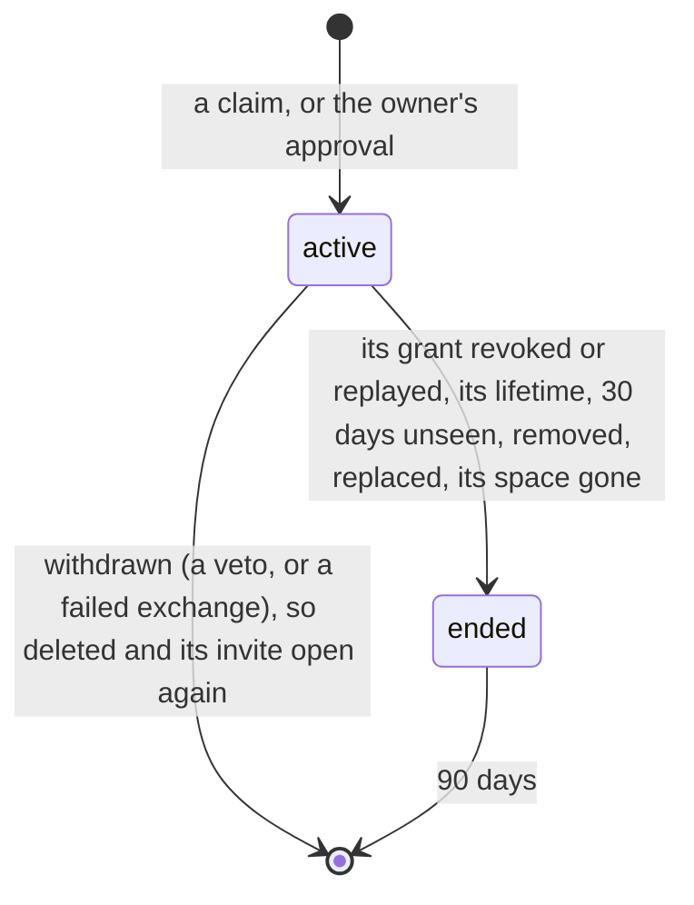

# sharing

Invites to a **space** (the part of an app that is shared: a shelf, a board, a project), and the owner's approval at a space, built on the oauth part's hooks. A **member** is one grant into one space: one app, signed in once, by invite or by the owner's approval. An invite joins by its code: the person's app connects at the space's address, and they type it on the page that opens. Not built yet: a page for an invite's link, and asking to join.

## Use it when

- People other than the owner, and their agents, should reach one part of the app (one space) and nothing else.
- The owner hands out single-use invites (a typed code), or approves an app at a space themselves.

## Don't use it when

- Only the owner and their own agents sign in: the oauth part alone does that (`src/kit/oauth/README.md`).
- A whole team reaches the whole app: the people part (members through Cloudflare Access, with roles).

## Add it

```bash
npx @escalay/kit add sharing
```

Needs `db`, `oauth`, `mcp` and `pagination` (and through them `core`). Imported from `./kit/sharing/index.js`. Runs on
Node and Workers.

## Wire it

An app made by `kit init` whose spaces are shelves (`kit feature shelves --singular shelf --fields "name:string"`);
`kit add sharing` prints the settings and the schedule it lacks. Each block names its file and place:

```ts
// src/features/shelves/spaces.ts, new: the shelves as spaces, each shelf's id its space's name
import type { Db } from '../../kit/index.js'
import { shelvesRepo } from './repo.js'

export const shelfSpaces = (db: Db) => {
  const byId = async (id: string) => {
    const row = await shelvesRepo(db).get(id)
    return row ? { id: row.id, name: row.id, title: row.name } : null
  }
  return { byName: byId, byId }
}
// src/features/shelves/index.ts, in place of the statements that start the same way: a deleted shelf ends its members
  register: async (app, { db, parts }) => {
    const handle = shelvesHandlers({ ...repo, remove: async (id) => { await repo.remove(id); if (parts.sharing) await parts.sharing.forget(id) } })
// src/features/shelves/index.ts, before `const handle`
    const repo = shelvesRepo(db)
// src/app.ts, after `import BRAND`
import { z } from '@hono/zod-openapi'
import { shelfSpaces } from './features/shelves/spaces.js'
import { mcpTool } from './kit/mcp/index.js'
import { createSharing, registerSharing, sharingTools, SHARING_OPEN_PATHS, SHARING_TAG, type Sharing } from './kit/sharing/index.js'
// src/app.ts, in place of the statements that start the same way (the realm and name stay the app's)
export type Parts = { sharing?: Sharing }
  const oauth = env.OAUTH_SIGNING_KEY ? createOAuth({ name: 'Shelves', signingKey: env.OAUTH_SIGNING_KEY, store: await dbOAuthStore(db), owner, reuseGraceSeconds: 30, ...(sharing && { publicOrigin: env.PUBLIC_ORIGIN, limits: { store: await dbGuardStore(db) }, ...sharing.oauth }) }) : undefined
    tags: [...FEATURES.map((feature) => feature.tag), ...(sharing ? [SHARING_TAG] : [])],
    auth: { realm: 'shelves', keys: parseApiKeys(env.API_KEYS), access, ...(sharing && { open: [...SHARING_OPEN_PATHS], relay: ['/mcp', '/a2a', sharing.relay] }) },
    guards: { store: await dbGuardStore(db), ...(sharing && { skip: sharing.neverKept }) },
  const parts: Parts = { sharing }
  const factory = mcpServerFactory({ info: { name: 'shelves', version: VERSION }, instructions: 'Shelves: read the guide at /llms.txt first.', tools: [...TOOLS, ...(sharing ? sharingTools({ noun: 'shelf' }) : [])], prompts, skills, callApi: inProcess(app) })
// src/app.ts, inside `export type Env`'s braces, at the end
SHARING_SECRET?: string; PUBLIC_ORIGIN?: string
// src/app.ts, before `const oauth`: on once its settings are, so createApp({ db, env: {} }) stays plain
  const sharing = env.OAUTH_SIGNING_KEY && env.SHARING_SECRET && env.PUBLIC_ORIGIN ? await createSharing({ db, secret: env.SHARING_SECRET, spaces: shelfSpaces(db), spaceOfPath: (path) => /^\/api\/shelves\/([^/]+)/.exec(path)?.[1] ?? null, owner, fixedKeys: [...parseApiKeys(env.API_KEYS).values()] }) : undefined
// src/app.ts, after `mountMcp(app, { factory`: the part's routes, and a shelf's own MCP
  if (sharing && oauth) await registerSharing(app, sharing, { oauth })
  if (sharing) mountMcp(app, { path: sharing.mcpPath, factory: mcpServerFactory({ info: { name: 'shelves', version: VERSION }, instructions: 'One shelf, shared with you.', tools: SHELF_TOOLS, callApi: inProcess(app) }), allowedHostnames: [env.PUBLIC_HOST ?? 'localhost', 'localhost', '127.0.0.1'] })
// src/app.ts, before `export const VERSION`
const SHELF_TOOLS = [mcpTool({ name: 'view_shelf', title: 'This shelf', description: 'The shelf this address shares.', input: z.object({}), call: (_, at) => ({ path: `/api/shelves/${encodeURIComponent(at?.params.space ?? '')}` }), summarize: (shelf: { name: string }) => shelf.name })]
// src/worker.ts and src/server.ts, after `import { openDb`
import { sharingOf } from './kit/sharing/index.js'
// src/worker.ts, after `fetch:`: wrangler.jsonc's "triggers": { "crons": ["17 * * * *"] } runs it hourly
  scheduled: (_event, env, ctx) => ctx.waitUntil(appOf(env).then(async (app) => { const sharing = sharingOf(app); if (sharing) await sharing.sweep() })),
// src/server.ts, after `serve(`: hourly
setInterval(() => void sharingOf(app)?.sweep().catch((error) => console.error('sharing sweep failed', error)), 3_600_000)
```

An app with its own four hooks (`mine`) chains them, its veto first so a refusal never spends an invite:
`createOAuth` takes `...chained(sharing, mine)` after `...sharing.oauth`. Behind Cloudflare Access it lets exactly
`sharingSignInPaths(sharing)` through.

```ts
// src/hooks.ts
import type { Sharing } from './kit/sharing/index.js'

type Hooks = Omit<Sharing['oauth'], 'resources' | 'resourceOf'>
export const chained = (sharing: Sharing, mine: Hooks): Hooks => ({
  approve: (c, ask) => (sharing.handles(ask) ? sharing.oauth.approve(c, ask) : mine.approve(c, ask)),
  onGrant: async (grant, c) => (await mine.onGrant(grant, c)) && (await sharing.oauth.onGrant(grant, c)),
  onRevoke: async (revoked) => { await sharing.oauth.onRevoke(revoked); await mine.onRevoke(revoked) },
  accepts: async (caller, c) => { const judged = await sharing.oauth.accepts(caller, c); return judged === true ? mine.accepts(caller, c) : judged },
})
```

## Options

`createSharing(options)`; `sharingTools({ path, noun })` takes the same `path` and the word for a space.

| Option | Type | Default | What it does |
|---|---|---|---|
| `db` | `Db` | required | the app's database, its OAuth state's too; `registerSharing` migrates `SHARING_MIGRATIONS` into it |
| `secret` | string | required | 32 bytes or more, three keys derived from it (HKDF-SHA256). Rotating it voids open invites, not members |
| `spaces` | `{ byName(name), byId(id) }` | required | the app's space by the name in its address, and by id: `{ id, name, title }` (`Space`), or null. Ids are never reused |
| `spaceOfPath` | `(path) => string \| null` | none | the space an `/api` request is about (an MCP tool's in-process call), from its path alone. Without it a space token reaches no `/api` route |
| `owner` | `(c) => Promise<string \| null>` | required | the signed-in owner's email, or null: the same function the app gives `createOAuth` |
| `fixedKeys` | string[] | `[]` | names of keys from `API_KEYS` that may share |
| `resourcePath` | string | `'/s/{space}/mcp'` | the space's MCP address: one whole `{space}` segment with a segment after it; `relay` and `mcpPath` come from it |
| `spaceName` | RegExp | `/^[a-z0-9][a-z0-9-]{0,62}$/` | what a space's name looks like, checked before any lookup |
| `path` | string | `'/api/spaces'` | where the owner routes live: `{path}/{space}/…` |
| `knownReturns` | `{ name, callback }[]` | `[]` | the apps it expects, by exact callback (https, or a custom scheme it trusts): named, not warned of. A loopback http redirect is always known |
| `limits` | `{ store?, address? }` | `{ store: await dbGuardStore(db) }` | where typed codes are counted, and how the address is read; always on (`false` throws) |
| `signInPath` | string | none | where the owner signs in, linked from "Sign in first" |
| `tag` | string | `'Sharing'` | the routes' OpenAPI tag (`SHARING_TAG` declares it) |

## Exports

| File | What |
|---|---|
| `index.ts` | `createSharing` (`relay`, `mcpPath`, `neverKept`, `config`; the hooks `oauth`; `bind`, `handles`, `memberOf`, `sweep`, `forget`), `registerSharing`, `sharingOf` (the part an app registered, for its scheduled handler), `SHARING_TAG`, `SHARING_OPEN_PATHS`, `sharingSignInPaths`, and re-exports the files below |
| `grants.ts` | the hooks but `approve` (Rules); `boundOf`, `appNameOf`, `isRootAudience`, `spaceNameIn`, `ONLY_ITS_SPACE`, `MemberView` |
| `signin.ts`, `owner.ts` | `approve`, `signInStepOf` (the ladder), `POST /sharing/join`; the owner's `POST /sharing/as-owner` and `/sharing/owner` |
| `pages.ts`, `limits.ts`, `sweep.ts` | the pages; the code's limits; `sweep`, `forget` |
| `routes.ts`, `handlers.ts`, `tools.ts` | `sharingRoutes` (below), `PLAIN_TEXT` (the label rule); `sharerOf` (`Sharer`); `sharingTools` |
| `schema.ts` | the tables `sharingInvites`, `sharingMembers`, and `SHARING_MIGRATIONS` (step 1: two tables, seven indexes); each column's meaning in its JSDoc |
| `repo.ts` | `sharingRepo(db)`: every statement over the tables, nothing about HTTP |
| `states.ts` | `inviteStateOf`, `memberStateOf`, `memberListingOf`; `redeemByOf`, `memberExpiresAtOf`, `REDEEM_WITHIN` (a day), `UNSEEN_FOR` (30 days), `MAX_OPEN_INVITES` (100) |
| `secrets.ts` | `sharingKeys`, `newLinkToken` (192 bits), `newInviteCode` (`BDKM-QXTW`, from `CODE_ALPHABET`), `normalisedCode`; what the tables keep instead: `linkHashOf`, `codeHashOf`; what the limits count by: `addressKeyOf` (an HMAC), `ticketHashOf` (SHA-256) |

The owner routes, each with its operationId, tool, command and answers: [REFERENCE.md](REFERENCE.md).

## Flows

Joining with a code: the invite is spent at the token exchange, never at the click.



The owner approving an app at a space, and Invite again: [REFERENCE.md](REFERENCE.md).

An invite (`inviteStateOf`). Redeemed is not a column: a member row holding its `invite_id` is.



A member (`memberStateOf`). Past its lifetime or unseen for 30 days it reads as ended before `sweep` writes it.



## Rules

- **Which tokens the part judges** (`onGrant`, `accepts`):

  | Token | `onGrant` | `accepts` |
  |---|---|---|
  | no audience, the root, the root's MCP (`isRootAudience`) | yes, untouched; no if a sharing page made it | everywhere |
  | a space, from the part's pages (`data.sharing`) | the claim writes the member, or no | its member's space only, while it lives |
  | any other (a space by a device grant or the kit's page, the app's own resource) | no: withdrawn | refused |

- **The ladder** (`signInStepOf`), for a sign-in the part `handles`: what it asks for and whether the owner is signed in
  pick the kit's consent page, the code page, the owner's page, or none ([REFERENCE.md](REFERENCE.md)).
- **The pages name the return**: an app on this computer (loopback http), a `knownReturns` name (exact), or else
  "This app returns to <host>" (a custom scheme by its scheme). Each that approves says "This connects the app signed
  in in this browser."; all are escaped, `no-store`, `noindex`, unframed, script-free, `form-action` here and the return.
- **Every post works the step out again** from the ticket this browser holds (same-origin first), never a hidden field.
  `POST /sharing/join` completes only with an open invite of the asked space (any space, for a client that named
  none); the owner's posts ask `owner(c)`, then `byName`. None ever completes a root grant.
- **The owner's one click names its grant**: scopes always explicit, what was asked that the ticks give (Allow changes
  only narrows), and 30 days unless Until revoked is ticked. At a known return both boxes start ticked (what was asked,
  until revoked); at any other, unticked (read, 30 days).
- **A member is its row.** `accepts` finds it by the token's grant, its space by `byId`, and compares that space's
  name now with the request's (its path at a space address, else `spaceOfPath`): a renamed space keeps its members,
  its old name opens nothing. Out of place: `ONLY_ITS_SPACE`, whether or not the asked space exists. Past its
  lifetime or 30 days unused, refused anywhere, saying why; a use is noted at most once an hour.
- **A grant never holds more than was given:** an invite's approver `invite:<id>` and scopes within the invite's; the
  owner's `owner:<email>` (never the bare email: never the owner's token), the resource's space id, a lifetime the part
  has.
- **`onRevoke` mirrors the kit**: `withdrawn` (a veto, or anything failing after `onGrant`'s yes) deletes its row, so
  its invite opens again; `client_revoked` ends the client's rows, any other end the grant's. Then, unless withdrawn,
  an agent's open invites under that grant or client are revoked; its joiners keep access. Told twice, nothing moves.
- **The owner's reason is closed first**: Remove, Invite again joining, `sweep` and `forget` end the row (`removed`,
  `replaced`, `expired`, `lapsed`, `space_gone`), then `revokeGrant`; Remove first revokes its invites, Invite again's
  too. The list hides removed and replaced members and shows other ended ones as signed out.
- **`resources` is a pure check of the path** (`spaceNameIn`): cased, encoded and dotted names are no space.
  `handles(ask)`: whether a sign-in is the part's (a space, the root or its MCP). A client's name is its own claim,
  kept after `appNameOf` (no control, bidi or zero-width character, 80 at most).
- **Who may share** (`sharerOf`): the owner signed in (never a team `member`), a key in `fixedKeys`, or an agent with
  a root token from a known grant: 7 or 30 days only, its client and grant on the record.
- **Nothing says whether a space exists.** Anyone who may not share, a name `spaceName` refuses and a space `byName`
  doesn't find all get the same 404 with the same body; an id from another space is the same 404 as a made-up one
  (every by-id statement takes the space). The code page never names the space.
- **Shown once means never kept.** `createInvite` and `inviteAgain` answer through `showOnce`, `no-store` (a retry
  with the same Idempotency-Key: 409 `shown_once`); `neverKept` (`/sharing/*`) keeps the pages' answers out too.
- **Never through A2A.** `sharingTools` go to the owner's MCP only. Each acts only on the user's word, and
  `create_invite` and `invite_again` return the message to send, never send it.
- **The claim is the insert**: `claimInvite` is one `insert … select … where` (unique `invite_id`, `grant_id`), as
  `addInvite` holds the cap. No transaction.
- **A revoke is always recorded**, whatever member holds it: a revoked invite never reopens.
- **No secret at rest**: codes, link tokens and addresses as HMACs, tickets as SHA-256. The migration's SQL holds no comment
  or quote.
- Standard: `docs/STANDARD.md` §7, §23

## Failure modes

| The caller sees | Why |
|---|---|
| `createSharing` throws | a secret under 32 bytes; a `resourcePath` without one whole `{space}` segment before another; `limits: false` |
| `registerSharing` throws "needs publicOrigin" | the app's `createOAuth` has none |
| `sweep` or `forget` throws "call registerSharing first" | called before the part is bound |
| the page "Use the address in your invite" | a client named the owner's whole app: no invite binds it |
| the code page again, "not one of ours" (400) | no open invite of the asked space (or, for a client that named none, of a space the app has) |
| `access_denied` at the app | the fifth wrong code on one sign-in, or the owner's Refuse |
| 429 page "Too many codes" | this address's codes, in all or at this space, or the space's 600 (Limits) |
| 403 page "Not allowed" | a post from another site, of a sign-in these pages don't approve, or Approve without the owner |
| 400 page "expired", "refused", "already joined" | the ticket ran out, is another browser's, or was answered |
| the code page, "asks only to make changes" | a client asking only `write`, at a read invite |
| the owner page again (400) | Allow changes for an app that asked to read, or a write-only app without it |
| 404 page "No space … here" | the owner at a name `byName` misses |
| 401 page "Sign in first" | Continue as the owner without the owner signed in |
| 503 page "not ready" | `approve` before `registerSharing` |
| 404 "No space … here that you may share" | the caller may not share, or the name is not a space (always the same body) |
| 404 "No member …" | removed, replaced, another space's, or made up |
| 400 on `createInvite`, `inviteAgain` | a label empty, over 80 or not plain text (`PLAIN_TEXT`); an agent giving `until_revoked` |
| 409 on `createInvite`, `inviteAgain` | 100 open at the space, or `shown_once` |
| 409 on `revokeInvite` | the invite was used already: revoked all the same, its member keeps access |
| 400 `invalid_grant` "withdrawn" | `onGrant` said no: a space grant not from the part's pages, an invite not open at its space, more than it gives, a sharing approval at the root, or before `bind` |
| 401 "works only at its own space" | a live space token anywhere but its space's name now, or a space `byId` misses |
| 401 "ended on …", "lapsed", "not ready" | its lifetime passed; 30 days unused; a token with an audience before `bind` |
| 500 at `/oauth/token`, the invite open again | a throw after the claim: the kit withdraws the grant, so the row goes |
| a member who never got in, its code spent | the withdraw could not land (`onRevoke` failed, or a crash): the row lapses |

## Limits

- 100 open invites per space; lists 50 a page by default, 100 at most.
- An invite's code: 8 letters from 20 (about 34.6 bits), redeemable for a day. Typed codes: 10 a minute per address,
  10 per 10 minutes per address at a space (`any` for a client that named none), then 600 per 10 minutes per space,
  5 wrong per sign-in; never the owner's. One address spends only its own budget; codes from about 60 addresses
  reach the 600, locking the space's invitees out for the window. Set the app's `address`, or each post names its own.
- `sweep` deletes members 90 days ended, invites 7 days closed.

## Tests

- In the app: `connectAgent` (testing) signs an invitee's agent in, the code typed through `approveSignIn`'s `form:
  { action: '/sharing/join', fields: { code } }`, then calls `view_shelf` at the invite's `address`.
- The kit's own: `test/sharing*.test.ts` (tables, owner, grants, sign-in, members, the app end to end over
  `test/sharing-fixture.ts`), and the grants contract on D1 in `test/workers/sharing.test.ts`.

## Upgrading

What changed between kit versions, and what to do: [docs/upgrading.md#sharing](https://github.com/escalay/api-kit/blob/main/docs/upgrading.md#sharing).
