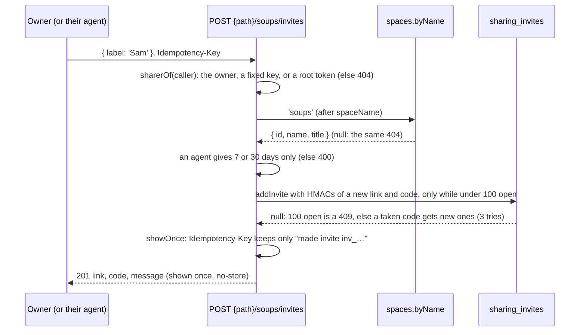
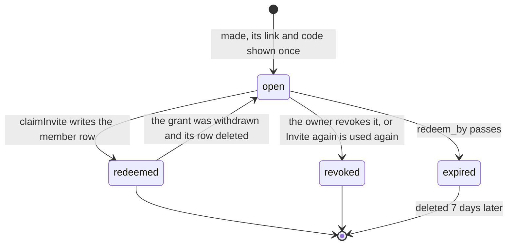
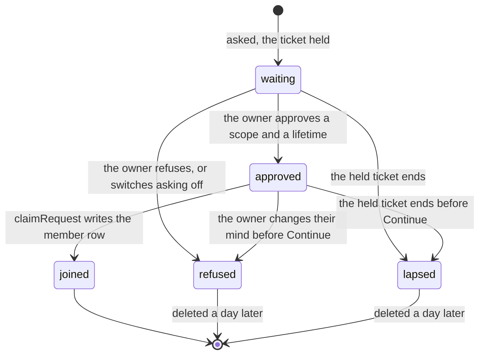
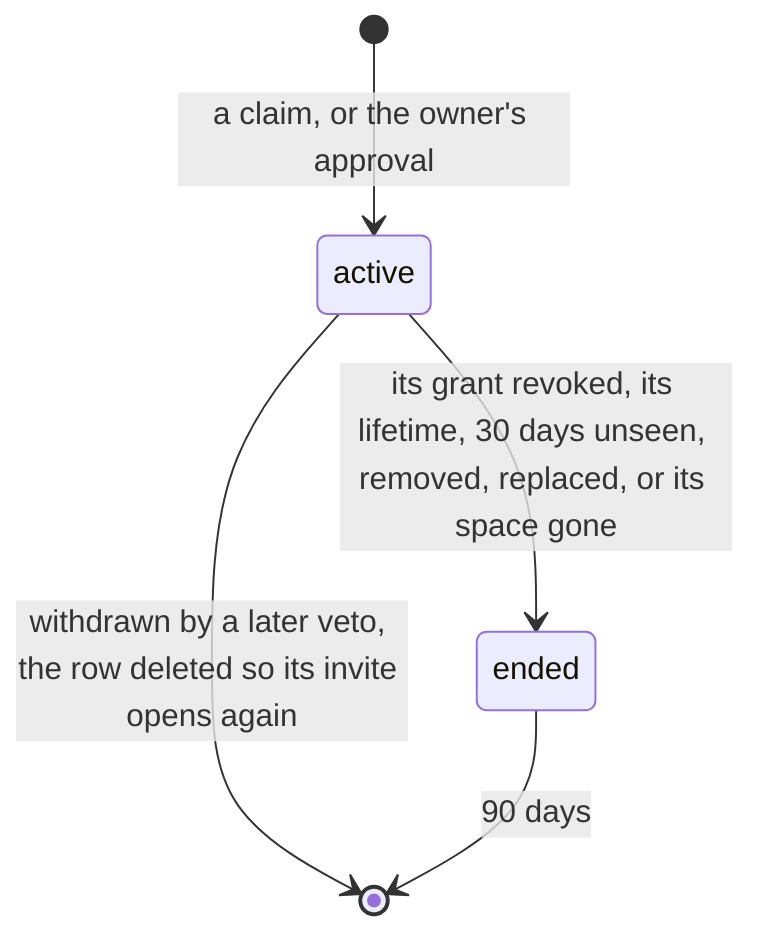

# sharing

Invites to a **space** (the part of an app that is shared: a shelf, a board, a project), asks to join, and the owner's approval, built on the oauth part's hooks. A **member** is one grant into one space: one app, signed in once, by invite, by ask or by the owner's approval. The part is being built in steps; so far it holds its tables, the only queries over them, the named states of its rows, its secrets, and the owner's routes and MCP tools for a space's settings and its invites. Nothing redeems an invite yet: the link it answers points at the sign-in pages still to come, and nothing is wired into `createOAuth`. Until this README says it is, an app that needs people to join builds that on oauth's `approve`, `complete` with `resource`, `holdTicket`, `onGrant` and `onRevoke`, keeping `docs/STANDARD.md` §23.

## Use it when

- People other than the owner, and their agents, should reach one part of the app (one space) and nothing else.
- The owner hands out single-use invites (a link and a typed code), or lets people ask to join and decides later.

## Don't use it when

- Only the owner and their own agents sign in: the oauth part alone does that (`src/kit/oauth/README.md`).
- A whole team reaches the whole app: the people part (members through Cloudflare Access, with roles).

## Add it

```bash
npx @escalay/kit add sharing
```

Needs `db`, `oauth`, `mcp` and `pagination` (and through them `core`). Imported from `./kit/sharing/index.js`. Runs on
Node and Workers.

## Wire it

```ts
import { createSharing, registerSharing, sharingTools, SHARING_TAG } from './kit/sharing/index.js'

const sharing = await createSharing({
  db,
  // 32+ random bytes, its own entry in the app's secret store: never the OAuth signing key
  secret: env.SHARING_SECRET,
  spaces: { byName: (name) => shelves.byName(name) },   // → { id, name, title } or null; ids never reused
  owner,                                                // the same function the app gives createOAuth
  fixedKeys: [...parseApiKeys(env.API_KEYS).values()],
  askToJoin: true,
})
const app = createAgentApi({
  …,
  tags: [...FEATURE_TAGS, SHARING_TAG],
  auth: { realm, keys, relay: ['/mcp', '/a2a', sharing.relay] },
  guards: { …, skip: sharing.neverKept },
  oauth,
})
await registerSharing(app, sharing, { oauth })   // migrates, then the owner routes
mcpServerFactory({ tools: [...FEATURE_TOOLS, ...sharingTools({ noun: 'shelf' })], … })   // the owner's MCP only
```

## Options

`createSharing(options)`; `sharingTools({ path, noun })` takes the same `path` and the word for a space.

| Option | Type | Default | What it does |
|---|---|---|---|
| `db` | `Db` | required | the app's database (`openDb`), the same one as its OAuth state; `registerSharing` migrates `SHARING_MIGRATIONS` into it |
| `secret` | string | required | the app's sharing secret, 32 bytes or more; four keys are derived from it (HKDF-SHA256: `sharing-link`, `sharing-code`, `sharing-cookie`, `sharing-address`). Rotating it voids open invites; members keep working |
| `spaces` | `{ byName(name) }` | required | the app's space by the name in its address: `{ id, name, title }` (`Space`), or null. Ids are never reused |
| `owner` | `(c) => Promise<string \| null>` | required | the signed-in owner's email, or null: the same function the app gives `createOAuth` |
| `fixedKeys` | string[] | `[]` | names of keys from `API_KEYS` that may share |
| `resourcePath` | string | `'/s/{space}/mcp'` | the space's MCP address: one whole `{space}` segment with a segment after it; `relay` and `mcpPath` come from it |
| `spaceName` | RegExp | `/^[a-z0-9][a-z0-9-]{0,62}$/` | what a space's name looks like, checked before any lookup |
| `path` | string | `'/api/spaces'` | where the owner routes live: `{path}/{space}/…` |
| `askToJoin` | boolean | `false` | whether asking to join exists at all; each space still switches it on |
| `tag` | string | `'Sharing'` | the routes' OpenAPI tag (`SHARING_TAG` declares it) |

`registerSharing(app, sharing, { oauth })` takes the app's `createOAuth` server: its root and MCP path say which agents
may share, and its issuer (`publicOrigin`) names invite links.

## Exports

| File | What |
|---|---|
| `index.ts` | `createSharing` (the options checked: `relay`, `mcpPath`, `neverKept`, `config`), `registerSharing`, `SHARING_TAG`, and re-exports the files below |
| `routes.ts` | `sharingRoutes`: the owner routes as OpenAPI contracts (below); `PLAIN_TEXT`, the label rule (no control, bidi or zero-width characters) |
| `handlers.ts` | the handlers; `sharerOf`, who may share (`Sharer`) |
| `tools.ts` | `sharingTools`: the MCP tools for the owner routes |
| `schema.ts` | the Drizzle tables `sharingSpaces`, `sharingInvites`, `sharingRequests`, `sharingMembers`, and `SHARING_MIGRATIONS` (step 1: the four tables and ten indexes); what each column means is in its JSDoc |
| `repo.ts` | `sharingRepo(db)`: every statement over the tables, nothing about HTTP (below) |
| `states.ts` | the named states: `inviteStateOf`, `requestStateOf`, `memberStateOf`, `memberListingOf`, `askingStateOf`; the times `redeemByOf`, `memberExpiresAtOf`, `REDEEM_WITHIN` (a day), `UNSEEN_FOR` (30 days), `UNANSWERED_PAUSE` (10), `MAX_OPEN_INVITES` (100) |
| `secrets.ts` | `sharingKeys`, `newLinkToken` (192 bits), `newInviteCode` (`BDKM-QXTW`, from `CODE_ALPHABET`), `normalisedCode`, `newShownCode` (6 digits), and what the tables keep instead: `linkHashOf`, `codeHashOf`, `addressKeyOf` (HMACs), `ticketHashOf` (SHA-256) |

The owner routes (`{path}` default `/api/spaces`) and their tools:

| Route | operationId | Tool, command | Answers |
|---|---|---|---|
| `GET {path}/{space}/sharing` | `getSharing` | `get_sharing`, `sharing view` | 200 `askToJoin` (`off`, `on`, `paused`), `askToJoinOffered`, `openInvites`; 404 |
| `PATCH {path}/{space}/sharing` `{ askToJoin }` | `updateSharing` | `set_ask_to_join`, `sharing edit` | 200; 409 when `askToJoin` is off in the options; off refuses everyone waiting |
| `POST {path}/{space}/invites` `{ label, scope = 'read', lifetime = '30d' }` | `createInvite` | `create_invite`, `invite create` | 201 with `link`, `code` and `message`, shown once; 400; 409 at 100 open, or `shown_once` on a retry |
| `GET {path}/{space}/invites?limit&cursor` | `listInvites` | `list_invites`, `invite list` | 200, newest first, a page at a time, never a link or code |
| `DELETE {path}/{space}/invites/{id}` | `revokeInvite` | `revoke_invite`, `invite revoke` | 204, again 204; 409 once used |

`sharingRepo(db)`, by table:

| Table | Statements |
|---|---|
| `sharing_spaces` | `spaceAt`, `setAskToJoin` (clears a pause), `noteUnanswered`, `noteAnswered`, `forgetSpace` |
| `sharing_invites` | `addInvite` (null at 100 open, or on a link or code hash already taken), `inviteAt`, `inviteByLink`, `inviteByCodeAt`, `inviteByCodeAnywhere` (only for a client that named no space), `listInvites`, `countOpenInvites`, `revokeInvite`, `revokeInvitesReplacing`, `revokeInvitesMadeByGrant`, `revokeInvitesMadeByClient`, `revokeInvitesOf` |
| `sharing_requests` | `addRequest` (null on a ticket that already asked), `requestAt`, `requestByTicket`, `listRequests`, `countWaitingAt`, `countWaitingFrom` (an address), `approveRequest`, `refuseRequest`, `refuseWaitingAt` |
| `sharing_members` | `claimInvite`, `claimRequest`, `addOwnerMember`, `memberByGrant`, `memberAt`, `listMembers`, `noteSeen`, `endMember`, `endMemberOfGrant`, `endMembersOfClient`, `endMembersOf`, `deleteMemberOfGrant` |
| aging | `endExpiredMembers`, `endLapsedMembers`, `deleteEndedMembers`, `deleteClosedInvites`, `deleteClosedRequests` |

## Flows

Making an invite. Every owner route starts the same way: who is asking, then the space.



An invite (`inviteStateOf`). Redeemed is not a column: a member row holding its `invite_id` is.



An ask to join (`requestStateOf`). Joined is a member row holding its `request_id`.



A member (`memberStateOf`). Past its lifetime or unseen for 30 days it reads as ended before aging writes it.



## Rules

- **Who may share** (`sharerOf`): the owner signed in (`owner(c)` answers; never a team `member`), a key named in
  `fixedKeys`, or an agent whose token is for the whole app (no audience, the root, or the root's MCP) from a known
  grant. A key made through the API, a space's own token and anyone else may not.
- **Nothing says whether a space exists.** Anyone who may not share, a name `spaceName` refuses (cased, dotted,
  encoded) and a space `byName` doesn't find all get the same 404 with the same body. An invite id from another space
  is the same 404 as a made-up one.
- **Shown once means never kept.** An invite's link and code are kept only as HMACs and answered once, `no-store`;
  `createInvite` calls `showOnce`, so a retry with the same Idempotency-Key is a 409 `shown_once` saying an invite was
  made, never the secrets, and only one invite exists. `neverKept` (`/sharing/*`) keeps the sign-in pages' answers out
  of the guard store too.
- **Agents invite for a while, on the record.** An agent may give 7 or 30 days, never until revoked; each invite it
  makes records its client and grant (`made_by_client`, `made_by_grant`).
- **Links name the issuer.** An invite's link is `oauth.issuerOf(c)` (`publicOrigin`) + `/sharing/join/<token>`,
  whatever the request's host header says.
- **Never through A2A.** `sharingTools` go to the owner's MCP only: a delegating agent must not mint invites. Each
  tool acts only on the user's word, and `create_invite` returns the message to send, never sends it.
- **The claim is the insert.** `claimInvite` and `claimRequest` are one `insert … select … where` each: the member is
  written only while the invite is of the member's space, unrevoked, in time and unredeemed (the ask: approved, in
  time, unused). `invite_id`, `request_id` and `grant_id` are unique, so a racing second claim writes nothing and
  answers null, never throws. So is the cap: `addInvite` writes only while the space holds fewer than 100 open
  invites, so invites made at once never pass it. No statement uses a transaction: each holds on node:sqlite, libSQL
  and D1.
- **An id never crosses spaces.** Every statement taking an id a route names also takes the space
  (`and space_id = ?`).
- **Ending is not deleting.** A removed, replaced or revoked member's row stays (ended, with its reason) until aging
  deletes it, so its invite never reopens; only a withdrawn grant's row is deleted (`deleteMemberOfGrant`).
- **States are named only through `states.ts`**, one rule per function; the repo's once-only statements check the
  same rules in SQL. A live row past its lifetime or unseen for 30 days is ended (fail closed); the owner's list hides
  removed and replaced members and shows other ended ones as signed out.
- **No secret at rest.** The link token and the typed code are kept only as HMACs under their own derived keys, the
  asker's address only as an HMAC, the consent ticket only as a SHA-256.
- The migration's SQL holds no comment and no quote: a step is split on `;` outside quotes.
- Standard: `docs/STANDARD.md` §7, §23

## Failure modes

| The caller sees | Why |
|---|---|
| `createSharing` throws "the secret holds N bytes" | the sharing secret is shorter than 32 bytes: make 32 random bytes of its own |
| `createSharing` throws "needs exactly one {space} segment" | `resourcePath` has no `{space}`, two, one inside a segment, or none after it |
| 404 "No space … here that you may share" | the caller may not share, or the name is not a space (always the same body) |
| 400 on `createInvite` | a label that is empty, over 80 or holds control, bidi or zero-width characters; an agent asking for `until_revoked` |
| 409 on `createInvite` | 100 open invites at the space; or `shown_once`: a retry with the same Idempotency-Key (the invite was made) |
| 409 on `updateSharing` | the app's `askToJoin` option is off |
| 409 on `revokeInvite` | the invite was used already |
| `addInvite` answers null | the space holds 100 open invites (`createInvite` answers 409), or its link or code hash is taken: `createInvite` makes new ones, then fails after 3 |
| `claimInvite` answers null | the invite is spent, revoked, past `redeem_by`, of another space, or the grant already has a member |
| `claimRequest` answers null | the ask is not approved, lapsed, of another space, or already joined |
| `approveRequest` or `refuseRequest` answers false | the ask is decided, joined, lapsed, or of another space |

## Limits

- 100 open invites per space; lists 50 a page by default, 100 at most.
- Two instances on one database are safe: each decision is one statement.
- An invite's code: 8 letters from 20 (about 34.6 bits), redeemable for a day.
- Node and Workers, on any database `openDb` opens (node:sqlite, libSQL, D1).

## Tests

- `test/sharing.test.ts`: the migration's tables and indexes, every named state as a table, the secrets, both claims
  and the 100-open cap under a race, an id from one space at another for every by-id statement, and no table holding a secret.
- `test/sharing-owner.test.ts`: who may share as a table; invites made, listed, paged and revoked; the same 404 at
  every route for strangers, missing, cased and encoded names, and another space's id; the cap with invites made at
  once; agents' lifetimes and makers;
  an Idempotency-Key retry (memory and database guards, and through MCP) keeping no link or code; `lintOpenApi`,
  `toolRoutes`, `toolsRun`, `cliGaps`.
- `test/workers/sharing.test.ts`: the migration, both claims and the cap on D1, the keys inside workerd.

## Upgrading

What changed between kit versions, and what to do: [docs/upgrading.md#sharing](https://github.com/escalay/api-kit/blob/main/docs/upgrading.md#sharing).
