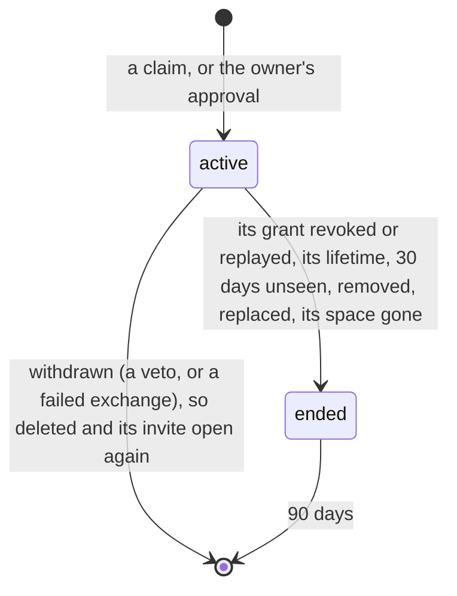
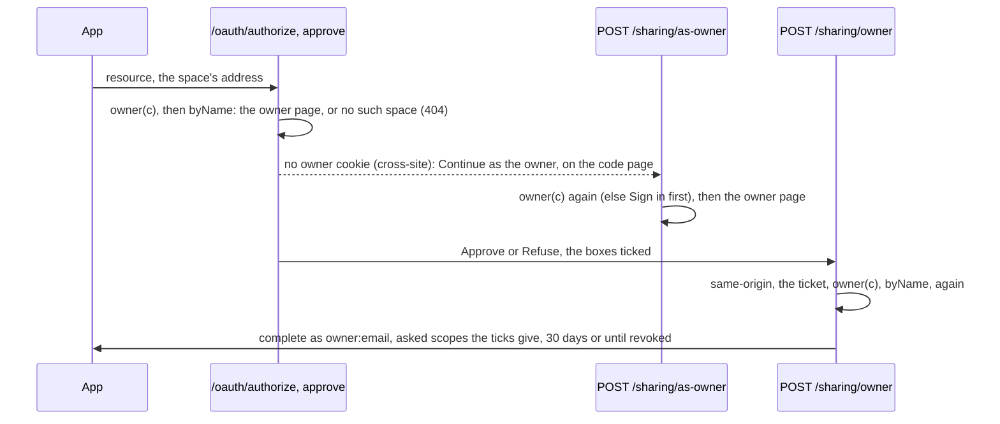
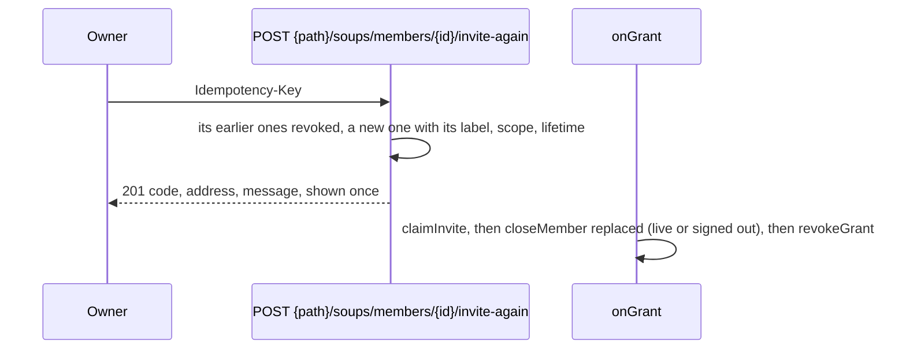

# sharing: reference

What the README leaves to this file, which ships beside it: wiring it by hand, the owner routes, a friend's agent as a test, what a
space's MCP offers, the refusals, the sign-in ladder, a member's states and two more flows.

## Wire it by hand

`kit add sharing --wire --spaces shelves` writes all of this; an app made before the wiring markers takes it by hand,
each block naming its place:

```ts
// src/features/shelves/spaces.ts, new: the shelves as spaces, each shelf's id its space's name
import type { Db } from '../../kit/index.js'
import { shelvesRepo } from './repo.js'

export const shelfSpaces = (db: Db) => {
  const byId = async (id: string) => {
    const row = await shelvesRepo(db).get(id)
    return row ? { id: row.id, name: row.id, title: row.name } : null
  }
  return { byName: byId, byId }
}
// src/features/shelves/index.ts, in place of the statements that start the same way: a deleted shelf ends its members
  register: async (app, { db, parts }) => {
    const handle = shelvesHandlers({ ...repo, remove: async (id) => { await repo.remove(id); if (parts.sharing) await parts.sharing.forget(id) } })
// src/features/shelves/index.ts, before `const handle`
    const repo = shelvesRepo(db)
// src/app.ts, after `import BRAND`
import { z } from '@hono/zod-openapi'
import { shelfSpaces } from './features/shelves/spaces.js'
import { mcpTool } from './kit/mcp/index.js'
import { createSharing, registerSharing, sharingTools, SHARING_OPEN_PATHS, SHARING_TAG, type Sharing } from './kit/sharing/index.js'
// src/app.ts, in place of the statements that start the same way (the realm and name stay the app's)
export type Parts = { sharing?: Sharing }
  const oauth = env.OAUTH_SIGNING_KEY ? createOAuth({ name: 'Shelves', signingKey: env.OAUTH_SIGNING_KEY, store: await dbOAuthStore(db), owner, reuseGraceSeconds: 30, ...(sharing && { publicOrigin: env.PUBLIC_ORIGIN, limits: { store: await dbGuardStore(db) }, ...sharing.oauth }) }) : undefined
    tags: [...FEATURES.map((feature) => feature.tag), ...(sharing ? [SHARING_TAG] : [])],
    auth: { realm: 'shelves', keys: parseApiKeys(env.API_KEYS), access, ...(sharing && { open: [...SHARING_OPEN_PATHS], relay: ['/mcp', '/a2a', sharing.relay] }) },
    guards: { store: await dbGuardStore(db), ...(sharing && { skip: sharing.neverKept }) },
  const parts: Parts = { sharing }
  const factory = mcpServerFactory({ info: { name: 'shelves', version: VERSION }, instructions: 'Shelves: read the guide at /llms.txt first.', tools: [...TOOLS, ...(sharing ? sharingTools({ noun: 'shelf' }) : [])], prompts, skills, callApi: inProcess(app) })
// src/app.ts, inside `export type Env`'s braces, at the end
SHARING_SECRET?: string; PUBLIC_ORIGIN?: string
// src/app.ts, before `const oauth`: on once its settings are, so createApp({ db, env: {} }) stays plain
  const sharing = env.OAUTH_SIGNING_KEY && env.SHARING_SECRET && env.PUBLIC_ORIGIN ? await createSharing({ db, secret: env.SHARING_SECRET, spaces: shelfSpaces(db), spaceOfPath: (path) => /^\/api\/shelves\/([^/]+)/.exec(path)?.[1] ?? null, owner, fixedKeys: [...parseApiKeys(env.API_KEYS).values()] }) : undefined
// src/app.ts, after `mountMcp(app, { factory`: the part's routes, and a shelf's own MCP
  if (sharing && oauth) await registerSharing(app, sharing, { oauth })
  if (sharing) mountMcp(app, { path: sharing.mcpPath, factory: mcpServerFactory({ info: { name: 'shelves', version: VERSION }, instructions: 'One shelf, shared with you.', tools: SPACE_TOOLS, callApi: inProcess(app) }), allowedHostnames: [env.PUBLIC_HOST ?? 'localhost', 'localhost', '127.0.0.1'] })
// src/app.ts, before `export const VERSION`
const SPACE_TOOLS = [mcpTool({ name: 'view_shelf', title: 'This shelf', description: 'The shelf this address shares.', input: z.object({}), call: (_, at) => ({ path: `/api/shelves/${encodeURIComponent(at?.params.space ?? '')}` }), summarize: (shelf: { name: string }) => shelf.name })]
// src/worker.ts and src/server.ts, after `import { openDb`
import { sharingOf } from './kit/sharing/index.js'
// src/worker.ts, after `fetch:`: wrangler.jsonc's "triggers": { "crons": ["17 * * * *"] } runs it hourly
  scheduled: (_event, env, ctx) => ctx.waitUntil(appOf(env).then(async (app) => { const sharing = sharingOf(app); if (sharing) await sharing.sweep() })),
// src/server.ts, after `serve(`: hourly
setInterval(() => void sharingOf(app)?.sweep().catch((error) => console.error('sharing sweep failed', error)), 3_600_000)
```

## The owner routes

The owner routes (`{path}` default `/api/spaces`), paged lists newest first (`?limit&cursor`), and their tools:

| Route | operationId | Tool, command | Answers |
|---|---|---|---|
| `GET {path}/{space}/sharing` | `getSharing` | `get_sharing`, `sharing view` | 200; 404 |
| `POST {path}/{space}/invites` `{ label, scope = 'read', lifetime = '30d' }` | `createInvite` | `create_invite`, `invite create` | 201 `code` shown once, with `address` and `message`; 400; 409 |
| `GET {path}/{space}/invites` | `listInvites` | `list_invites`, `invite list` | 200, never a code |
| `GET {path}/{space}/invites/{id}` | `getInvite` | none | 200, the card its `self` names; 404 |
| `DELETE {path}/{space}/invites/{id}` | `revokeInvite` | `revoke_invite`, `invite revoke` | 204; 409 once used |
| `GET {path}/{space}/members` | `listMembers` | `list_members`, `member list` | 200, `active` or `signed_out` |
| `GET {path}/{space}/members/{id}` | `getMember` | none | 200; 404 |
| `DELETE {path}/{space}/members/{id}` | `removeMember` | `remove_member`, `member remove` | 204, again 204; 404 |
| `POST {path}/{space}/members/{id}/invite-again` | `inviteAgain` | `invite_again`, `member reinvite` | 201 as `createInvite`; 400; 409 |

## A friend's agent, as a test

Wired with `kit add sharing --wire --spaces shelves`, the owner routes are at `/api/spaces/{shelf id}/…`, never under
`/api/shelves`. `POST …/invites` answers 201 with `code` (shown once), `address` (the shelf's MCP, where the friend's
app connects; the code page opens from there) and `message` (both in words, to send). `GET …/members` answers
`{ count, _embedded: { members: [{ id, label, via, scope, state, … }] }, _links }`. The whole join, with
`connectAgent` and `approveSignIn` from the testing part (the kit runs this block in a wired app):

```ts
// test/sharing.test.ts
import { expect, it } from 'vitest'
import { createApp } from '../src/app.js'
import { generateOAuthKey, hashApiKey, testDb } from '../src/kit/index.js'
import { approveSignIn, callMcp, connectAgent } from '../src/kit/testing/index.js'

const headers = { authorization: 'Bearer owner-key', 'content-type': 'application/json' }
const env = { API_KEYS: `owner:${hashApiKey('owner-key')}`, OAUTH_SIGNING_KEY: await generateOAuthKey(), SHARING_SECRET: 'a sharing secret of thirty-two bytes or more, for tests only', PUBLIC_ORIGIN: 'http://localhost' }
it('lets a friend’s agent read the shelf it was invited to, and no other, until the shelf goes', async () => {
  const app = await createApp({ db: await testDb(), env, address: 'socket' })
  const shelf = async (name: string) => ((await (await app.request('/api/shelves', { method: 'POST', headers, body: JSON.stringify({ name }) })).json()) as { id: string }).id
  const [soups, bakes] = [await shelf('Soups'), await shelf('Bakes')]
  const invite = await app.request(`/api/spaces/${soups}/invites`, { method: 'POST', headers: { ...headers, 'idempotency-key': 'sam' }, body: JSON.stringify({ label: 'Sam' }) })
  const { code, address } = (await invite.json()) as { code: string; address: string }
  const { tokens } = await connectAgent(app, { address, approve: (query) => approveSignIn(app, query, { form: { action: '/sharing/join', fields: { code } } }) })
  const members = (await (await app.request(`/api/spaces/${soups}/members`, { headers })).json()) as { _embedded: { members: unknown[] } }
  expect(members._embedded.members).toEqual([expect.objectContaining({ label: 'Sam', via: 'invite', scope: 'read', state: 'active' })])
  const view = (at: string) => callMcp(app, 'tools/call', { path: at, bearer: tokens!.access_token, params: { name: 'view_shelf', arguments: {} } })
  expect((await view(new URL(address).pathname)).text).toContain('Soups')
  expect((await view(`/s/${bakes}/mcp`)).status).toBe(401)
  expect((await app.request(`/api/shelves/${soups}`, { method: 'DELETE', headers })).status).toBe(204)
  expect((await view(`/s/${soups}/mcp`)).status).toBe(401)
})
```

## What a space's MCP offers

`--wire` gives a shelf's own MCP (its invites' `address`) `view_shelf`, and for each feature made
`--under shelves` a list tool over that shelf's children: `kit feature recipes --under shelves` gets
`list_shelf_recipes`, which calls `/api/shelves/{shelf}/recipes`. A child made after wiring gets its tool when
`kit add sharing --wire --spaces shelves` runs again. A child by its own id (`/api/recipes/{id}`) is no space's path,
so it stays the owner's: a member's token there is a 401. By hand, one line per child, after `SPACE_TOOLS`:

```ts
SPACE_TOOLS.push(mcpTool({ name: 'list_shelf_recipes', title: 'Recipes in this shelf', description: 'The recipes in the shelf this address shares, the newest first, a page at a time.', input: z.object({ limit: z.number().int().min(1).max(100).optional().describe('At most this many (default 50).'), cursor: z.string().optional().describe('Where the next page starts: the cursor the last page ended with.') }), call: (args, at) => ({ path: `/api/shelves/${encodeURIComponent(at?.params.space ?? '')}/recipes`, query: args }), summarize: (page: { _embedded: { recipes: { title: unknown }[] } }) => page._embedded.recipes.map((row) => String(row.title)).join('\n') || 'None yet.' }))
```

## Refusals: 401 or 403

A 401 is a token that can't be used here (sign in again, at the right address); a 403 is a caller the app knows asking
for what it may not do; a 404 hides a space the caller may not see.

| Caller | Asks for | Answer |
|---|---|---|
| a member's token (it holds one space) | another space's MCP or routes, that space existing or not | 401, `ONLY_ITS_SPACE` |
| a member's token | the owner's `/mcp`, the owner routes, anything outside its space | 401 |
| a member removed or swept, or of a space `forget` ended | anything | 401, on its next call |
| a token with `read` only | a write over REST (an owner's `POST {path}/{space}/invites` too) | 403 `forbidden`, `error="insufficient_scope"` in `WWW-Authenticate` |
| a token with `read` only | a write through a space's MCP tool | 200, the tool's result `isError` with that 403 |
| a key that may not share the space | `{path}/{space}/…`, the space existing or not | 404, the same for both |
| an app typing a wrong or spent code | the code page | 400, the page again, naming neither |
| Approve or Continue as the owner from another site, or with the owner gone | `/sharing/owner`, `/sharing/as-owner` | 403, nothing spent |

## The ladder

`signInStepOf`, for a sign-in the part `handles`:

| It asks for | The owner signed in | Step |
|---|---|---|
| the root or its MCP, named by the client | yes | `kit`: the kit's consent page |
| the root or its MCP, named by the client | no | `wrong-address`: no form |
| nothing (the root, chosen by the server) | yes | `kit` |
| nothing | no | `code`: the code's invite binds its space |
| a space `byName` finds | yes | `owner` |
| a space `byName` misses | yes | `no-such-space` (404, to the owner only) |
| a space | no | `code`, with Continue as the owner |

## A member's states

`memberStateOf`. Past its lifetime or unseen for 30 days it reads as ended before `sweep` writes it.



## Two more flows

The owner approves an app at a space.



Invite again: the old sign-in ends once the fresh invite is used. A withdrawn join reopens it; the old stays replaced.


