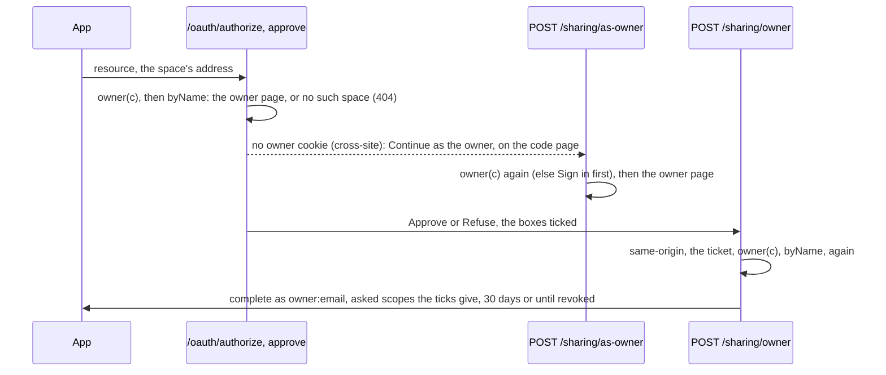
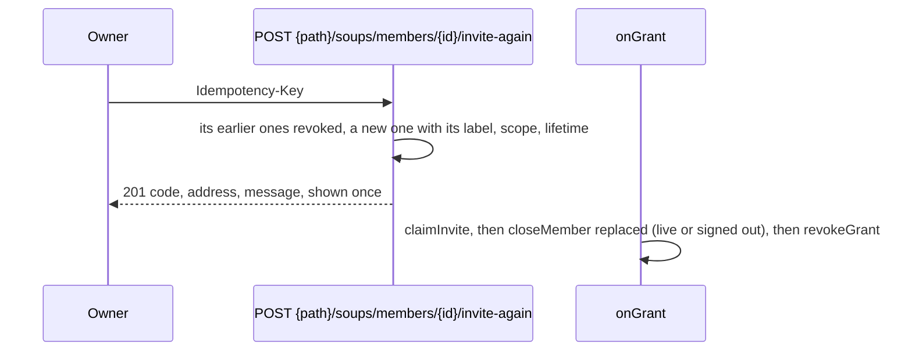

# sharing: reference

What the README leaves to this file, which ships beside it: the owner routes, the sign-in ladder and two more flows.

## The owner routes

The owner routes (`{path}` default `/api/spaces`), paged lists newest first (`?limit&cursor`), and their tools:

| Route | operationId | Tool, command | Answers |
|---|---|---|---|
| `GET {path}/{space}/sharing` | `getSharing` | `get_sharing`, `sharing view` | 200; 404 |
| `POST {path}/{space}/invites` `{ label, scope = 'read', lifetime = '30d' }` | `createInvite` | `create_invite`, `invite create` | 201 `code` shown once, with `address` and `message`; 400; 409 |
| `GET {path}/{space}/invites` | `listInvites` | `list_invites`, `invite list` | 200, never a code |
| `GET {path}/{space}/invites/{id}` | `getInvite` | none | 200, the card its `self` names; 404 |
| `DELETE {path}/{space}/invites/{id}` | `revokeInvite` | `revoke_invite`, `invite revoke` | 204; 409 once used |
| `GET {path}/{space}/members` | `listMembers` | `list_members`, `member list` | 200, `active` or `signed_out` |
| `GET {path}/{space}/members/{id}` | `getMember` | none | 200; 404 |
| `DELETE {path}/{space}/members/{id}` | `removeMember` | `remove_member`, `member remove` | 204, again 204; 404 |
| `POST {path}/{space}/members/{id}/invite-again` | `inviteAgain` | `invite_again`, `member reinvite` | 201 as `createInvite`; 400; 409 |

## The ladder

`signInStepOf`, for a sign-in the part `handles`:

| It asks for | The owner signed in | Step |
|---|---|---|
| the root or its MCP, named by the client | yes | `kit`: the kit's consent page |
| the root or its MCP, named by the client | no | `wrong-address`: no form |
| nothing (the root, chosen by the server) | yes | `kit` |
| nothing | no | `code`: the code's invite binds its space |
| a space `byName` finds | yes | `owner` |
| a space `byName` misses | yes | `no-such-space` (404, to the owner only) |
| a space | no | `code`, with Continue as the owner |

## Two more flows

The owner approves an app at a space.

Invite again: the old sign-in ends once the fresh invite is used. A withdrawn join reopens it; the old stays replaced.

