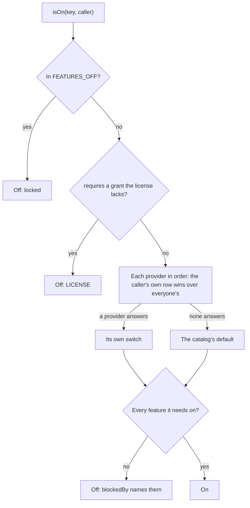
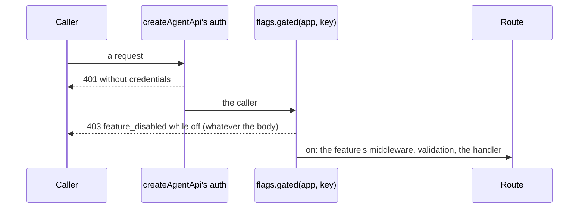

# switches

Feature switches: every feature an app can work without, listed once, each on or off for everyone, one person or one API key, with one place every route and background job asks; the owner switches through the API, a feature that is off stays listed and answers `403 feature_disabled` ("This feature is disabled."), and where the switches come from is one line: the app's own database today, a flag service (PostHog, LaunchDarkly, anything with an SDK) tomorrow, or both in order, with the catalog's keys in every one of them.

## Use it when

- An app has additive features its owner may turn off (sending, a digest, webhooks, model calls), for everyone or one
  person or key.
- A flag service should decide some features, the database the rest.
- Some features are paid: a license key grants them.

## Don't use it when

- The feature is core (sign-in, the app's main data, the switches' own routes): those are never gated.
- A setting or a missing binding stops a feature: that is the `unavailable` hook, which says so and gates nothing.

## Add it

```bash
npx @escalay/kit add switches
```

Needs `db` and `mcp` (for the tools). Every new app has it, with an empty catalog. The browser side is
`switches-client`, `switches-react` and `switches-ui` (browser README).

## Wire it

```ts
// src/features/catalog.ts
export const CATALOG = defineFeatures({
  sending: { title: 'Sending', description: 'Mail out from the app: replies, new mail, answers.' },
  digest: { title: 'Daily digest', description: 'One mail a day with what changed.', needs: ['sending'], default: false },
  webhooks: { title: 'Webhooks', description: 'Events posted to other services.', renamedFrom: ['hooks'] },
})

// src/features/flags.ts
export const flagProviders = (db: Db): FlagProvider[] => [databaseProvider(db)]
// later, a flag service decides first and the database the rest:
export const flagProviders = (db: Db): FlagProvider[] => [fromSdk({ name: 'posthog', allFlags: (context) => posthog.getAllFlags(context.targetingKey ?? 'everyone') }), databaseProvider(db)]

// src/app.ts
const flags = switches({ catalog: CATALOG, providers: flagProviders(db), off: parseFeatureList(env.FEATURES_OFF) })
await flags.register(app, { isOwner: (c) => isAdmin(c.get('caller'), fixedKeys), onSwitch: (change) => recordEvent(db, 'feature.switched', change) })
registerWebhooks(flags.gated(app, 'webhooks'), …)                   // its routes answer 403 while off
if (await flags.isOn('webhooks')) await pump(db)                    // background work: everyone's switch
await flags.assertOn('sending', contextOf(caller), { fresh: true }) // an action that leaves the app, as the caller
// MCP: tools: [...featureTools, ...switchTools()]; toolsRun samples: list_features: {}, switch_feature: { key, state: 'off', preview: true }
```

Routes:

```
GET   /api/features         every feature for you: on, own, source, reason, blockedBy, needs, alsoOff, unavailable, overrides; providers, writable, locked, unknownOff
GET   /api/features/{key}   one feature
PATCH /api/features/{key}   { on: true | false | null, scope? } (owner only) → { dryRun, changes, feature }; ?dryRun=true changes nothing
```

## Options

The catalog (`defineFeatures`), per feature:

| Option | Type | Default | What it does |
|---|---|---|---|
| key | lowercase words joined by hyphens | required | the name in the database, in `FEATURES_OFF` and in a flag service: it never changes |
| `title`, `description` | string | required | what the owner reads, and what switching it off stops |
| `default` | boolean | true | on or off when no provider answers |
| `needs` | keys | none | the feature is off whenever one it needs is off (`blockedBy` says which); loops are refused at boot |
| `renamedFrom` | old keys | none | stores and `FEATURES_OFF` still read the old name, and the next switch moves a stored row to the new key |
| `requires` | string | none | a license grant: off, whatever is stored, until the deployment's license grants it |

`switches(config)` and `register(app, options)`:

| Option | Type | Default | What it does |
|---|---|---|---|
| `catalog` | the catalog | required | `defineFeatures(…)` |
| `providers` | `FlagProvider[]` | required | asked in order for the keys still undecided; the first answer wins, the catalog's default decides the rest |
| `off` | string[] | none | `FEATURES_OFF` (`parseFeatureList`): off whatever any store says; old names read too |
| `path` | string | `/api/features` | where the routes live, and the `switchOn` link in a 403 |
| `license` | `licenseOf(…)` | none | the deployment's license |
| `unavailable` | `(context) => { key: why }` | none | why a feature that is on cannot work now; gates nothing |
| `isOwner` (register) | `(c) => boolean` | required | who may switch |
| `onSwitch` (register) | `(change, c) => void` | none | hears every switch the API makes (`{ key, scope, on, by }`) |
| `tag` (register) | string | `Features` | the routes' OpenAPI tag |

Providers:

| Option | Type | Default | What it does |
|---|---|---|---|
| `databaseProvider(db, { cacheMs })` | number | 5000 | the `feature_switches` table, read whole and kept 5 s per isolate; the one the API writes to |
| `fromSdk({ name, allFlags \| isOn })` | functions | one required | any flag service: `allFlags` (one call per caller) is preferred over `isOn` (one per key) |
| `fromSdk({ flagKeyOf })` | `(key) => string` | the key | the service's flag name for a key |
| `fromSdk({ cacheMs, timeoutMs })` | number | 5000, 300 | answers kept per caller; a service slower than `timeoutMs`, or failing, is skipped for that call |
| `memoryProvider(values, name?)` | `{ key: boolean }` | | fixed values, for tests or code |
| `licenseOf({ key, publicKey, product, instance?, upgrade? })` | | `key` unset: no license | the license key, the product's public JWK, its name, this deployment's id for bound keys, where to buy one |

A provider of your own is an object with `name`, `resolve(keys, context, options)` and, to be switchable through the
API, `write` and `overrides`. A flag service's value of `true`, `"on"` or a variant other than `"off"`/`"control"` is
on; `undefined` means "not mine", and the next provider decides.

### Paid features: license keys

A feature can need a license: `requires: 'enterprise'` in the catalog. It is off, whatever is stored, until the
deployment's license key grants `enterprise` (its plan, or one of its `grants`). The key is an ES256 JWT the product's
maker signs; the app holds only the public key, and checks it offline every hour.

```bash
npx @escalay/kit license keys --out .                     # once per product: the private key to a secret store, the public JWK printed
npx @escalay/kit license mint --private license-private.jwk --product notes --licensee "Acme" --plan enterprise --days 365 [--instance <id>]
npx @escalay/kit license verify <key> --public public.jwk --product notes
```

```ts
const LICENSE_PUBLIC_KEY = { kty: 'EC', crv: 'P-256', x: '…', y: '…' }   // from `license keys`
switches({ catalog, providers, license: licenseOf({ key: env.LICENSE_KEY, publicKey: LICENSE_PUBLIC_KEY, product: 'notes', upgrade: 'https://example.com/pricing' }) })
```

- Without a valid key a paid feature answers 403 with `reason: "LICENSE"`, `requires` and `upgrade`; `PATCH` refuses to
  switch it on (409); `GET /api/features` shows `requires`, `licensed` and the deployment's `license` (never the key).
- Features that `need` a paid one are off with it (`blockedBy`).
- `--instance` binds a key to one deployment (`aud`); the app passes its id as `instance`.
- The browser shows "Get enterprise" instead of the switch and "Get a license" on the notice (`switches-ui`).
- A self-hosted app's code can be changed by whoever runs it: keys keep honest users honest and say what they paid
  for; they are not a lock.

## Exports

| File | What |
|---|---|
| `catalog.ts` | `defineFeatures` (checks the catalog at boot), `needsInOrder`, `dependentsOf`, `keyOf` (old names too), `parseFeatureList` |
| `providers.ts` | `FlagProvider` (OpenFeature-shaped: a targeting key, a value, a reason), `contextOf` (the caller as a context), `contextOfScope`, `isScope`, `memoryProvider`, `fromSdk` |
| `schema.ts` | the `feature_switches` table (key, scope, on, changed_by, changed_at) and `SWITCH_MIGRATIONS` |
| `repo.ts` | `switchesRepo`, `databaseProvider` (the table as a provider, read whole and kept 5 s) |
| `routes.ts` | `switchRoutes`: `GET {path}`, `GET` and `PATCH {path}/{key}` |
| `tools.ts` | `switchTools`: `list_features`, `switch_feature` |
| `license.ts` | `verifyLicense` (one key, offline, never throws), `licenseOf` (a deployment's license, checked hourly) |
| `index.ts` | `switches` (`isOn`, `assertOn`, `gate`, `gated`, `set`, `stateOf`, `register`), `SWITCHES_TAG` |

## Flows

How one feature is decided for a caller:



A gated route:



## Rules

- Only additive features go in the catalog. Sign-in, the app's main data and the switches' own routes are core and
  never gated.
- A **key** is lowercase words joined by hyphens, and never changes: a rename keeps the old name in `renamedFrom`.
- A row per feature and scope: `everyone`, `person:<email>` or `key:<name>`; the caller's own row wins over everyone's.
  `FEATURES_OFF` comes before every provider.
- The gate runs after auth and before validation: no key gets 401, a switched-off feature 403 whatever the body. A
  feature's own middleware runs only while it is on, so a refused call spends no rate limit.
- Work with no caller (incoming mail, queue jobs, scheduled runs) is resolved for everyone; an OAuth agent as the
  person who approved it.
- Answers are cached (the database's rows 5 s per isolate, a flag service's answers 5 s per caller). An action that
  leaves the app passes `fresh: true`.
- `PATCH` answers 409 when `FEATURES_OFF` locks the feature, when no provider can be written, or when a provider
  before the writable one decides it for that scope ("managed in posthog: change it there").
- Every switch the API makes goes to `onSwitch`: log it as an event. It is told once the switch is stored, and a hook
  that throws is logged, never answered: the switch stays made.
- Other people's and keys' switches are shown only to an owner.
- What a feature waits on outside the switches (a setting turned off, a missing binding) is the app's `unavailable`
  hook: `switches({ …, unavailable: async (context) => ({ extract: 'Model calls are off, so no fields are read.' }) })`.
  The list says it for a feature that is on (and for the features that need it) and the tool's line reads "on, but
  cannot work now: …". It gates nothing; the feature's own routes say the same when called.
- Standard: `docs/STANDARD.md` §21

## Failure modes

A 403 for a switched-off feature:

```json
{ "code": "feature_disabled", "status": 403, "title": "Feature disabled", "detail": "This feature is disabled.", "feature": "digest", "blockedBy": ["sending"], "switchOn": "/api/features/sending" }
```

| The caller sees | Why |
|---|---|
| 403 `feature_disabled` | the feature, or one it needs (`blockedBy`), is off for this caller |
| 403 `feature_disabled` with `reason: "LICENSE"`, `requires`, `upgrade` | a paid feature without a license granting it |
| 403 "Only the owner can switch features." | `isOwner` said no |
| 404 "No feature …" | a key the catalog doesn't have (an old name is read as its new key) |
| 400 "… is not a scope" | a scope other than `everyone`, `person:<email>` or `key:<name>` |
| 409 "switched off by FEATURES_OFF" | the environment locks it |
| 409 "needs a license granting …" | switching on a paid feature without the license |
| 409 "none of which the API can change" | no provider can be written |
| 409 "managed in <provider> for <scope>" | a provider before the writable one decides it: change it there |
| the app fails at boot | `defineFeatures` refused the catalog: a bad key, an unknown or looping `needs`, an old name that clashes |

## Limits

- A switch made through the API reaches other isolates within the 5 s cache, unless the call passes `fresh: true`.
- A flag service slower than 300 ms is skipped for that call, and the next provider or the default decides.
- A license is checked offline every hour; a self-hosted app's code can be changed by whoever runs it.
- Node and Workers.

## Tests

- `toolsRun` (testing part) with the samples `list_features: {}` and
  `switch_feature: { key, state: 'off', preview: true }`; `memoryProvider` for fixed values.
- `test/switches.test.ts` (the catalog, the 403 and its order, needs and dry runs, scopes, `FEATURES_OFF`, old names,
  the cache, a flag service in front, routes and tools), `test/license.test.ts`, `test/switches-ui.test.tsx`.

## Upgrading

What changed between kit versions, and what to do: [docs/upgrading.md#switches](https://github.com/escalay/api-kit/blob/main/docs/upgrading.md#switches).
