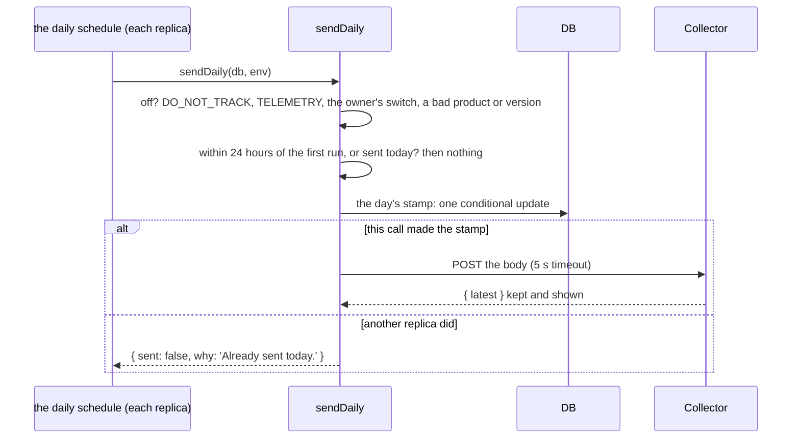

# telemetry

A daily anonymous usage report for a product people deploy for themselves, so its makers learn how many run it, which version, and roughly how much each is used, without learning who or what: one POST a day to the product's collector, and the owner sees exactly what is sent and can switch it off.

## Use it when

- The product is deployed by others (self-hosted, a Deploy to Cloudflare button), and its makers want counts, never
  data.

## Don't use it when

- The app is the makers' own deployment: its own logs and analytics already say this.
- Exact numbers, ids or text are wanted: the report takes coarse ranges and booleans only.

## Add it

```bash
npx @escalay/kit add telemetry
```

Needs `db` and `mcp` (for the tool).

## Wire it

```ts
const usage = telemetry({
  product: 'notes', schemaVersion: 1, version: VERSION, url: 'https://pulse.example.com',
  collect: async (db) => ({ notes: countRange(await countNotes(db)), oldest_note: dayRange(await oldestNoteDays(db)), search_used: await searched(db) }),
})
await usage.register(app, { db, isOwner: (c) => isAdmin(c.get('caller'), fixedKeys) })
// MCP: tools: [...featureTools, ...telemetryTools()]; toolsRun sample: get_telemetry: {}

// worker.ts: a daily Cron Trigger ("0 3 * * *" in wrangler.jsonc)
export default { fetch, scheduled: (_event, env, ctx) => ctx.waitUntil(usage.sendDaily(db, env)) }
// Node: once an hour is fine, it sends at most once a UTC day
setInterval(() => void usage.sendDaily(db, process.env), 3_600_000)
```

`sendDaily` returns `{ sent, why }` for the app's logs.

An app with the `switches` part keeps one switch for the report, not two: pass
`switch: { isOn: () => flags.isOn('usage-report'), set: (on, by) => flags.set({ key: 'usage-report', on, by }) }`
and the report's own `enabled` column is left alone.

## Options

`telemetry(config)`:

| Option | Type | Default | What it does |
|---|---|---|---|
| `product` | string | required | the product's name, the last segment of the collector's path: lowercase letters, digits and hyphens |
| `schemaVersion` | number | required | the version of the report's shape, a whole number from 1; raise it when `collect` changes what it returns |
| `version` | string | required | the version running, like `1.2.3` or `1.2.3-beta.1`; anything else and nothing is sent |
| `url` | string | required | the collector's origin (`https://pulse.example.com`) |
| `collect` | `(db) => report` | required | the report: coarse ranges and booleans only, plus `choices`; anything else is dropped |
| `choices` | `Record<field, words[]>` | none | fields that hold one of a fixed set of words (how it was installed); only those words pass |
| `switch` | `{ isOn, set }` | the `telemetry` row's `enabled` | the app's own switch for the report (the switches part) |
| `fetch` | `fetch` | `fetch` | what sends it; for tests |

`usage.register(app, options)`:

| Option | Type | Default | What it does |
|---|---|---|---|
| `db` | `Db` | required | the app's database; the `telemetry` table is migrated into it |
| `isOwner` | `(c) => boolean` | required | whether the caller may switch the report |
| `env` | `(c) => { DO_NOT_TRACK?, TELEMETRY? }` | the Worker's bindings, else `process.env` | where the route reads the environment's switches |
| `path` | string | `/api/telemetry` | where the routes live |
| `tag` | string | `Telemetry` | the routes' OpenAPI tag |

### What is sent

`POST ${url}/v1/${product}` with exactly this body, and nothing else (the collector refuses other keys):

```json
{ "schema": 1, "instance": "0b6f6a3e-2f7c-4d1e-9a51-3f0f4b8f2c11", "version": "1.4.2", "report": { "notes": "11-100", "search_used": true } }
```

- `instance`: a random v4 UUID made on the deployment's first run. It ties one day's report to the next and to
  nothing else.
- `version`: like `1.2.3` or `1.2.3-beta.1`; anything else and nothing is sent.
- `report`: what the app's `collect` returns, **coarse ranges and booleans only**: counts through `countRange`
  (`0`, `1-10`, `11-100`, `101-1k`, `1k-10k`, `10k+`), ages through `dayRange` (`0`, `1-7`, `8-30`, `31-90`,
  `91-365`, `365+`), yes/no as `true`/`false`. A field with a fixed set of words (how it was installed) is declared in
  `choices`, and only those words pass. Never ids, names, emails, URLs, free text or exact numbers.
  `coarseReport` enforces it: a key that isn't lowercase `snake_case` or a value that isn't one of those ranges or a
  boolean is dropped, so a slip can't leak.

Routes:

```
GET   /api/telemetry   { on, why, enabled, endpoint, body, since, lastSentAt, latest }: body is exactly what is sent
PATCH /api/telemetry   { enabled } (owner only, through the isOwner hook) → the same
```

## Exports

| File | What |
|---|---|
| `schema.ts` | the `telemetry` table (one row: instance, since, enabled, last_sent_at, latest) and `TELEMETRY_MIGRATIONS` |
| `repo.ts` | `telemetryRepo`: the row (made on the first run), the switch, the stamps |
| `routes.ts` | `telemetryRoutes`: `GET` and `PATCH {path}` |
| `tools.ts` | `telemetryTools`: `get_telemetry` |
| `index.ts` | `telemetry` (`register`, `sendDaily`, `bodyOf`), `countRange`, `dayRange`, `coarseReport`, `TELEMETRY_TAG` |

## Flows



## Rules

- Off, and nothing sent, when `DO_NOT_TRACK=1` (or `true`) or `TELEMETRY=off` (or `false`, `0`; any case) is set, or
  the owner switched it off; `GET` says which. The route reads those from the Worker's bindings, else `process.env` (or pass `env`).
- Nothing in the first 24 hours after the first run; then at most one try per UTC day, recorded before the POST, so a
  dead collector is not hit again until tomorrow. A 5 second timeout. It never throws into the app.
- The day's stamp is one conditional update, and only the call that made it sends: replicas (or Workers isolates)
  running the schedule together send once.
- A `collect` that throws never fails the routes: `GET` and `PATCH` answer with an empty `report` and a `why` that
  names the error, and nothing is sent until it works.
- When the collector answers `{ "latest": "1.5.0" }`, `latest` is kept and shown: the newest version there is.
- Raise `schemaVersion` whenever `collect` changes what it returns.
- Say in the product's README and setup page that it reports, what, and how to switch it off.
- Standard: `docs/STANDARD.md` §18

## Failure modes

| The caller sees | Why |
|---|---|
| `{ sent: false, why }` from `sendDaily` | switched off (and by what), the first 24 hours, already sent today, a bad product, schema version or version, the collector's status, or the error: it never throws |
| `GET` with an empty `report` and a `why` naming the error | `collect` threw: nothing is sent until it works |
| 403 on `PATCH` "Only the owner can switch the usage report." | `isOwner` said no |
| a field missing from `report` | `coarseReport` dropped it: not lowercase `snake_case`, or not a range, a boolean or one of its `choices` |

## Limits

- One report a UTC day per deployment, at most one try; a day the collector is down is not retried.
- Node and Workers: a Cron Trigger on Workers, an interval on Node.

## Tests

- `toolsRun` (testing part) with the sample `get_telemetry: {}`.
- `test/telemetry.test.ts`: the body sent, the daily schedule, two replicas, every switch, a throwing `collect`,
  coarse values only, routes and tool.

## Upgrading

What changed between kit versions, and what to do: [docs/upgrading.md#telemetry](https://github.com/escalay/api-kit/blob/main/docs/upgrading.md#telemetry).
