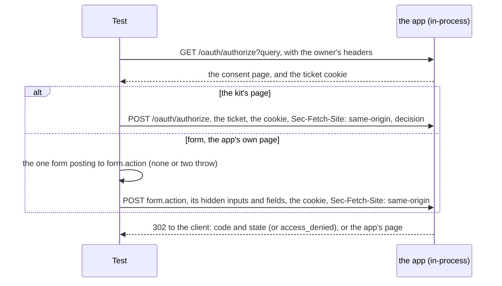

# testing

Checks that keep an API agent-ready as it grows, for the app's own tests: each returns a list of problems, `[]` when all is well, so a test is one line and a failure says exactly what to fix; plus a software passkey and an OAuth approval made the way a browser makes it.

## Use it when

- Always, in an app on the kit: every app's `test/api.test.ts` runs these.
- Passkeys or OAuth approvals must run in CI with no person and no browser.

## Don't use it when

- In production code: this part is for tests (it is its own entry, so the app's server never imports it).

## Add it

```bash
npx @escalay/kit add testing
```

Needs `guide` (and through it `core`). Imported from `./kit/testing/index.js`.

## Wire it

```ts
import { guideGaps, guideRoutes, lintOpenApi, toolRoutes, toolsRun } from './kit/testing/index.js'

const doc = await (await app.request('/openapi.json', { headers })).json()
expect(lintOpenApi(doc)).toEqual([])
expect(guideRoutes(guideFiles(GUIDE_DIR), doc)).toEqual([])
expect(guideGaps(guideFiles(GUIDE_DIR), vars, { doc, tools: TOOLS })).toEqual([])
expect(toolRoutes(TOOLS, doc)).toEqual([])
expect(await toolsRun(TOOLS, app, { search_notes: { q: 'soup' }, get_note: { slug: 'fox' } }, { headers })).toEqual([])

const { tools, resources } = mountedMcp(app)
expect(cliGaps({ tools, resources, jobs })).toEqual([])
```

## Options

| Option | Type | Default | What it does |
|---|---|---|---|
| `guideRoutes(files, doc, prefix)` | string | `/api/` | which paths the guide's `GET /api/…` mentions are checked against the spec |
| `guideGaps(files, vars, { doc, tools, resources, commands, brand })` | | none | with `doc` (and `tools`), the kit's generated placeholders count as filled, so a typo like `{{api.endpoint}}` is caught; without `doc`, `api.`, `mcp.`, `skills.` and `cli.` names are skipped; `brand` (the app's `defineBrand`) for `{{brand.*}}` |
| `toolsRun(tools, app, samples, { headers })` | | no headers | sample arguments per tool, and the credentials every call sends |
| `cliGaps({ tools, resources, jobs }, { singular })` | string[] | none | nouns that end in s but are singular |
| `cliSnapshot({ app, version, tools, resources, jobs })` | | `''` for `app` and `version` | the snapshot's app name and version |
| `connectAgent(app, { redirect, scope, name })` | strings | a loopback callback, `'read write'`, `'Sample Agent'` | where the code returns, what it asks, and the client's name |
| `approveSignIn(app, query, { headers, decision, form })` | `'allow'` \| `'deny'`; `{ action, fields? }` | `'allow'`, no headers, the kit's page | the owner's credentials (the app's `owner` reads them), and the answer on the kit's page; `form`: the app's own page instead (`approve`), the one form that posts to `action` (a path), sent with its hidden inputs and `fields` |

## Exports

| Check | Catches |
|---|---|
| `lintOpenApi` | an operation an agent can't find or understand: no `operationId`, or one that isn't camelCase or is used twice; no summary, or one over 80 characters; a description under 20 characters; no tag, or a tag the document doesn't declare; a parameter without a description; no 2xx response, or a 2xx (other than 202 and 204) with no body schema; a 4xx or 5xx that isn't problem+json; an operation that takes input or needs a key and documents no 4xx; a named schema with no description. It does not check examples |
| `guideRoutes` | a `GET /api/…` (or `POST`, `PUT`, `PATCH`, `DELETE`) the guide mentions that the spec doesn't have |
| `guideGaps` | a `{{placeholder}}` nothing fills (a typo like `{{api.endpoint}}`); pass `{ brand }` (the app's `defineBrand`) when the guide says `{{brand.*}}` |
| `toolRoutes` | a tool whose call names no documented route |
| `toolsRun` | a tool that names the right route and still fails when run: a mangled id, a wrong parameter, a summary showing `undefined` or throwing. A tool with no sample arguments fails it, so a new tool can't ship untested |
| `cliGaps` | a command the app's CLI can't offer well: a tool or resource without a `cli` name, a name taken twice or shadowing a job or a built-in, a plural noun, an argument without a description, a tool or job without an example, an example that names a flag the command lacks (`singular: [...]` adds nouns that end in s) |

| Helper | What |
|---|---|
| `cliSnapshot({ app, version, tools, resources, jobs })` | every command as the CLI package carries it (`sdk/cli/commands.json`): `scripts/openapi.ts` writes it as `JSON.stringify(snapshot, null, 2) + '\n'`, and `sdk/test/cli.test.ts` compares the file byte for byte, so a changed tool fails until `pnpm sdk:types` runs |
| `flagsOf(schema)` | an input schema's properties as the CLI's flags (`{ name, key, type, description, required, multiple, enum?, default? }`), positional ones included |
| `softAuthenticator()` | a software passkey: `register(options, origin)` and `login(options, origin)` answer the WebAuthn ceremonies the way a phone would, so claim → register → verify → login → verify runs in CI (the people and setup parts). `options` is the one inside the options route's `{ challengeId, options }`; `challengeId` goes back with the answer (the people README's test) |
| `approveSignIn(app, query, { headers, decision, form })` | approves an OAuth sign-in the way a browser does: it opens `/oauth/authorize`, keeps the ticket cookie the page sets, and posts a form on it same-origin with that cookie: the kit's consent form with `decision`, or with `form` the app's own (`{ action: '/sharing/join', fields: { code: 'BDKM-QXTW' } }`). It returns the answer: the 302 to the client, or the app's page |
| `connectAgent(app, { address, approve, redirect, scope, name })` | a third-party agent signing in at `address` (`/mcp`, or a space's) as an MCP client does: the 401's `resource_metadata`, `/oauth/register`, `/oauth/authorize` with PKCE, `approve(query)` for the person's click (`approveSignIn`), then the code at `/oauth/token`. Returns `{ page, html, tokens }`, `tokens` null when the click gave no code (a friend's agent joining with an invite's code: the sharing README, Wire it); `AgentConnection` is its type |

| File | What |
|---|---|
| `index.ts` | the checks, `approveSignIn`, `connectAgent`, and the exports of the other two |
| `cli.ts` | `cliGaps`, `cliSnapshot`, `flagsOf` |
| `authenticator.ts` | `softAuthenticator` |

## Flows

`approveSignIn`:



## Rules

- Name every tool's command (`cli` on `mcpTool`) when the tool is written; `cliGaps` runs in every app's tests.
- Run `toolsRun` over every tool in every app, with sample ids from the test's fixture data; tools run in order, so
  make what they need (a board) first and put deleting tools last.
- `toolsRun` calls each tool with no `at` (as A2A does), so a space's tools (`at.params`, the mcp README) are run
  through their `/s/:space/mcp` mount instead.
- Give the app an injectable embedder and data paths (`createApp(env, { embedder })`) so tests need no network or reload.
- A hand-made approval POST without the ticket cookie and a same-origin header is refused (the oauth README): use
  `approveSignIn`, with `form` for the app's own page. Give each form on that page its own `action`, so a test can
  name one.
- Standard: `docs/STANDARD.md` §13

## Failure modes

| The caller sees | Why |
|---|---|
| a non-empty list from a check | each entry names the operation, file, tool or command and what is wrong |
| `toolsRun`: "no sample arguments", or "sample arguments for a tool that doesn't exist" | the samples miss a tool, or name one the list doesn't have |
| `toolsRun`: "its summary threw on the 202 answer (still working …)" | the route answered a run still working: give it a finished run, or summarize a 202 |
| `approveSignIn` throws "/oauth/authorize answered N with no consent form" | no consent page was shown: the headers don't make the caller the app's `owner`, or the query fails the kit's checks (client, redirect, PKCE, resource) |
| `approveSignIn` throws "no form posts to /join (the page's forms: …)" | with `form`, the page has no `<form method="post">` whose `action` is exactly `form.action`: the app showed another page (an error, the kit's), or the action is spelled otherwise |
| `approveSignIn` throws "2 forms post to /join, so which one is ambiguous" | with `form`, more than one form posts there: give each its own action |
| `approveSignIn` throws "form.action must be a path on the app" | `form.action` is a URL or `//host`: a browser's same-origin POST goes to a path |

## Limits

- `lintOpenApi` checks the document's shape, not its examples or the truth of its descriptions: an agent run (STANDARD
  §13) still finds where one stalls.
- `toolsRun` runs tools in order against the app in-process: state one tool makes is what the next one sees.
- Node and Workers.

## Tests

- `test/kit.test.ts` runs every check on a sample API; `test/cli.test.ts` runs `cliGaps` and `cliSnapshot` on the
  kit's own parts; `test/people.test.ts` signs in with `softAuthenticator`; `test/oauth.test.ts` approves with
  `approveSignIn`, on the kit's page and an app's own.

## Upgrading

What changed between kit versions, and what to do: [docs/upgrading.md#testing](https://github.com/escalay/api-kit/blob/main/docs/upgrading.md#testing).
