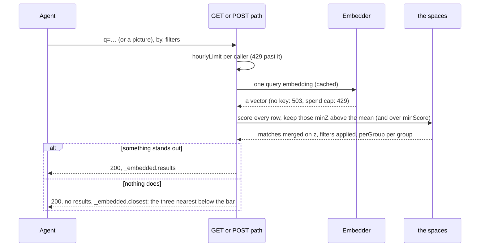

# vector-search

Search by words, by picture and by likeness, as three documented routes and their MCP tools, on the vectors part's spaces: only matches that stand out from the whole catalog come back, and an empty answer shows the nearest few below the bar.

## Use it when

- A catalog has `look` and/or `meaning` vectors (the vectors part) and agents or people should search it by sense.
- "More like this one" should always answer, for free.

## Don't use it when

- The vectors are not built yet: build the ledgers first (`embedMissing`); until then the routes answer 503.
- Keyword or filter search answers the question.

## Add it

```bash
npx @escalay/kit add vector-search
```

Needs `vectors` and `mcp` (and through them `core`). Imported from `./kit/vector-search/index.js`. The browser side is
`search-client`, `search-react` and `vector-search-ui` (browser README).

## Wire it

```ts
import { registerVectorSearch, vectorSearchTools } from './kit/vector-search/index.js'

registerVectorSearch(app, {
  path: '/api/search', similarPath: '/api/recipes/{slug}/similar', name: 'Recipe', noun: 'recipes', tag: 'Search', item: RecipeCardSchema,
  spaces: () => vectors, embedder: () => embedder, itemOf: (key, origin) => cardOf(key, origin), keyOf: (slug) => `recipe:${slug}`,
  filters: { shape: { decade: z.string().optional() }, keep: ({ decade }) => decade ? (key) => byKey.get(key)?.decade === decade : undefined },
  groupOf: (key) => authorOf(key), perGroup: 3, imageHosts: ['images.example.com'], example: 'a quick tomato soup',
})
const tools = vectorSearchTools({
  path: '/api/search', similarPath: '/api/recipes/{slug}/similar', noun: 'recipes', label: (recipe) => recipe.title,
  filters: { decade: z.string().optional().describe('Only recipes from this decade, e.g. 1990s.') },
})
```

Routes: `GET {path}?q=&by=look|meaning|both` (words, one embedding), `POST {path}` (a picture: multipart `image` or JSON
`{ image }`, filters in the query), `GET {similarPath}?by=` (likeness, free). Results are HAL, `_embedded.results[]` of
`{ score, z, space, item }`; when nothing clears the bar, the nearest three below it come back as `_embedded.closest`.

## Options

`registerVectorSearch(app, config)`:

| Option | Type | Default | What it does |
|---|---|---|---|
| `path` | string | required | GET searches by words, POST by picture |
| `similarPath` | string | none | the likeness route, with one path parameter, the item's id (`/api/recipes/{slug}/similar`); left out, no likeness route |
| `name`, `noun`, `tag` | string | required | singular for OpenAPI names (`Recipe`), plural for descriptions (`recipes`), the routes' tag |
| `item` | zod schema | required | one result's `item` |
| `spaces` | `() => { look?, meaning? }` | required | the vectors searched now; a space not built yet is left out |
| `embedder` | `() => Embedder \| undefined` | required | undefined without a key: words and pictures answer 503, likeness still works |
| `itemOf` | `(key, origin) => card \| undefined` | required | the card for a vector's key; undefined skips a row that left the catalog |
| `keyOf` | `(id) => key` | the id itself | the likeness route's id → its vector key |
| `filters` | `{ shape, keep }` | none | query parameters every route accepts, and the keys they keep (undefined keeps all); applied after z is measured |
| `groupOf`, `perGroup` | `(key) => string`, number | none | at most `perGroup` results per group (an author, a collection), so one group doesn't fill the page |
| `minZ` | `{ look?, meaning?, picture? }` | `max(3.5, √(2 ln n) − 0.5)`; `picture` 2.5 | how far a row must stand out, per space for words, and for a picture |
| `minScore` | `{ look?, meaning? }` | none | a raw-similarity floor on top of `minZ`, per space |
| `imageHosts` | string[] | none | exact hostnames a JSON `image` URL may come from over https (no redirects); data URLs and the API's own image links always work |
| `hourlyLimit` | number | 600 | calls per caller per hour on the paid routes (words and pictures); 0 turns the limit off |
| `pictures` | boolean | true | false for a catalog with no pictures: no picture route, no picture tool |
| `example` | string | `'a fox made of triangles'` | the example query in the spec and the guide: one this catalog answers well |
| `offers` | `('look' \| 'meaning')[]` | both | the spaces this catalog has at all: a text-only catalog offers `['meaning']`, so `by=look` isn't advertised |
| `fetchImpl` | `fetch` | `fetch` | fetches a picture by URL from `imageHosts`; for tests |

`vectorSearchTools(config)` takes `path`, `similarPath`, `noun`, `imageHosts`, `pictures` and `offers` as above, and:

| Option | Type | Default | What it does |
|---|---|---|---|
| `label` | `(item) => string` | required | one line naming a result's item |
| `filters` | zod shape | none | the same filters as the routes, as tool arguments |
| `names` | `{ search?, image?, similar? }` | `search_<noun>`, `search_<noun>_by_image`, `similar_<noun>` | the tools' names |

## Exports

| Export | What |
|---|---|
| `registerVectorSearch(app, config)` | the three routes, documented, rate-limited where they cost; call it after `createAgentApi` |
| `vectorSearchTools(config)` | the MCP tools for the same routes, with their commands (`<thing> search`, `search-by-image`, `similar`) |
| `VectorSearchConfig`, `SearchSpace` | the types |

## Flows



## Rules

- Measure the bar on each catalog with real and nonsense queries (`minZ`, `minScore`) and write it in the guide's trust page.
- Every filter is declared on all three routes (and the tools), so an unknown one is a 400.
- `both` merges spaces on z, never on raw cosine; a row found in both keeps its better side.
- The similar route takes an item's id or its board ref (`recipe:soup`); it tries the id as given first, so ids that
  hold a colon (`episode:<slug>`) work. It always answers, closest first, without the item itself.
- A picture by URL is one of the API's own image links (fetched in-process with the caller's credentials) or an https
  URL on `imageHosts`; a server never fetches an arbitrary URL.
- Standard: `docs/STANDARD.md` §15

## Failure modes

| The caller sees | Why |
|---|---|
| 503 `unavailable` "needs this server's embedding key" | `embedder()` gave none: words and pictures need a key; likeness and every other route still work |
| 503 `unavailable` with `Retry-After: 3600` | the vectors for the asked space are not built yet |
| 429 `spend_cap` | OpenRouter refused for money (the key's cap or credit): the paid routes stop, likeness still works |
| 429 with `RateLimit` | more than `hourlyLimit` paid searches this hour from this caller |
| 503 `upstream` | the embedding service failed for another reason: retry in a minute |
| 400 "A picture by URL must be one of this API's own image links…" | a URL not on `imageHosts`, not https, or not the API's own |
| 400 "Could not fetch an image from …" | the URL didn't answer an image |
| 413 | a picture over 8 MB |
| 415 | an upload that is not PNG, JPEG, WebP or GIF |
| 404 "No look vector for …" | the likeness route's id is not in the catalog, or not embedded yet |
| 200 with no results and `_embedded.closest` | nothing stands out: the nearest rows below the bar, which are not matches |

## Limits

- Every search scores every row of a space in memory: the cost grows with the catalog.
- z is measured over the whole catalog, filters applied after: a narrow filter can leave few rows above a z bar.
- `hourlyLimit` counts in the in-memory guard store, so per process (per isolate on Workers).
- A picture: PNG, JPEG, WebP or GIF, at most 8 MB; turning it into a data URL needs `sharp` (vectors part).

## Tests

- Give the app an injectable embedder and data paths, so tests need no network; `toolsRun` (testing part) runs the
  three tools.
- `test/vector-search.test.ts` over `test/logos-fixture.ts`: words, pictures, likeness, the bar, filters, failures, the
  tools.

## Upgrading

What changed between kit versions, and what to do: [docs/upgrading.md#vector-search](https://github.com/escalay/api-kit/blob/main/docs/upgrading.md#vector-search).
