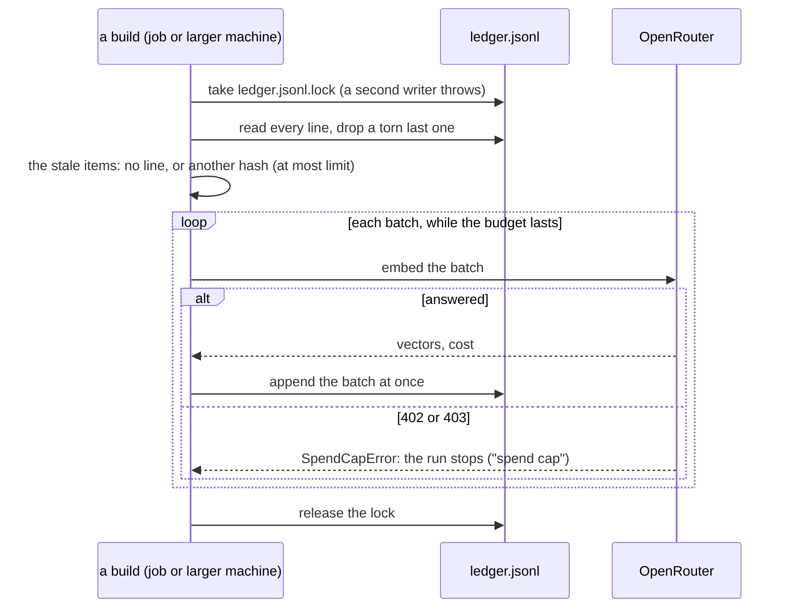

# vectors

Embeddings with Gemini Embedding 2 through OpenRouter: what things look like (`look`, from pictures) and what they are about (`meaning`, from text), kept in append-only ledgers keyed by a content hash, so a rerun pays only for what changed, plus the maths search needs (`nearest`, `standouts`, `centroid`).

## Use it when

- Items have pictures or prose worth searching by sense, not by keyword.
- A build must never pay twice for the same embedding, and must stop at a budget.

## Don't use it when

- Keyword or filter search answers the question: a query in the repo is free.
- The routes are wanted too: add `vector-search`, which brings this part.

## Add it

```bash
npx @escalay/kit add vectors
```

Needs nothing else from the kit, and an OpenRouter key per app. `imageDataUrl` needs `sharp` in the app
(`pnpm add sharp`), loaded on first use: a build that embeds pictures calls it, and so does vector-search's picture
route for every picture sent. An app that embeds only text never needs it.

## Wire it

```ts
import { createEmbedder, documentText, embedMissing, embedRequest, readLedger, vectorSpace, nearest } from './kit/index.js'

// A build, off the request path: a pilot first, always a budget
const run = await embedMissing({ file: 'data/vectors/meaning.jsonl', items: notes.map((note) => ({ key: `note:${note.id}`, content: documentText(note.title, [note.body]) })), embed: (inputs) => embedRequest(key, inputs), batchSize: 100, budget: 0.5, limit: 200 })

// At start: the ledger as a searchable space, without keys that left the catalog
const space = vectorSpace(await readLedger('data/vectors/meaning.jsonl'), (key) => store.has(key))
const similar = nearest(space, vectorOf(space, 'note:1')!, { limit: 12 })
const embedder = createEmbedder({ apiKey: env.OPENROUTER_API_KEY })          // queries at request time, cached
```

## Options

| Option | Type | Default | What it does |
|---|---|---|---|
| `embedMissing({ file })` | string | required | the ledger (JSONL); `<file>.lock` is held while it runs |
| `embedMissing({ items })` | `{ key, content, input? }[]` | required | what to embed: `content`'s hash decides whether a key is stale; `input` makes what is sent when it differs (a picture's data URL) |
| `embedMissing({ embed })` | `(inputs) => Promise<Embedded>` | required | one request: `(inputs) => embedRequest(key, inputs)` |
| `embedMissing({ batchSize })` | number | 100 | inputs per request (Gemini takes 100 texts; use 32 for pictures) |
| `embedMissing({ concurrency })` | number | 4 | batches in flight at once |
| `embedMissing({ budget })` | number (USD) | no limit | no new batch starts once this much is spent, as OpenRouter reports it |
| `embedMissing({ limit })` | number | no limit | embed at most this many: a pilot |
| `embedMissing({ log })` | `(message) => void` | nothing | progress and skipped items |
| `createEmbedder({ apiKey })` | string | required | the app's own capped OpenRouter key |
| `createEmbedder({ cacheSize })` | number | 500 | queries and pictures kept, so a repeated one costs nothing |
| `createEmbedder({ fetchImpl })` | `fetch` | `fetch` | for tests |
| `nearest` / `standouts`: `limit`, `keep`, `groupOf`, `perGroup` | | `limit` required | how many, which keys may come back, and at most `perGroup` per `groupOf` group |
| `standouts({ minZ })` | number | `max(3.5, √(2 ln n) − 0.5)` | how many standard deviations above the query's mean a row must stand |
| `standouts({ minScore })` | number | none | a raw-similarity floor on top, for a corpus all about one subject |

## Exports

| Export | What |
|---|---|
| `embedMissing` | embeds only new or changed items, appends each batch as it returns, stops at `budget` (a 402/403 is a `SpendCapError`); one writer per ledger (`<file>.lock`) |
| `createEmbedder` | query-time embedding of words (`query`) or a picture (`image`), and batches (`documents`, `images`) |
| `embedRequest` | one OpenRouter request: inputs → unit vectors in order, with its cost; retries rate limits and server errors |
| `imageDataUrl` | any image → the JPEG data URL a look vector is made from: at most 384 px, transparency on white (`sharp`) |
| `documentText`, `queryText` | a document and a query in the format Gemini Embedding 2 reads |
| `readLedger`, `appendLedger`, `vectorSpace`, `vectorOf`, `centroid` | load a ledger into packed arrays (the latest line per key wins), add lines, one key's vector, a collection's mean |
| `nearest`, `standouts` | likeness, and only the rows that stand out from the whole catalog (z-score, with `minScore` floors) |
| `hashOf` | the content hash; byte-compatible across versions (a test pins it) |
| `encodeVector`, `decodeVector`, `SpendCapError`, `EMBEDDING_MODEL`, `DIMENSIONS`, `IMAGE_PX`, `MIN_Z` | the ledger's vector form, the money error, the model and its sizes |

## Flows



## Rules

- Builds run off the request path (a job, or a larger machine), start with a pilot (`limit: 200`), always carry a `budget`.
- Ledgers are data: gitignored, kept offsite (object storage), baked into the image or synced in. A newer ledger left in another
  checkout means live search runs on stale vectors: keep one copy current.
- **One writer per ledger.** `embedMissing` holds `<file>.lock` (made only if missing, holding its process id) while it
  runs; a second run on the same file, in this process or another, throws naming the lock. A lock whose process is
  gone (a crash) is taken over on the same machine. A lock with no process id yet is a writer still starting for 10
  seconds, and taken over only after that; a lock left on shared storage by another machine stays until
  someone deletes it. Two machines building one ledger at once is not supported: build in one place, sync the file.
- **A torn last line** (a write cut short by a crash) is left out by `readLedger` with one `console.warn`, and the next
  `embedMissing` drops it before appending (and embeds its item again, the only cost); a whole last line cut just
  before its newline is kept and ended first. Any other line that isn't JSON
  is damage appending never makes: `readLedger` throws with its line number, and the file is restored from its copy.
- Standard: `docs/STANDARD.md` §15

## Failure modes

| The caller sees | Why |
|---|---|
| a run with `stopped: 'spend cap'` | OpenRouter answered 402 or 403: the key's cap or the account's credit ran out; a rerun resumes. A search route answers 429 `spend_cap` for the same error (vector-search) |
| a run with `stopped: 'budget'` | `budget` was spent; a rerun resumes |
| a key in `failed` | its `input` couldn't be made (a picture that won't render, or bytes without `input`); the rest of its batch still went |
| `embedMissing` throws "is being written by process …" | another run holds `<file>.lock`; if none runs, delete the lock |
| `readLedger` throws "line N is not a ledger line" | a line other than the last isn't JSON: the file was damaged; restore it from its copy |
| a warning "line N is torn" | the last line was cut short by a crash: left out, and embedded again by the next run |
| `imageDataUrl` throws loading `sharp` | `sharp` is not installed in the app |

## Limits

- Ledgers are files read and written with `node:fs`, and the lock is a process id: builds and `readLedger` run where
  the files live (a machine or a container), on Node. One machine builds a ledger at a time.
- A space is held in memory as packed `Float32Array`s: 768 dimensions per key.
- `createEmbedder` keeps the last 500 queries and pictures (`cacheSize`).

## Tests

- Give the app an injectable embedder (`createApp(env, { embedder })`) and a `fetchImpl`, so tests need no network.
- `test/vectors.test.ts`: ledgers, torn and damaged lines, the lock, budgets, the pinned `hashOf`.

## Upgrading

What changed between kit versions, and what to do: [docs/upgrading.md#vectors](https://github.com/escalay/api-kit/blob/main/docs/upgrading.md#vectors).
