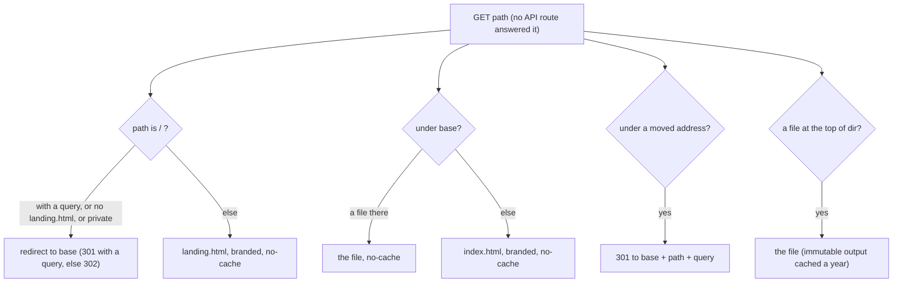

# web

The front door on Node: an app's own web pages served by the API from a built folder, with an optional public page at `/`, the browser app under `/app` behind the sign-in, old addresses redirected, and hashed assets cached for good.

## Use it when

- A Node app serves its browser app (a Vite build) from the same origin as the API.
- `/` should be a public page saying what the service is and how agents connect, with no data.
- The app moved under `/app` and its old addresses must keep working.

## Don't use it when

- The app runs on Workers: the Worker's static assets serve the browser app there (the `app` preset's
  `wrangler.jsonc` `assets`), and `createAgentApi({ home: 'app' })` sends `/` to `/app/`. This part reads files from
  the disk.
- Not to be confused with the browser parts (`src/browser/`), which go into the frontend.

## Add it

```bash
npx @escalay/kit add web
```

Needs `core` and `@hono/node-server`.

## Wire it

```ts
import { frontDoorOpen, serveFrontDoor } from './kit/index.js'

const web = { dir: join(APP_DIR, 'web/dist'), moved: ['/notes'], private: true }
const app = createAgentApi({ …, home: false, auth: { …, open: frontDoorOpen(web) } })   // the pages' files carry no data
// … routes, guide, MCP …
if (!serveFrontDoor(app, web)) console.warn(`No ${web.dir}/index.html: build the browser app first`)   // last: it answers what nothing else did
```

`home: false` leaves `/` to the front door (by default `createAgentApi` sends it to `/docs`).

## Options

`serveFrontDoor(app, config)` and `frontDoorOpen(config)` take the same config:

| Option | Type | Default | What it does |
|---|---|---|---|
| `dir` | string | required | the built app: `index.html`, optionally `landing.html`, and its files |
| `base` | string | `/app` | where the app lives: every page under it gets `index.html` (deep links open the app), and its files are served relatively |
| `moved` | string[] | none | addresses the app answered before it moved under `base`, redirected there (301) with their path and query |
| `immutable` | string | `/assets/` | hashed build output that never changes under its name: cached a year (`immutable`), and never given a `?v=` |
| `private` | boolean | false | with the API's `private`: no front page, `/` goes to the app behind the sign-in, the app's files need the same credentials as the API and are never kept in a shared cache, and every page says `noindex` |

## Exports

| Export | What |
|---|---|
| `serveFrontDoor(app, config)` | serves the front page, the app under `base` and the redirects; false, serving nothing, when `dir` has no `index.html` |
| `frontDoorOpen(config)` | the paths the API's auth leaves open: `/`, the files at the top of `dir`, the immutable build output and the old addresses (they only redirect); `/app` itself stays behind the sign-in. Private: only `/` and the old addresses |
| `versionAssets(html, dir, immutable)` | a page with its local `.js` and `.css` links versioned by content (`app.js?v=1a2b3c4d`), files under `immutable` left as they are |
| `FrontDoorConfig` | the config |

## Flows



## Rules

- Register it last, after every API route: anything they didn't answer is a page.
- With `createAgentApi({ brand })`, each page gets the brand's head tags (icons, manifest, theme colour, Open Graph)
  unless it names a `rel="icon"` of its own, and a `favicon.ico` in `dir` wins over the brand's.
- Vite's hashed `/assets/` are served under their own names (a `?v=` on them would load each module twice); the pages'
  own scripts and styles get `?v=<content hash>`, so a CDN that keeps static files for hours still loads new ones.
- In private mode `/` redirects to `/app` and nothing public names the service.
- `Accept: text/markdown` on `/` still gets the agent guide: core answers it first (not in private mode).
- Standard: `docs/STANDARD.md` §16

## Failure modes

| The caller sees | Why |
|---|---|
| the API's 404 at `/` and under `/app` | `dir` has no `index.html`: `serveFrontDoor` returned false and serves nothing; build the browser app first |
| 401 at `/app` | no credentials: `frontDoorOpen` never opens `/app`, which stays behind the sign-in |
| a redirect from `/` to `/app` instead of the front page | `dir` has no `landing.html`, the app is private, or `/` came with a query (an old deep link) |

## Limits

- Node only: it reads `dir` with `node:fs` and serves files with `@hono/node-server`'s `serveStatic`. On Workers, the
  static assets binding serves the app.
- `index.html` and `landing.html` are read once, when `serveFrontDoor` runs: a new build needs a restart.

## Tests

- `test/web.test.ts`: what is open without a key, the app under `/app`, the redirects, versioned assets, hashed output,
  private mode, and Markdown for agents at `/`.

## Upgrading

What changed between kit versions, and what to do: [docs/upgrading.md#web](https://github.com/escalay/api-kit/blob/main/docs/upgrading.md#web).
